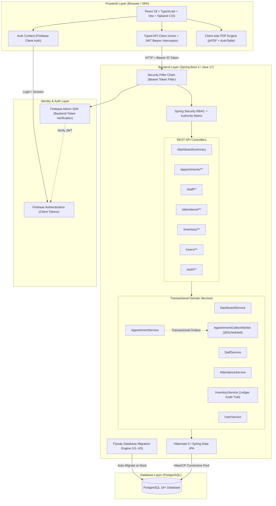

# GG Nursing Home Hub

GG Nursing Home Hub is a centralized, production-ready nursing home management system designed for healthcare operations, staff administration, patient appointment booking, daily attendance tracking, and medical inventory control.

The system is built as a **clean, modular monolith** with a modern Single-Page Application (SPA) frontend and a secure Spring Boot 3 enterprise backend backed by PostgreSQL.

---

## 🏛️ System Architecture



---

## 🚀 Core Features

### 1. Admin Dashboard (`/dashboard/summary`)
- Real-time operational overview: total appointments, pending reviews, staff count, today's attendance rates, and low-stock item counts.
- Filterable appointment queues and low-stock inventory alert banners.
- Merged recent activity feed tracking appointment bookings and inventory receipts.
- Direct shortcuts to management modules based on verified permissions.

### 2. Patient & Staff Appointment Management (`/appointments/**`)
- Public patient booking with client-provided idempotency keys preventing duplicate submissions.
- Transactional outbox pattern (`appointment_outbox`) for asynchronous email/SMS notification delivery.
- Authenticated patient self-lookup (`GET /appointments/my`) returning only appointments matching the verified Firebase token email.
- Staff appointment queue with status transitions (`booked` ➔ `completed`) and server-side pagination.

### 3. Staff Directory (`/staff/**`)
- Centralized staff directory with full CRUD operations.
- Department, role, phone, and email tracking.
- Active/inactive status management.

### 4. Attendance Management (`/attendance/**`)
- Daily attendance tracking with multi-status options (`present`, `absent`, `leave`, `off`, `half-time`, `over-time`).
- Date-based query filters and history auditing.
- In-browser monthly PDF report generation using `jspdf` and `jspdf-autotable`.

### 5. Medical Inventory Management (`/inventory/**`)
- Hierarchical category and vendor/supplier management.
- Stock catalog tracking current stock, unit of measure, minimum reorder thresholds, and active status.
- **Atomic Stock Receiving**: Transactional receipt generation with immediate inventory level updates and double-entry immutable ledger logging (`inventory_ledger`).
- Real-time stock availability reports highlighting low-stock items.
- Item trace reports providing complete audit trails for any supply.

### 6. Authentication & Granular Access Control (`/auth/**`, `/users/**`)
- Firebase Authentication for client identity (email/password).
- Backend token verification using Firebase Admin SDK (`FirebaseAuthenticationFilter`).
- PostgreSQL persistence for user accounts, role assignments, and granular permissions (`PERM_MANAGE_USERS`, `PERM_MANAGE_ATTENDANCE`, `PERM_MANAGE_INVENTORY`, etc.).
- Automated `FirstOwnerBootstrap` for zero-configuration, secure initial owner provisioning on system initialization.
- Automatic session management: 30-minute inactivity auto-logout and 24-hour absolute session expiration.

---

## 🛠️ Technology Stack

| Layer | Technology | Details |
|---|---|---|
| **Frontend** | React 18, TypeScript, Vite, Tailwind CSS | Lucide React icons, Radix UI primitives, Axios |
| **Backend** | Spring Boot 3.2.5, Java 17 | Spring Security, Spring Data JPA, Hibernate 6, Lombok |
| **Database** | PostgreSQL 16+ | Managed schema via Flyway migrations (V1–V5), HikariCP pool |
| **Auth** | Firebase Auth + Firebase Admin SDK | Client JWT passed in `Authorization: Bearer <token>` header |
| **Testing** | JUnit 5, Mockito, MockMvc, Vitest, Testing Library | 108 backend tests, 61 frontend tests |

---

## ⚙️ Environment Configuration

### Frontend (`.env`)

Create a `.env` file in the project root:

```env
# Spring Boot API URL
VITE_API_BASE_URL=http://localhost:8080

# Firebase Client Web Configuration
VITE_FIREBASE_API_KEY=your-firebase-api-key
VITE_FIREBASE_AUTH_DOMAIN=your-firebase-app.firebaseapp.com
VITE_FIREBASE_PROJECT_ID=your-firebase-project-id
VITE_FIREBASE_APP_ID=your-firebase-app-id

# Notification Webhooks (Optional)
VITE_SMS_WEBHOOK_URL=
VITE_WHATSAPP_WEBHOOK_URL=
```

### Backend (`backend/.env` or Environment Variables)

Create a `backend/.env` file or export environment variables:

```env
# Server
PORT=8080

# PostgreSQL Connection
DB_HOST=localhost
DB_PORT=5432
DB_NAME=gg_nursing_home
DB_USER=postgres
DB_PASSWORD=your_postgres_password

# Firebase Admin SDK
FIREBASE_PROJECT_ID=your-firebase-project-id
# Path to service account JSON (optional if using GOOGLE_APPLICATION_CREDENTIALS)
FIREBASE_CREDENTIALS_PATH=

# Initial Bootstrap Owner (Provisioned automatically on first startup)
BOOTSTRAP_FIRST_OWNER_ENABLED=true
BOOTSTRAP_FIRST_OWNER_EMAIL=owner@example.com
BOOTSTRAP_FIRST_OWNER_ROLE=owner
```

---

## 🏃 Running the Application

### 1. Start PostgreSQL Database

Using Docker Compose:

```bash
docker-compose up -d
```

Or connect to an existing PostgreSQL instance and ensure the database specified in `DB_NAME` exists.

### 2. Start the Spring Boot Backend

```bash
cd backend
mvn spring-boot:run
```

The backend starts on `http://localhost:8080`. On first run, Flyway automatically executes migrations `V1` through `V5`:
- `V1`: Core schema (users, roles, permissions, appointments, staff, attendance)
- `V2`: Production indices and performance optimization
- `V3`: Appointment idempotency and transactional outbox schema
- `V4`: Inventory subsystem (categories, suppliers, items, receipts, ledger)
- `V5`: Inventory security and authorization permissions

### 3. Start the Frontend

```bash
# In the project root
npm install
npm run dev
```

The Vite dev server runs at `http://localhost:5173`.

---

## 🧪 Testing & Verification

### Run Backend Integration & Unit Tests
```bash
cd backend
mvn test
```
*Expected: 108 tests passing, 0 failures, 0 errors.*

### Run Frontend Unit & Integration Tests
```bash
npm test -- --run
```
*Expected: 61 tests passing across 8 test suites.*

### Run Frontend Linter
```bash
npm run lint
```
*Expected: 0 errors.*

### Build Production Frontend Bundle
```bash
npm run build
```
*Generates optimized production assets in `dist/`.*

---

## 🔒 Security Architecture

1. **Defense in Depth**: Frontend route guards (`ProtectedRoute.tsx`) provide user navigation protection, but all business logic, data mutations, and queries are strictly authenticated and authorized by Spring Security filters and `@PreAuthorize` method annotations on the backend.
2. **Identity Verification**: Every protected backend request extracts the `Bearer <token>` HTTP header and validates the cryptographic signature and expiration via Firebase Admin SDK.
3. **Data Isolation**: Patients querying appointments via `GET /appointments/my` are strictly constrained to records where `email` matches the verified token email claim.
4. **Audit Trail**: Stock additions and adjustments record who received the stock, the timestamp, and the exact ledger balance delta in immutable `inventory_ledger` rows.
