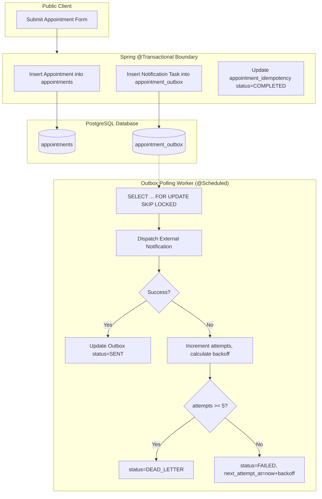

# Task 5.0 — Appointment Management Migration: Discovery & Architecture Design

## Document Revision History

| Version | Date | Author / Reviewer | Summary of Changes |
| :--- | :--- | :--- | :--- |
| **1.0** | 2026-11-04 | System Architecture Team | Initial discovery, workflow audit, and baseline migration architecture design (Task 5.0). |
| **1.1** | 2026-11-05 | System Architecture Team | **Independent Review Corrections (Task 5.0.1)**:<br>• **Idempotency**: Replaced 120s phone-window check with client-generated UUID idempotency key, unique constraint, concurrent-request conflict handling, and 24h TTL.<br>• **Appwrite Export**: Replaced single 5000-limit query with cursor-based pagination (`Query.cursorAfter`), stable composite sort, deterministic UUIDv5 mapping, collision/invalid/duplicate reporting, and full source-destination reconciliation.<br>• **Paginated API Contract**: Standardized on paginated listing (default size 50, max 100, `createdAt DESC, id DESC`, `status` filter); defined frontend compatibility model.<br>• **Transactional Outbox**: Replaced after-commit async dispatch with PostgreSQL Transactional Outbox (`appointment_outbox`), ACID transaction persistence, scheduled worker with `SKIP LOCKED`, exponential backoff, dead-letter state, and idempotent gateway delivery without Kafka/Redis.<br>• **Proxy Trust & Rate Limiting**: Explicitly documented proxy trust boundaries, spoofed header stripping, and single-JVM rate limiter limitations (non-distributed, memory-bound).<br>• **Cancellation Scoping**: Removed cancellation endpoint from current scope; retained DB status constraint for historical data compatibility only.<br>• **Realistic Cutover**: Removed "zero downtime" claim; detailed baseline export, write freeze/delta sync, record verification, and rollback protocol.<br>• **Privacy & Data Integrity**: Added PII log redaction rules, patient field minimization, normalization with raw-value preservation in migration mapping, and retention policies. |

---

## Executive Summary

This document provides a comprehensive, production-grade migration plan for transitioning the G G Nursing Home (GGNH) Appointment Management subsystem from **Appwrite Cloud** to **Spring Boot (Java 17) and PostgreSQL**.

In strict accordance with project boundaries, this is a **READ-ONLY discovery and architectural design specification**. No existing application code, database schemas, or cloud resources have been modified or deleted.

---

## 1. Existing Implementation Inspection & Trace

### 1.1 Source Inspection & Call Sites

An exhaustive trace across the codebase identified the following files and call sites:

| Layer | File Path | Role & Functionality |
| :--- | :--- | :--- |
| **Frontend Service** | [`src/services/appointmentService.ts`](file:///d:/TryingStuff/gg-nursing-home-hub-main/src/services/appointmentService.ts) | Encapsulates Appwrite Databases SDK calls: `getAppointments()`, `addAppointment()`, and `markCompleted()`. |
| **Public Visitor Form** | [`src/pages/Contact.tsx`](file:///d:/TryingStuff/gg-nursing-home-hub-main/src/pages/Contact.tsx) | Public appointment request form; sends third-party email (FormSubmit.co), optional webhooks (SMS/WhatsApp), and calls `appointmentService.addAppointment()`. |
| **Staff Portal UI** | [`src/pages/StaffAppointments.tsx`](file:///d:/TryingStuff/gg-nursing-home-hub-main/src/pages/StaffAppointments.tsx) | Internal staff page displaying booked and completed appointments in two tables with metric summary counters and "Mark Complete" action. |
| **Route Protection** | [`src/App.tsx`](file:///d:/TryingStuff/gg-nursing-home-hub-main/src/App.tsx#L124-L130) | Guards `/staff/appointments` with `<ProtectedRoute requiredAccess="manage-appointments">`. |
| **Navigation** | [`src/components/StaffNavbar.tsx`](file:///d:/TryingStuff/gg-nursing-home-hub-main/src/components/StaffNavbar.tsx#L48-L54) | Navigation item to `/staff/appointments` visible only to users with `canManageAppointments`. |
| **Dashboard Quick Action** | [`src/pages/StaffHome.tsx`](file:///d:/TryingStuff/gg-nursing-home-hub-main/src/pages/StaffHome.tsx#L31-L38) | Action card linking to `/staff/appointments` for authorized staff. |
| **Configuration** | [`src/lib/appwrite.ts`](file:///d:/TryingStuff/gg-nursing-home-hub-main/src/lib/appwrite.ts#L13-L41) | Reads `VITE_APPWRITE_APPOINTMENT_COLLECTION_ID` and verifies `isAppointmentStorageConfigured`. |
| **Legacy Schema Config** | [`appwrite.config.json`](file:///d:/TryingStuff/gg-nursing-home-hub-main/appwrite.config.json#L157-L235) | Collection schema specification for `appointment` in Appwrite. |
| **Backend Entity** | [`backend/src/main/java/com/ggnh/hub/entity/Appointment.java`](file:///d:/TryingStuff/gg-nursing-home-hub-main/backend/src/main/java/com/ggnh/hub/entity/Appointment.java) | JPA entity mapped to the `appointments` PostgreSQL table. |
| **Backend Repository** | [`backend/src/main/java/com/ggnh/hub/repository/AppointmentRepository.java`](file:///d:/TryingStuff/gg-nursing-home-hub-main/backend/src/main/java/com/ggnh/hub/repository/AppointmentRepository.java) | Spring Data JPA repository with pagination and status queries. |
| **Backend Controller** | [`backend/src/main/java/com/ggnh/hub/controller/AppointmentController.java`](file:///d:/TryingStuff/gg-nursing-home-hub-main/backend/src/main/java/com/ggnh/hub/controller/AppointmentController.java) | Initial REST endpoints for appointment creation, listing, and completion. |
| **Backend DTO** | [`backend/src/main/java/com/ggnh/hub/dto/CreateAppointmentRequest.java`](file:///d:/TryingStuff/gg-nursing-home-hub-main/backend/src/main/java/com/ggnh/hub/dto/CreateAppointmentRequest.java) | Request DTO created during SEC-06 remediation for public booking. |
| **Database Migration** | [`backend/src/main/resources/db/migration/V1__create_initial_schema.sql`](file:///d:/TryingStuff/gg-nursing-home-hub-main/backend/src/main/resources/db/migration/V1__create_initial_schema.sql#L75-L95) | Creates table `appointments` with check constraints and indexes. |

---

## 2. Existing Business Behavior & Workflow Analysis

### 2.1 Public Visitor Appointment Booking (`Contact.tsx`)

1. **User Input Collection**:
   - `name`: Full Name (**Mandatory** in UI; validated via `!form.name.trim()`).
   - `phone`: Mobile Phone Number (**Mandatory** in UI; validated via `!form.phone.trim()`, `maxLength=15`).
   - `email`: Email Address (**Optional** in UI; if blank, the UI substitutes `"Not provided"`).
   - `doctor`: Preferred Doctor (**Optional** in UI; select dropdown from `["Dr. Vikas Gupta", "Dr. Shefali Gupta", "Consultant Physician", "Don't know"]`. If unselected, the UI substitutes `"Not selected"`. Can also be pre-filled via URL query param `?doctor=...`).
   - `message`: Patient concern or preferred time (**Optional** in UI; textarea up to 1000 characters; if blank, the UI substitutes `"Not provided"`).

2. **Submission Sequence**:
   ```mermaid
   sequenceDiagram
       autonumber
       actor Visitor as Public Visitor
       participant UI as Contact.tsx
       participant FS as FormSubmit.co API
       participant WH as SMS / WhatsApp Webhooks
       participant AW as Appwrite Databases
       
       Visitor->>UI: Fills form & clicks "Send Message"
       UI->>UI: Validates name & phone non-empty
       UI->>FS: POST https://formsubmit.co/ajax/ggnhpvtltd@gmail.com
       alt FormSubmit.co Fails
           FS-->>UI: Network error / HTTP non-200
           UI-->>Visitor: Toast: "Unable to send appointment" (FLOW ABORTED)
       else FormSubmit.co Succeeds
           FS-->>UI: 200 OK
           opt Webhooks Configured
               UI->>WH: POST notifyPayload (Promise.allSettled)
               WH-->>UI: Response (Ignored on failure)
           end
           UI->>AW: appointmentService.addAppointment(payload)
           AW-->>UI: Document created ($id, status='booked')
           UI-->>Visitor: Toast: "Appointment Request Sent! You will recieve a call within 24 hours"
           UI->>UI: Reset form fields
       end
   ```

3. **Critical Architectural Defect Identified**:
   - **FormSubmit.co blocks database persistence**: If `formsubmit.co` fails or is blocked (e.g., by client ad-blockers, network firewalls, CORS policy, or provider downtime), the entire request aborts before `appointmentService.addAppointment` is invoked. Patient booking data is completely lost without being recorded in any database.
   - **Exposure of Patient PII**: Patient personal details (name, phone, health message) are posted from the browser to third-party endpoints without encryption or audit trail.

### 2.2 Authorized Staff Appointment Management (`StaffAppointments.tsx`)

1. **Access Control**:
   - Guarded by `<ProtectedRoute requiredAccess="manage-appointments">`.
   - Access is granted if the user has role `owner` or permission `manageAppointments` (`PERM_MANAGE_APPOINTMENTS` or `manage-appointments`).
2. **Data Presentation**:
   - Calls `appointmentService.getAppointments()` on mount.
   - Shows summary statistics: Booked count (`status === 'booked'`) and Completed count (`status === 'completed'`).
   - Two separate tables:
     - **Booked Appointments**: Displays `Name`, `Phone`, `Doctor`, `Status`, `Requested At` (formatted `createdAt`), and an action button **"Mark Complete"**.
     - **Completed Appointments**: Displays `Name`, `Phone`, `Doctor`, `Status`, and `Completed At` (formatted `completedAt`).
3. **Status Transitions & Operations**:
   - Only **one** status transition is currently supported in the business workflow: `booked` $\rightarrow$ `completed`.
   - When "Mark Complete" is clicked:
     - Invokes `appointmentService.markCompleted(id)`.
     - Appwrite updates document: `{ status: "completed", completedAt: new Date().toISOString() }`.
     - `appointmentService.markCompleted()` immediately calls `this.getAppointments()` and returns the updated full array to re-render local state.
4. **Operations Not Currently Implemented**:
   - **No appointment editing**: No modal or form exists for modifying patient name, phone, doctor, or message after booking.
   - **No cancellation workflow**: Neither `appointmentService.ts` nor `StaffAppointments.tsx` exposes a cancel button or method. (The database check constraint allows `'cancelled'`, but no operational workflow uses it).
   - **No appointment deletion**: No deletion button or method exists.
   - **No staff assignment**: There is no assignment of internal staff members or calendar time slots to appointments in the current UI or service.

---

## 3. Current Appwrite Schema & Data Dependencies

### 3.1 Appwrite Collection Structure (`appwrite.config.json`)

- **Database ID**: `69c251cd001631c67aab`
- **Collection ID**: `appointment` (mapped to `VITE_APPWRITE_APPOINTMENT_COLLECTION_ID`)
- **Permissions**: `create("any")`, `read("any")`, `update("any")`, `delete("any")`
- **Row-Level Security**: `false`

> [!CAUTION]
> **Severe Legacy Security Vulnerability**: The Appwrite appointment collection currently allows `read("any")`, `update("any")`, and `delete("any")` with no row-level security. Anyone on the internet with the Appwrite Project ID and Database ID can dump all patient medical messages and contact details, modify statuses, or wipe the collection. Migrating to Spring Boot with `@PreAuthorize` closes this vulnerability.

### 3.2 Attribute Mappings & Discrepancies

| Appwrite Attribute | Appwrite Type | Appwrite Required | PostgreSQL V1 Column | PostgreSQL V1 Type | Nullable in V1? | Mismatch / Notes |
| :--- | :--- | :--- | :--- | :--- | :--- | :--- |
| `$id` | String (20-36) | System (True) | `id` | UUID | No (Default gen_random_uuid()) | Appwrite uses custom alphanumeric IDs (e.g. `6512...`), while Postgres uses UUIDs. |
| `name` | String (120) | True | `patient_name` | VARCHAR(200) | No | Column name difference; Postgres length is larger (200 vs 120). |
| `email` | String (254) | **False** | `patient_email` | VARCHAR(255) | **No (NOT NULL)** | **CRITICAL MISMATCH**: In Appwrite and UI, email is optional. Postgres V1 has `NOT NULL`. |
| `phone` | String (20) | True | `patient_phone` | VARCHAR(50) | No | Postgres length is larger (50 vs 20). |
| `doctor` | String (100) | **False** | `doctor_name` | VARCHAR(150) | **No (NOT NULL)** | Mismatch: If doctor is empty, UI sent `"Not selected"`. |
| `message` | String (2000) | False | `message` | TEXT | Yes | Fully compatible. |
| `status` | String (20) | False | `status` | VARCHAR(30) | No (Default 'booked') | Postgres enforces `chk_appointment_status ('booked', 'completed', 'cancelled')`. |
| `$createdAt` | ISO DateTime | System (True) | `created_at` | TIMESTAMPTZ | No (Default CURRENT_TIMESTAMP) | Fully compatible. |
| `completedAt` | String (30) | False | `completed_at` | TIMESTAMPTZ | Yes | Compatible (ISO 8601 string converted to timestamptz). |

---

## 4. Database Design & Schema Evolution

### 4.1 Existing PostgreSQL Schema (`V1__create_initial_schema.sql`)

```sql
CREATE TABLE appointments (
    id UUID PRIMARY KEY DEFAULT gen_random_uuid(),
    patient_name VARCHAR(200) NOT NULL,
    patient_email VARCHAR(255) NOT NULL,
    patient_phone VARCHAR(50) NOT NULL,
    doctor_name VARCHAR(150) NOT NULL,
    message TEXT,
    status VARCHAR(30) NOT NULL DEFAULT 'booked',
    created_at TIMESTAMP WITH TIME ZONE NOT NULL DEFAULT CURRENT_TIMESTAMP,
    completed_at TIMESTAMP WITH TIME ZONE,
    CONSTRAINT chk_appointment_status CHECK (
        status IN ('booked', 'completed', 'cancelled')
    )
);

CREATE INDEX idx_appointments_status ON appointments(status);
CREATE INDEX idx_appointments_created_at ON appointments(created_at DESC);
```

### 4.2 Gap Analysis & Flyway Migration Proposal

The existing `appointments` table is fundamentally sound and correctly positioned as the single source of truth. **No second appointment table should be created.**

However, schema constraints must be reconciled to reflect reality:
1. `patient_email` in `V1` is `NOT NULL`, but email is optional in the clinic workflow.
2. `doctor_name` in `V1` is `NOT NULL`, but patients may submit without selecting a specific doctor.
3. Durable idempotency tracking and transactional outbox tables are required.

#### Implemented Flyway Migration: `V4__appointment_management_enhancements.sql`

```sql
-- Migration: V4__appointment_management_enhancements.sql
-- Description: Nullable email/doctor, updated_at audit column, idempotency store, transactional outbox, and migration mapping

-- 1. Align column nullability with clinical workflow reality
ALTER TABLE appointments ALTER COLUMN patient_email DROP NOT NULL;
ALTER TABLE appointments ALTER COLUMN doctor_name DROP NOT NULL;

-- 2. Audit column for tracking modifications
ALTER TABLE appointments ADD COLUMN IF NOT EXISTS updated_at TIMESTAMP WITH TIME ZONE DEFAULT CURRENT_TIMESTAMP;

-- 3. Dedicated Idempotency Store for Public Booking (uses idempotency_key to avoid SQL keyword conflicts)
CREATE TABLE IF NOT EXISTS appointment_idempotency (
    idempotency_key UUID PRIMARY KEY,
    appointment_id UUID REFERENCES appointments(id) ON DELETE CASCADE,
    status VARCHAR(20) NOT NULL, -- 'PROCESSING', 'COMPLETED'
    response_payload JSONB,
    created_at TIMESTAMP WITH TIME ZONE NOT NULL DEFAULT CURRENT_TIMESTAMP,
    expires_at TIMESTAMP WITH TIME ZONE NOT NULL
);

CREATE INDEX IF NOT EXISTS idx_idempotency_expires ON appointment_idempotency(expires_at);

-- 4. PostgreSQL Transactional Outbox for Durable Notification Dispatch
CREATE TABLE IF NOT EXISTS appointment_outbox (
    id UUID PRIMARY KEY DEFAULT gen_random_uuid(),
    appointment_id UUID NOT NULL REFERENCES appointments(id) ON DELETE CASCADE,
    event_type VARCHAR(50) NOT NULL,    -- 'APPOINTMENT_REQUESTED'
    channel VARCHAR(20) NOT NULL,       -- 'EMAIL', 'SMS', 'WHATSAPP'
    payload JSONB NOT NULL,             -- Recipient, masked contact, notification body
    status VARCHAR(20) NOT NULL DEFAULT 'PENDING', -- 'PENDING', 'PROCESSING', 'SENT', 'FAILED', 'DEAD_LETTER'
    attempts INT NOT NULL DEFAULT 0,
    max_attempts INT NOT NULL DEFAULT 5,
    next_attempt_at TIMESTAMP WITH TIME ZONE NOT NULL DEFAULT CURRENT_TIMESTAMP,
    locked_at TIMESTAMP WITH TIME ZONE, -- Lease timestamp for crash recovery
    last_error TEXT,
    created_at TIMESTAMP WITH TIME ZONE NOT NULL DEFAULT CURRENT_TIMESTAMP,
    sent_at TIMESTAMP WITH TIME ZONE
);

CREATE INDEX IF NOT EXISTS idx_outbox_poll ON appointment_outbox(status, next_attempt_at) 
    WHERE status IN ('PENDING', 'FAILED');

-- 5. Migration Mapping Table (preserves historical Appwrite IDs without polluting domain entity)
CREATE TABLE IF NOT EXISTS appointment_migration_mapping (
    legacy_appwrite_id VARCHAR(50) PRIMARY KEY,
    pg_appointment_id UUID NOT NULL UNIQUE REFERENCES appointments(id) ON DELETE CASCADE,
    raw_document JSONB NOT NULL,
    migrated_at TIMESTAMP WITH TIME ZONE NOT NULL DEFAULT CURRENT_TIMESTAMP
);
```

### 4.3 Robust Idempotency Design (Replacing Phone-Based Window)

Phone-number-based deduplication is rejected because:
- Family members frequently book back-to-back appointments for different individuals using the same contact phone number.
- Legitimate patients re-book appointments if an initial symptom changes or upon request.

#### End-to-End Idempotency Specification:

1. **Client-Generated Key**:
   - The frontend generates a unique UUIDv4 string prior to dispatching `POST /api/v1/appointments`.
   - The key is sent via the standard HTTP header: `Idempotency-Key: <UUID>`.
2. **Backend Idempotency Lifecycle**:
   ```mermaid
   sequenceDiagram
       autonumber
       participant Client as Frontend Client
       participant API as AppointmentController
       participant DB as appointment_idempotency (Postgres)
       participant Appt as appointments Table
       
       Client->>API: POST /appointments with Idempotency-Key
       API->>DB: SELECT status, response_payload FROM appointment_idempotency WHERE key = :key
       alt Key exists and status == 'COMPLETED'
           DB-->>API: Return cached response_payload
           API-->>Client: HTTP 201 Created (Cached Response)
       else Key exists and status == 'PROCESSING'
           API-->>Client: HTTP 409 Conflict ("Booking request currently in progress. Please wait.")
       else Key does not exist
           API->>DB: INSERT INTO appointment_idempotency (key, status='PROCESSING', expires_at=now()+24h)
           alt Unique Constraint Violation (Concurrent Race)
               API-->>Client: HTTP 409 Conflict ("Concurrent booking detected. Retry with same key.")
           else Insert Succeeded
               API->>Appt: INSERT INTO appointments ...
               API->>DB: UPDATE appointment_idempotency SET status='COMPLETED', appointment_id=..., response_payload=...
               API-->>Client: HTTP 201 Created (New Booking)
           end
       end
   ```
3. **Concurrent Requests with Same Key**:
   - Concurrent requests for the same key hit the `PRIMARY KEY` unique constraint on `appointment_idempotency.key`.
   - The concurrent transaction fails fast and returns `HTTP 409 Conflict` with a message instructing the client that processing is underway.
4. **Retention & TTL**:
   - Idempotency records are assigned an `expires_at = CURRENT_TIMESTAMP + INTERVAL '24 hours'`.
   - A daily Spring `@Scheduled` worker purges expired records:
     `DELETE FROM appointment_idempotency WHERE expires_at < CURRENT_TIMESTAMP`.

---

## 5. Backend REST API Design & Contracts

All endpoints are hosted under context path `/api/v1` (configured in `application.yml`).

### 5.1 Endpoint Matrix

| Method | Path | Authentication | Authorization Authority | Description | Scope Status |
| :--- | :--- | :--- | :--- | :--- | :--- |
| `POST` | `/api/v1/appointments` | **Public** (Permit All) | None (Rate-limited, Idempotent) | Creates a new appointment booking. | **Core Migration** |
| `GET` | `/api/v1/appointments` | **Authenticated** | `ROLE_owner` OR `PERM_MANAGE_APPOINTMENTS` | Lists appointments with pagination and filters. | **Core Migration** |
| `GET` | `/api/v1/appointments/{id}` | **Authenticated** | `ROLE_owner` OR `PERM_MANAGE_APPOINTMENTS` | Retrieves a single appointment record by UUID. | **Core Migration** |
| `PATCH`| `/api/v1/appointments/{id}/complete` | **Authenticated** | `ROLE_owner` OR `PERM_MANAGE_APPOINTMENTS` | Transitions appointment status to `completed`. | **Core Migration** |
| `PATCH`| `/api/v1/appointments/{id}/cancel` | **N/A** | N/A | *Excluded from initial migration scope*. | **Out of Scope** |

> [!NOTE]
> **Cancellation Scoping**: The current application UI only supports `booked -> completed`. The database constraint allows `'cancelled'` for historical integrity, but no cancellation controller endpoint or UI button is implemented in this migration to prevent scope expansion.

---

### 5.2 Detailed Endpoint Contracts

#### 1. Public Appointment Creation: `POST /api/v1/appointments`

- **Access**: Unauthenticated public visitors.
- **Headers**:
  - `Idempotency-Key`: UUID (**Required**; frontend generates a UUIDv4 header for all submissions). Missing or invalid UUID returns `400 Bad Request`.
- **Rate Limit**: 10 requests/min per client IP (subject to proxy trust rules in Section 6.1).
- **Security Rule**: The endpoint strictly binds to `CreateAppointmentRequest`. Callers cannot assign `id`, `status`, `createdAt`, or `completedAt`.

##### Request DTO (`CreateAppointmentRequest`)

```java
public class CreateAppointmentRequest {

    @NotBlank(message = "Patient name is required")
    @Size(min = 2, max = 200, message = "Patient name must be between 2 and 200 characters")
    @Pattern(regexp = "^[\\p{L}\\s.'-]+$", message = "Patient name contains invalid characters")
    @JsonProperty("name")
    @JsonAlias({"patientName", "name"})
    private String name;

    @NotBlank(message = "Patient phone is required")
    @Size(min = 7, max = 20, message = "Patient phone must be between 7 and 20 characters")
    @Pattern(regexp = "^[+0-9\\s()-]{7,20}$", message = "Patient phone contains invalid characters")
    @JsonProperty("phone")
    @JsonAlias({"patientPhone", "phone"})
    private String phone;

    @Size(max = 255, message = "Email must not exceed 255 characters")
    @Email(message = "Email must be a valid format if provided")
    @JsonProperty("email")
    @JsonAlias({"patientEmail", "email"})
    private String email;

    @Size(max = 150, message = "Doctor name must not exceed 150 characters")
    @JsonProperty("doctor")
    @JsonAlias({"doctorName", "doctor"})
    private String doctor;

    @Size(max = 2000, message = "Message must not exceed 2000 characters")
    @JsonProperty("message")
    private String message;
}
```

##### Response DTO (`AppointmentResponse`)

```json
{
  "id": "c1f7a0b3-9e42-4f81-81df-7b56738910ac",
  "name": "Sunita Verma",
  "email": "sunita.v@example.com",
  "phone": "+91 98765 43210",
  "doctor": "Dr. Vikas Gupta",
  "message": "Routine health checkup consultation",
  "status": "booked",
  "createdAt": "2026-11-04T10:15:30Z",
  "completedAt": null
}
```

- **HTTP Status**: `201 Created`
- **Error Responses**:
  - `400 Bad Request`: Validation failure.
  - `409 Conflict`: Concurrent request with same idempotency key currently executing.
  - `429 Too Many Requests`: Rate limit exceeded.

---

#### 2. Staff Appointment Listing: `GET /api/v1/appointments`

- **Access**: Authenticated staff with `ROLE_owner` or `PERM_MANAGE_APPOINTMENTS`.
- **Query Parameters**:
  - `page` (integer, default `0`, min `0`).
  - `size` (integer, default `50`, min `1`, max `100`).
  - `status` (optional string: `booked`, `completed`, `cancelled`).
  - `sort` (default `createdAt,desc` with secondary tie-breaker `id,desc`).
- **Policy**: Default page size is **50**; maximum allowed page size is **100**. Unbounded or 5000-item queries are rejected.

##### Response DTO (`PagedResponse<AppointmentResponse>`)

```json
{
  "content": [
    {
      "id": "c1f7a0b3-9e42-4f81-81df-7b56738910ac",
      "name": "Sunita Verma",
      "email": "sunita.v@example.com",
      "phone": "+91 98765 43210",
      "doctor": "Dr. Vikas Gupta",
      "message": "Routine health checkup consultation",
      "status": "booked",
      "createdAt": "2026-11-04T10:15:30Z",
      "completedAt": null
    }
  ],
  "page": 0,
  "size": 50,
  "totalElements": 1,
  "totalPages": 1,
  "last": true
}
```

- **HTTP Status**: `200 OK`
- **Error Responses**:
  - `401 Unauthorized`: Unauthenticated / invalid Firebase token.
  - `403 Forbidden`: Authenticated user lacks `manageAppointments` permission.

---

#### 3. Mark Appointment Complete: `PATCH /api/v1/appointments/{id}/complete`

- **Access**: Authenticated staff with `ROLE_owner` or `PERM_MANAGE_APPOINTMENTS`.
- **Path Variable**: `id` (UUID format).
- **Business Behavior**: Sets `status = 'completed'` and `completedAt = OffsetDateTime.now()`. Rejects completion if already in `cancelled` state.

##### Response DTO (`AppointmentResponse`)

```json
{
  "id": "c1f7a0b3-9e42-4f81-81df-7b56738910ac",
  "name": "Sunita Verma",
  "email": "sunita.v@example.com",
  "phone": "+91 98765 43210",
  "doctor": "Dr. Vikas Gupta",
  "message": "Routine health checkup consultation",
  "status": "completed",
  "createdAt": "2026-11-04T10:15:30Z",
  "completedAt": "2026-11-04T11:45:00Z"
}
```

- **HTTP Status**: `200 OK`
- **Error Responses**:
  - `400 Bad Request`: Malformed UUID.
  - `404 Not Found`: Appointment not found.
  - `409 Conflict`: Cannot complete an appointment in `cancelled` status.

---

## 6. Security, Reliability & Outbox Architecture

### 6.1 Reverse Proxy & Rate Limiting Trust Boundaries

The rate limiter implementation in [`RateLimitingFilter.java`](file:///d:/TryingStuff/gg-nursing-home-hub-main/backend/src/main/java/com/ggnh/hub/security/ratelimit/RateLimitingFilter.java) and [`InMemoryRateLimiter.java`](file:///d:/TryingStuff/gg-nursing-home-hub-main/backend/src/main/java/com/ggnh/hub/security/ratelimit/InMemoryRateLimiter.java) has critical architectural constraints:

1. **Proxy Trust Enforcement**:
   - **Default Behavior**: `app.rate-limit.trust-proxy-headers` is set to `false`. The backend uses `request.getRemoteAddr()` directly.
   - **Arbitrary Forwarded Headers Rejected**: The application must **never** blindly trust `X-Forwarded-For` from arbitrary public clients.
   - **Deployment Reverse Proxy Requirement**: When deployed behind an ingress reverse proxy (NGINX / Caddy / Cloudflare):
     - `trust-proxy-headers` is enabled **only if** the network path ensures requests arrive solely from the trusted proxy IP range.
     - The ingress proxy **must strip or overwrite** incoming client-supplied `X-Forwarded-For` headers (`proxy_set_header X-Forwarded-For $remote_addr;`) to prevent IP spoofing attacks.
2. **Per-JVM Rate Limiter Limitations**:
   - The current `InMemoryRateLimiter` uses a local `ConcurrentHashMap`.
   - **Non-Distributed**: State is local to a single JVM instance. In a horizontally scaled cluster (e.g. 2 replicas behind a load balancer), the effective rate limit is doubled (20 req/min).
   - **Volatile**: Application restarts reset all rate-limiting buckets.
   - **Documentation Statement**: This rate limiter is an application-level guard against naive script spam, not a distributed edge rate-limiting solution. Production distributed throttling must be handled at the ingress gateway/CDN.

---

### 6.2 PostgreSQL Transactional Outbox for Durable Notifications

To eliminate the critical flaw where email/webhook failures drop appointments, notifications are implemented via a **Transactional Outbox**:



#### Outbox Lifecycle & Retry Policy:
1. **Atomic Insertion**: When `POST /appointments` is processed, the `Appointment` entity and the corresponding `appointment_outbox` record (`channel: EMAIL`, `status: PENDING`) are committed in the **exact same ACID transaction**.
2. **Background Polling**: A Spring `@Scheduled(fixedDelay = 5000)` worker polls for records ready for dispatch:
   ```sql
   SELECT * FROM appointment_outbox
   WHERE status IN ('PENDING', 'FAILED')
     AND next_attempt_at <= CURRENT_TIMESTAMP
   ORDER BY created_at ASC
   LIMIT 20
   FOR UPDATE SKIP LOCKED;
   ```
   `SKIP LOCKED` prevents duplicate delivery and enables clean concurrent processing across multiple application threads without locking tables.
3. **Exponential Backoff**:
   - Initial retry: 5 seconds.
   - Subsequent retries: $\text{interval} = \min(300, 5 \times 2^{(\text{attempts} - 1)})$ seconds (5s, 10s, 20s, 40s, 80s, 160s, 300s).
4. **Dead-Letter State**:
   - If an event fails after `5 attempts`, its status transitions to `DEAD_LETTER`.
   - Clinic staff can inspect dead-letter records via admin audit query without any lost patient records.
5. **Idempotent Gateway Delivery**:
   - Outbox record UUID `id` is transmitted to outgoing webhooks/email providers as a client request ID to prevent duplicate email transmissions during network hiccups.

---

### 6.3 Privacy & PII Redaction Rules

1. **Log Redaction Rules**:
   - Patient phone numbers must be masked: `+91 ***** *1060`.
   - Patient email addresses must be masked: `s***@example.com`.
   - Patient clinical messages (`message` field) must **NEVER** be printed to application logs under any log level.
   - Allowed application log format:
     ```java
     log.info("Appointment booked: id={}, doctor={}, idempotencyKey={}", 
         appointment.getId(), appointment.getDoctorName(), idempotencyKey);
     ```
2. **Patient Field Minimization**:
   - Response DTOs sent to staff portals contain only the minimum fields required for triage (`name`, `phone`, `doctor`, `status`, `createdAt`, `completedAt`). Internal security metadata (tokens, raw outbox state, legacy IDs) is strictly excluded.

---

## 7. Frontend Integration Design

### 7.1 Refactoring `src/services/appointmentService.ts`

The legacy Appwrite service will be replaced by an implementation using [`src/services/apiClient.ts`](file:///d:/TryingStuff/gg-nursing-home-hub-main/src/services/apiClient.ts).

#### Compatibility Strategy for Paginated Backend:
- `StaffAppointments.tsx` currently expects `appointmentService.getAppointments()` to return an array of appointments (`Appointment[]`) and performs client-side status filtering (`booked` vs `completed`).
- To maintain **100% component compatibility** without redesigning `StaffAppointments.tsx` or dumping 5000 records at once:
  1. `appointmentService.getAppointments(status?: AppointmentStatus)` requests the operational page (`size = 50`, max `100`) from `GET /api/v1/appointments`.
  2. The service unwraps `PagedResponse.content` and returns `Appointment[]`.
  3. The service exposes overloaded pagination methods (`getAppointmentsPage(page, size, status)`) for future incremental UI pagination enhancements.

```typescript
import { apiClient } from "@/services/apiClient";

export type AppointmentStatus = "booked" | "completed" | "cancelled";

export type Appointment = {
  id: string;
  name: string;
  email: string;
  phone: string;
  doctor: string;
  message: string;
  status: AppointmentStatus;
  createdAt: string;
  completedAt?: string;
};

export type AppointmentInput = {
  name: string;
  email?: string;
  phone: string;
  doctor?: string;
  message?: string;
};

type BackendAppointment = {
  id: string;
  name: string;
  email?: string;
  phone: string;
  doctor?: string;
  message?: string;
  status: AppointmentStatus;
  createdAt: string;
  completedAt?: string;
};

type PagedResponse<T> = {
  content: T[];
  page: number;
  size: number;
  totalElements: number;
  totalPages: number;
  last: boolean;
};

export const appointmentService = {
  async getAppointments(status?: AppointmentStatus): Promise<Appointment[]> {
    const res = await apiClient.get<PagedResponse<BackendAppointment>>(
      "/appointments",
      {
        params: {
          page: 0,
          size: 50,
          status: status || undefined,
        },
      }
    );

    return res.content.map((item) => ({
      id: item.id,
      name: item.name,
      email: item.email || "Not provided",
      phone: item.phone,
      doctor: item.doctor || "Not selected",
      message: item.message || "",
      status: item.status,
      createdAt: item.createdAt,
      completedAt: item.completedAt,
    }));
  },

  async addAppointment(input: AppointmentInput): Promise<Appointment> {
    const idempotencyKey = crypto.randomUUID();

    const res = await apiClient.post<BackendAppointment>(
      "/appointments",
      {
        name: input.name.trim(),
        phone: input.phone.trim(),
        email: input.email?.trim() || undefined,
        doctor: input.doctor?.trim() || undefined,
        message: input.message?.trim() || undefined,
      },
      {
        skipAuth: true,
        headers: {
          "Idempotency-Key": idempotencyKey,
        },
      }
    );

    return {
      id: res.id,
      name: res.name,
      email: res.email || "Not provided",
      phone: res.phone,
      doctor: res.doctor || "Not selected",
      message: res.message || "",
      status: res.status,
      createdAt: res.createdAt,
      completedAt: res.completedAt,
    };
  },

  async markCompleted(id: string): Promise<Appointment[]> {
    await apiClient.patch<BackendAppointment>(`/appointments/${id}/complete`);
    return this.getAppointments();
  },
};
```

---

## 8. Data Extraction, Migration & Cutover Plan

### 8.1 Robust Appwrite Extraction Specification

The legacy query `Query.limit(5000)` is **strictly rejected** as inadequate. The extraction pipeline will use cursor-based pagination with stable composite sorting.

#### Extraction Algorithm (`scripts/export-appwrite-appointments.mjs`):
1. **Stable Sorting**: Order by `$createdAt ASC` and `$id ASC`.
2. **Cursor Pagination**:
   ```javascript
   let lastDocId = null;
   let hasMore = true;
   const BATCH_SIZE = 100;
   const exportedRecords = [];

   while (hasMore) {
     const queries = [
       Query.orderAsc("$createdAt"),
       Query.orderAsc("$id"),
       Query.limit(BATCH_SIZE),
     ];
     if (lastDocId) {
       queries.push(Query.cursorAfter(lastDocId));
     }

     const response = await appwriteDatabases.listDocuments(
       databaseId,
       appointmentCollectionId,
       queries
     );

     if (response.documents.length === 0) {
       hasMore = false;
       break;
     }

     exportedRecords.push(...response.documents);
     lastDocId = response.documents[response.documents.length - 1].$id;

     if (response.documents.length < BATCH_SIZE) {
       hasMore = false;
     }
   }
   ```

### 8.2 Deterministic UUIDv5 Mapping & Reconciliation

1. **Deterministic UUID Mapping**:
   - Appwrite string IDs (e.g., `65a1b2c3d4e5f67890ab`) cannot be cast directly to PostgreSQL `UUID`.
   - A deterministic UUIDv5 is generated using a fixed GGNH namespace UUID:
     $$\text{UUID} = \text{UUIDv5}(\text{NAMESPACE\_GGNH}, \text{"appointment:"} + \text{doc.\$id})$$
   - This ensures rerunning the migration script produces the exact same UUIDs, enabling safe re-runs and idempotency.
2. **Preservation of Raw Historical Data**:
   - Every imported record is logged into `appointment_migration_mapping`:
     - `legacy_appwrite_id`: Original Appwrite document `$id`.
     - `pg_appointment_id`: Deterministic UUID.
     - `raw_document`: Unaltered JSON dump of the source Appwrite record.
3. **Collision Detection**:
   - The ingestion script maintains an in-memory Set of assigned UUIDs and legacy IDs. If a collision is encountered, the script halts and outputs the conflicting documents to `collision-appointments.json`.
4. **Invalid & Duplicate Record Reporting**:
   - Records with missing mandatory fields (e.g. blank name or blank phone) are **never silently discarded**.
   - They are written to `invalid-appointments.json` with explicit validation error codes and quarantined for manual review.
   - Exact duplicate documents (same name, phone, createdAt) are recorded in `duplicate-appointments.json`.

---

### 8.3 Realistic Cutover Strategy (No "Zero-Downtime" Assumption)

Achieving true zero-downtime with dual-write across two independent, uncoordinated storage engines (Appwrite Cloud and on-premise/cloud PostgreSQL) introduces severe split-brain risks. Instead, a **controlled maintenance window cutover** is specified:

```
  [Phase 1] Baseline Export & Staging Import (T-24h, live traffic continues)
       │
       ▼
  [Phase 2] Data Reconciliation & Integrity Verification
       │
       ▼
  [Phase 3] Scheduled Maintenance Window (15-30 mins, off-peak e.g. 02:00 IST)
       │  • Announce temporary maintenance on /contact
       │  • Final Delta Export from Appwrite (where $createdAt >= T_baseline)
       │  • Import Delta into PostgreSQL
       │  • Verify Total Counts: Appwrite Export == PostgreSQL Target
       │
       ▼
  [Phase 4] Deploy Frontend Cutover (Points to Spring Boot /api/v1)
       │
       ▼
  [Phase 5] Post-Cutover Verification & Smoke Testing
       │
  ┌────┴───────────────────────────┐
  │ Success?                       │
  ▼                                ▼
[Phase 6: Cutover Complete]      [Rollback Procedure]
• Set Appwrite to Read-Only      • Revert frontend deployment to Appwrite build
• 30-Day Retention Clock         • Remove maintenance notice
                                 • Triage issues before rescheduling
```

#### Rollback Procedure:
If unresolvable defects arise during post-cutover verification:
1. Re-deploy the previous frontend release artifact pointing to Appwrite.
2. Appwrite remained completely intact during the entire cutover.
3. If any appointments were booked in PostgreSQL during the verification window, export them and import them into Appwrite via a forward-sync script before reopening traffic.

#### Appwrite Retention Period:
The Appwrite collection permissions will be changed to read-only for internal staff. Data will be retained in Appwrite for **30 days** post-cutover before decommissioning.

---

## 9. Comprehensive Test Plan

### 9.1 Backend Integration Tests (`AppointmentControllerIntegrationTest.java`)

1. **Idempotency Verification**:
   - Submit request with `Idempotency-Key: K1` $\rightarrow$ 201 Created.
   - Submit identical request with `Idempotency-Key: K1` $\rightarrow$ 201 Created (returns cached response; verify repository count does not increase).
   - Concurrent submissions with same key $\rightarrow$ Second transaction receives 409 Conflict.
2. **Paginated Listing**:
   - Seed 60 records; call `GET /appointments?page=0&size=50` $\rightarrow$ Returns 50 records, `totalElements: 60`, `totalPages: 2`.
   - Call with `size=150` $\rightarrow$ Clamped to 100 or rejected with 400 Bad Request.
3. **Outbox Persistence**:
   - Verify that when `POST /appointments` succeeds, an `appointment_outbox` record is present with status `PENDING`.
4. **Outbox Worker & Retry**:
   - Mock external notification failure $\rightarrow$ Outbox record transitions to `FAILED`, `attempts` increments, `next_attempt_at` backed off.
   - After 5 failures $\rightarrow$ Transitions to `DEAD_LETTER`.
5. **Security & Authorization**:
   - Unauthenticated GET `/appointments` $\rightarrow$ 401 Unauthorized.
   - Authenticated user with `viewer` role $\rightarrow$ 403 Forbidden.
   - Public `POST /appointments` with spoofed `status: completed` $\rightarrow$ Ignored; status forced to `booked`.

### 9.2 Frontend Tests (`appointmentService.test.ts`)

1. Verify `getAppointments()` parses paginated response correctly and unwraps content array.
2. Verify `addAppointment()` generates and attaches an `Idempotency-Key` header.
3. Verify `markCompleted()` calls PATCH endpoint and re-queries the updated listing.

---

## 10. Open Questions & Implementation Risks

1. **Ingress Proxy Configuration**:
   - *Requirement*: Ensure reverse proxy configuration explicitly strips incoming `X-Forwarded-For` before forwarding to Spring Boot.
2. **Notification Channel Prioritization**:
   - *Design Choice*: The transactional outbox supports email, SMS, and WhatsApp. In Task 5.1, initial worker handler should activate the primary clinic email channel first, with webhooks staged progressively.
3. **Historical Record Reconciliation**:
   - *Action Item*: Run the cursor-based export script in dry-run mode during implementation planning to inspect the distribution of missing emails and phone formats.

---

## 11. Conclusion & Next Steps

This revised design addresses all independent review findings. The design now provides **provable idempotency**, a **resilient transactional outbox**, **strict pagination contracts**, **realistic proxy trust models**, and a **safe, verifiable migration pipeline**.

- **Current Status**: Design finalized and documented in `docs/APPOINTMENT_MIGRATION_DESIGN.md`.
- **Boundaries Preserved**: Zero code changes; no database migrations executed; Appwrite and Supabase untouched.
- **Next Step**: Await user approval before proceeding to implementation tasks.
