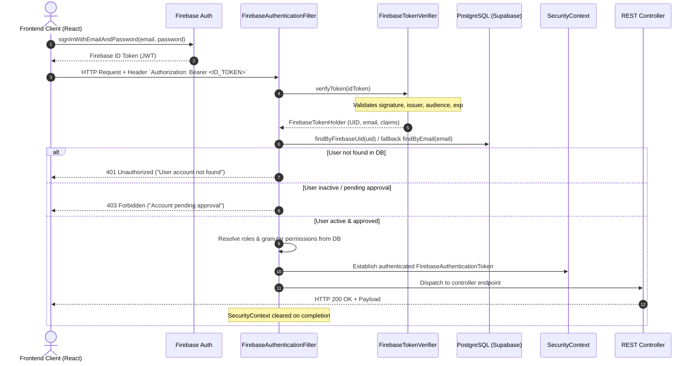

# GG Nursing Home Hub — Backend Authentication & Security Architecture

**Document Version**: 1.0.0  
**Target Backend**: Spring Boot 3.2.5 (Java 17)  
**Database**: PostgreSQL 17 (Flyway Migrations V1, V2, V3)  
**Identity Provider**: Firebase Authentication (ID Tokens)  
**Authorization Authority**: PostgreSQL (`users`, `roles`, `user_roles`, `user_permissions`)

---

## 1. Architecture & Request Flow

The system employs a hybrid cloud security model: **Firebase Authentication as the identity provider**, **Spring Security as the backend security layer**, and **PostgreSQL as the application authorization source of truth**.

Spring Boot does not issue custom JWTs and does not store user passwords. Instead, client applications obtain a cryptographically signed Firebase ID token upon user login and present it to the Spring Boot REST API.



---

## 2. Firebase Admin SDK Integration & Initialization

Firebase Admin SDK is initialized on Spring Boot application startup via `FirebaseInitializer`.

### Credentials Resolution Strategy

Credentials are resolved using the following order of precedence:

1. **Inline Credentials JSON**: Environment variable `FIREBASE_CREDENTIALS_JSON` (ideal for containerized environments or Secret Managers).
2. **Configuration File Path**: Environment variable `FIREBASE_CONFIG_PATH` pointing to a local service account key file (`serviceAccountKey.json`).
3. **Application Default Credentials (ADC)**: Environment variable `GOOGLE_APPLICATION_CREDENTIALS` or GCP runtime metadata.
4. **Safe Fallback**: If no credentials are found (e.g. during local tests or dev without cloud credentials), the system **fails safely**: it logs a warning and disables live token verification rather than crashing the Spring Boot ApplicationContext.

### Avoiding Redundant Initializations

`FirebaseInitializer` checks `FirebaseApp.getApps().isEmpty()`. If an app is already initialized, it reuses the singleton instance.

---

## 3. Environment Variables Reference

| Variable Name | Required? | Default | Purpose |
| :--- | :--- | :--- | :--- |
| `FIREBASE_ENABLED` | Optional | `true` | Enables or disables Firebase Admin initialization |
| `FIREBASE_CONFIG_PATH` | Optional | *Empty* | Absolute or relative path to Firebase service-account JSON |
| `FIREBASE_CREDENTIALS_JSON` | Optional | *Empty* | Raw JSON content of Firebase service-account credentials |
| `FIREBASE_PROJECT_ID` | Optional | *Empty* | Firebase project ID |
| `FIREBASE_CHECK_REVOKED` | Optional | `false` | Enables revocation-aware token verification with Firebase servers |
| `CORS_ALLOWED_ORIGINS` | Optional | `http://localhost:5173,http://localhost:3000` | Comma-separated list of permitted browser origins |

> [!IMPORTANT]
> Never commit `serviceAccountKey.json` files or raw credential JSON strings into Git. Privileged Firebase Admin SDK keys must never be exposed to frontend code or Vite environment variables (`VITE_*`).

---

## 4. Token Verification & Revocation Trade-Offs

Token verification is abstracted via the `FirebaseTokenVerifier` interface and implemented by `DefaultFirebaseTokenVerifier`:

### Verification Policies

1. **Standard Verification (`checkRevoked = false`) [DEFAULT]**:
   - Cryptographically verifies the RS256 signature against Google's public key certificate set (cached in memory).
   - Validates `iss` (`https://securetoken.google.com/<PROJECT_ID>`), `aud` (`<PROJECT_ID>`), and expiration `exp`.
   - **Trade-off**: Zero network roundtrip per request, sub-millisecond overhead (~0.1ms). Does not immediately catch tokens revoked before expiration (default token lifetime: 1 hour).
2. **Revocation-Aware Verification (`checkRevoked = true`)**:
   - Performs standard verification plus an external HTTPS RPC call to Google's backend to check whether the user's refresh token has been invalidated or password reset.
   - **Trade-off**: Immediate session revocation at the cost of 50–200ms latency per request and an external network dependency.

---

## 5. Database Identity Mapping (Flyway Migration V3)

The `users` table maps Firebase identities to internal PostgreSQL UUIDs:

```sql
-- Migration: V3__add_firebase_identity_mapping.sql
ALTER TABLE users
    ADD COLUMN IF NOT EXISTS firebase_uid VARCHAR(128) CONSTRAINT uq_users_firebase_uid UNIQUE;

CREATE INDEX IF NOT EXISTS idx_users_firebase_uid ON users(firebase_uid);

ALTER TABLE users
    ALTER COLUMN password_hash DROP NOT NULL;
```

### Identity Resolution Flow

When a verified token is processed:
1. Lookup user in PostgreSQL by `firebase_uid`.
   - If present, verify there is no conflict between the token's email and a different database user.
2. If not found by UID, search by email.
   - **SEC-01 Verification Requirement**: Automatic identity linking **strictly requires `email_verified == true`**. If the Firebase email is unverified, linking is refused and access is rejected to prevent pre-account takeover.
   - If `email_verified == true` and `firebase_uid IS NULL`, the system verifies that the Firebase UID is not already claimed by any other record, then performs safe **automatic identity linking** by saving the Firebase UID to the existing record.
3. If the email exists but belongs to a different `firebase_uid`, access is rejected to prevent account hijacking.
4. If the identity does not exist in PostgreSQL, access is rejected with HTTP 401 Unauthorized (unless requesting the registration or synchronization endpoints).
5. For registration and synchronization (`/api/v1/auth/register`, `/api/v1/auth/sync`), **`email_verified == true` is required**. Unverified emails are rejected with HTTP 403 Forbidden before account provisioning.

---

## 6. Authorization & RBAC Model

Spring Security authorities are dynamically computed from PostgreSQL tables (`roles` and `user_permissions`).

### Supported Static Roles

| Role Name | Authority Granted | Description |
| :--- | :--- | :--- |
| `owner` | `ROLE_owner`, `ROLE_OWNER` + all permissions | Super administrator with full authority |
| `editor` | `ROLE_editor`, `ROLE_EDITOR` | Clinical manager managing attendance & appointments |
| `viewer` | `ROLE_viewer`, `ROLE_VIEWER` | Read-only clinical and administrative views |
| `store-manager` | `ROLE_store-manager`, `ROLE_STORE_MANAGER` | Inventory controller managing items, stock, receipts |
| `department-head` | `ROLE_department-head`, `ROLE_DEPARTMENT_HEAD` | Department supervisor with inventory report viewing |
| `auditor` | `ROLE_auditor`, `ROLE_AUDITOR` | Compliance and ledger audit reviewer |

### Granular Permission Authorities

- `PERM_MANAGE_ATTENDANCE` (and alias `manage-attendance`)
- `PERM_MANAGE_APPOINTMENTS` (and alias `manage-appointments`)
- `PERM_MANAGE_USERS` (and alias `manage-users`)
- `PERM_MANAGE_INVENTORY` (and alias `manage-inventory`)
- `PERM_MANAGE_INVENTORY_REPORTS` (and alias `view-inventory-reports`)

> [!WARNING]
> Client-supplied roles or custom claims in Firebase ID tokens are **strictly ignored** during authorization. The database is the sole authority.

---

## 7. Account Approval, Provisioning & Access Safeguards

1. **Self-Registration & Synchronization**:
   - An authenticated Firebase user can call `POST /api/v1/auth/register` (or `/api/v1/auth/sync`).
   - The server verifies their token, enforces `email_verified == true`, and provisions or links an account.
   - New accounts are **inactive by default** (`is_active = false`), assigned the least-privileged `viewer` role, and granted no administrative permissions.
   - Unverified email addresses cannot provision or link accounts.
2. **Administrative Approval**:
   - Super administrators (users with `ROLE_owner` or `PERM_MANAGE_USERS`) inspect pending accounts via `GET /api/v1/users`.
   - Administrators approve accounts via `PATCH /api/v1/users/{id}/status` (`{ "active": true }`).
   - Administrators assign roles and permissions via `PUT /api/v1/users/{id}/access`.
3. **Administrative Access Safeguards (Service Layer Business Logic)**:
   - **No Self-Deactivation**: Administrators cannot deactivate their own accounts (`BAD_REQUEST`).
   - **Owner Protection**: Accounts holding the `owner` role cannot be modified, deactivated, or demoted by delegated managers (`FORBIDDEN`). Only an existing owner can modify an owner.
   - **Last Active Owner Protection**: The last active owner in the system cannot be deactivated (`BAD_REQUEST`), preventing complete loss of administrative access.
   - **No Self-Escalation**: Administrators cannot modify their own roles or permissions (`FORBIDDEN`).
   - **Owner Role Assignment**: Only an existing owner may grant or remove the `owner` role (`FORBIDDEN`).

---

## 8. Public and Protected Endpoint Policy

| Method | Endpoint | Authorization Required | Purpose |
| :--- | :--- | :--- | :--- |
| `OPTIONS` | `/**` | Public (Permit all) | CORS preflight validation |
| `POST` | `/api/v1/appointments` | Public (Permit all, Rate-limited) | Public booking; binds to `CreateAppointmentRequest` DTO; status forced to `booked` |
| `POST` | `/api/v1/auth/register` | Verified Firebase token (Rate-limited) | Safe user provisioning (inactive by default; unverified rejected) |
| `POST` | `/api/v1/auth/sync` | Verified Firebase token (Rate-limited) | Safe identity synchronization (unverified rejected) |
| `GET` | `/api/v1/auth/me` | Authenticated + Active | Current user profile and effective permissions |
| `GET` | `/api/v1/users` | `ROLE_owner` or `PERM_MANAGE_USERS` | User directory and access management |
| `PATCH` | `/api/v1/users/{id}/status` | `ROLE_owner` or `PERM_MANAGE_USERS` | Account approval / activation (owner safeguards enforced) |
| `PUT` | `/api/v1/users/{id}/access` | `ROLE_owner` or `PERM_MANAGE_USERS` | Role/perm update (self-escalation prohibited) |
| `GET` | `/api/v1/staff` | `ROLE_owner` or `PERM_MANAGE_ATTENDANCE` | Staff personal directory (restricted from general viewers/inventory) |
| `GET` | `/api/v1/staff/{id}` | `ROLE_owner` or `PERM_MANAGE_ATTENDANCE` | Specific staff contact details |
| `POST` | `/api/v1/staff` | `ROLE_owner` or `PERM_MANAGE_ATTENDANCE` | Create new staff profile |
| `PUT` | `/api/v1/staff/{id}` | `ROLE_owner` or `PERM_MANAGE_ATTENDANCE` | Update staff profile |
| `DELETE` | `/api/v1/staff/{id}` | `ROLE_owner` or `PERM_MANAGE_ATTENDANCE` | Remove staff profile |
| `GET` | `/api/v1/attendance` | `ROLE_owner` or `PERM_MANAGE_ATTENDANCE` | Attendance records (restricted from general viewers/inventory) |
| `POST` | `/api/v1/attendance/mark` | `ROLE_owner` or `PERM_MANAGE_ATTENDANCE` | Record daily staff attendance |
| `DELETE` | `/api/v1/attendance` | `ROLE_owner` or `PERM_MANAGE_ATTENDANCE` | Reset attendance records |
| `GET` | `/api/v1/appointments` | `ROLE_owner` or `PERM_MANAGE_APPOINTMENTS` | Staff appointment listing |
| `PATCH` | `/api/v1/appointments/{id}/complete` | `ROLE_owner` or `PERM_MANAGE_APPOINTMENTS` | Mark appointment completed |
| `*` | *All other endpoints* | Authenticated + Active | Default deny for any unspecified endpoint |

---

## 9. Abuse Protection, Filter Lifecycle & Rate Limiting

### Security Filter Ordering & SecurityContext Lifecycle

The filter chain executes in the following sequence:
1. `SecurityContextHolderFilter`: Loads deferred context and clears thread-local on exit.
2. `CorsFilter`: Processes CORS headers and handles preflight `OPTIONS` requests before application filters.
3. `RateLimitingFilter`: Throttles abuse on public endpoints before token or database lookups.
4. `LogoutFilter`: Handles logout if configured.
5. `FirebaseAuthenticationFilter`: Verifies Firebase ID tokens, links verified accounts, checks database active status, and sets Spring Security authentication.
   - For all execution paths (registered users, registration path, error paths), `SecurityContextHolder.clearContext()` is explicitly guaranteed inside a `finally` block to prevent thread-local leakage in servlet worker thread pools.
6. Downstream authorization filters and dispatcher servlet.

### Abuse Protection & Rate Limiting (SEC-07)

A lightweight sliding window rate limiter protects sensitive public endpoints:
- `POST /api/v1/appointments`: 10 requests / minute default (`app.rate-limit.appointments-per-minute`).
- `POST /api/v1/auth/register` and `/api/v1/auth/sync`: 10 requests / minute default (`app.rate-limit.auth-per-minute`).
- When exceeded, returns `HTTP 429 Too Many Requests` with a sterile JSON error response.
- **Client IP Resolution & Reverse Proxy**:
  - By default, `request.getRemoteAddr()` is used.
  - Blindly trusting `X-Forwarded-For` is disabled by default (`app.rate-limit.trust-proxy-headers: false`) because untrusted clients could spoof arbitrary IP headers to bypass throttling.
  - In production behind an authenticating gateway or reverse proxy (e.g. Nginx, Cloudflare), set `RATE_LIMIT_TRUST_PROXY_HEADERS=true` only after ensuring edge proxies strip client-provided headers.
- **Logging Sanitization**: Sensitive request contents (passwords, tokens, personal health details) are never logged upon rate limiting. Only client IP and endpoint categories are recorded.

---

## 10. CORS & Stateless API Security

- **Stateless Sessions**: Session policy is `SessionCreationPolicy.STATELESS`. No server-side HTTP sessions or JSESSIONID cookies are created.
- **CSRF**: Disabled because authentication relies exclusively on the `Authorization: Bearer` header, which browsers do not attach automatically in cross-origin scenarios.
- **CORS Allowed Origins**: Strict list configured via `CORS_ALLOWED_ORIGINS` (default: `http://localhost:5173,http://localhost:3000`). Wildcard `*` is not used with credentials.
- **Allowed Methods**: `GET, POST, PUT, PATCH, DELETE, OPTIONS`.
- **Allowed Headers**: `Authorization, Content-Type, X-Requested-With, Accept, Origin, Access-Control-Request-Method, Access-Control-Request-Headers`.
- **Preflight Cache**: Max age 3600 seconds (1 hour).
- **Error Responses**: Return standardized JSON without stack traces (`CustomAuthenticationEntryPoint` for 401 and `CustomAccessDeniedHandler` for 403).

---

## 11. Local Development & Testing Instructions

### Running Tests

Automated integration tests run with an in-memory PostgreSQL-compatible H2 database and a mocked Firebase verifier:

```bash
cd backend
mvn test
```

### Running with Local or Remote Firebase

To test against live Firebase credentials locally:
1. Download a service-account JSON key from **Firebase Console > Project Settings > Service accounts > Generate new private key**.
2. Save it outside the repository (e.g. `~/.config/firebase/serviceAccountKey.json`).
3. Set the environment variable in `backend/.env`:
   ```bash
   FIREBASE_CONFIG_PATH=/path/to/serviceAccountKey.json
   ```
4. Start the backend:
   ```bash
   cd backend
   mvn spring-boot:run
   ```

---

## 12. Security Limitations & Deferred Work

1. **Frontend Integration**: Frontend services currently communicate with Appwrite Cloud and Firebase directly. Switching frontend API calls from Appwrite to the Spring Boot backend (`apiClient.ts`) is deferred to subsequent refactoring phases.
2. **Hosted Supabase Migration**: Flyway migration `V3__add_firebase_identity_mapping.sql` has been created and verified in automated tests, but has **not** been applied to the live Supabase hosted database pending explicit user approval.
3. **Password Hash Field**: Preserved as nullable for backward compatibility with existing tests or legacy local accounts, but not used by Firebase authentication.

