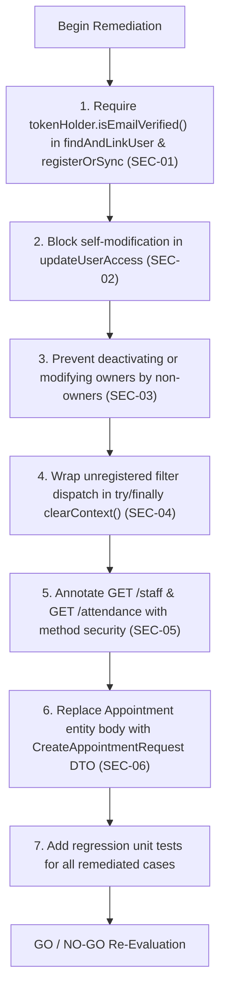

# Security Review — Firebase Authentication with Spring Security

**Audit Date**: October 31, 2026  
**Target Repository**: `GG Nursing Home Hub` (Spring Boot Backend)  
**Scope**: Task 3 Implementation (`backend/src/main/java/com/ggnh/hub/security/`, Controllers, Repositories, Migrations, and Tests)  
**Audit Type**: Strict Read-Only Security Architecture & Code Review  
**Auditor**: Senior Application Security Reviewer  

---

## 1. Executive Summary

This document presents a comprehensive, read-only security verification of the Firebase Authentication + Spring Security + PostgreSQL RBAC architecture implemented in Task 3.

The backend implementation achieves significant architectural goals:
- It eliminates the anti-pattern of custom JWT issuance from Spring Boot.
- It verifies cryptographic signatures, issuers, audiences, and expiration times using the Firebase Admin SDK.
- It enforces PostgreSQL as the single source of truth for authorization, ignoring unverified client claims.
- It implements stateless session management, strict CORS allowlisting, and sterile JSON error responses without stack traces.

However, the audit identified **1 Critical**, **2 High**, **2 Medium**, and **2 Low** severity vulnerabilities in the identity mapping, access control logic, and filter execution paths.

### Final Integration Verdict: **NO-GO FOR PRODUCTION FRONTEND INTEGRATION**
Until the Critical and High severity findings (specifically unverified email linking and administrative self-escalation) are remediated, frontend integration should not proceed to production.

---

## 2. Findings Matrix

| Finding ID | Severity | Category | Title | Affected File & Lines |
| :--- | :--- | :--- | :--- | :--- |
| **SEC-01** | **CRITICAL** | Identity & Auth | Pre-Account Takeover via Unverified Email Identity Linking | `UserSecurityService.java:39-55`, `AuthController.java:97-105` |
| **SEC-02** | **HIGH** | Access Control | Privilege Escalation via Self-Access Permission Manipulation | `UserAccessController.java:80-125` |
| **SEC-03** | **HIGH** | Access Control | Delegated User Manager Can Deactivate Hospital Owner | `UserAccessController.java:55-75` |
| **SEC-04** | **MEDIUM** | Filter & Lifecycle | ThreadLocal SecurityContext Leak on Registration Path | `FirebaseAuthenticationFilter.java:102-105` |
| **SEC-05** | **MEDIUM** | Authorization | Missing Method Security on Staff Directory & Attendance Read Endpoints | `StaffController.java:25-35`, `AttendanceController.java:45-68` |
| **SEC-06** | **LOW** | Input Validation | Mass Assignment / Over-Posting on Public Appointment Booking | `AppointmentController.java:46-50` |
| **SEC-07** | **LOW** | Availability | Absence of Rate Limiting on Unauthenticated & Registration Endpoints | `SecurityConfig.java:53-55` |

---

## 3. Detailed Vulnerability Analyses

### SEC-01: Pre-Account Takeover via Unverified Email Identity Linking
- **Severity**: **CRITICAL**
- **Affected Components**:
  - [`backend/src/main/java/com/ggnh/hub/security/service/UserSecurityService.java:39-55`](file:///d:/TryingStuff/gg-nursing-home-hub-main/backend/src/main/java/com/ggnh/hub/security/service/UserSecurityService.java#L39-L55)
  - [`backend/src/main/java/com/ggnh/hub/controller/AuthController.java:97-105`](file:///d:/TryingStuff/gg-nursing-home-hub-main/backend/src/main/java/com/ggnh/hub/controller/AuthController.java#L97-L105)

#### Technical Mechanics & Evidence
In `UserSecurityService.findAndLinkUser`:
```java
if (email != null && !email.isBlank()) {
    Optional<User> byEmail = userRepository.findByEmailIgnoreCase(email.trim());
    if (byEmail.isPresent()) {
        User user = byEmail.get();
        if (user.getFirebaseUid() == null || user.getFirebaseUid().isBlank()) {
            log.info("Linking Firebase UID '{}' to existing database user '{}'", uid, email);
            user.setFirebaseUid(uid);
            return Optional.of(userRepository.save(user));
        } ...
```
And similarly in `AuthController.registerOrSync`:
```java
Optional<User> existingByEmail = userRepository.findByEmailIgnoreCase(normalizedEmail);
if (existingByEmail.isPresent()) {
    User user = existingByEmail.get();
    if (user.getFirebaseUid() == null || user.getFirebaseUid().isBlank()) {
        user.setFirebaseUid(uid);
        User saved = userRepository.save(user);
        return ResponseEntity.ok(userSecurityService.toProfileResponse(saved));
    } ...
```
Although `DefaultFirebaseTokenVerifier.java:38` extracts `decodedToken.isEmailVerified()` into `FirebaseTokenHolder`, neither `findAndLinkUser` nor `registerOrSync` validates that `tokenHolder.isEmailVerified() == true` before performing automatic identity linking.

#### Concrete Exploit Scenario
1. A hospital administrator seeds an active owner account in PostgreSQL: `email = 'superadmin@ggnh.org'`, `is_active = true`, `roles = ['owner']`, `firebase_uid = NULL`.
2. An attacker signs up on Firebase Authentication using the public sign-up form with email `'superadmin@ggnh.org'` and an attacker-controlled password.
3. Firebase issues an ID token with `email_verified = false`.
4. The attacker sends a request to `GET /api/v1/auth/me` or `POST /api/v1/auth/register` with `Authorization: Bearer <unverified_token>`.
5. The backend validates the signature, matches the existing user by email, and permanently binds the attacker's Firebase UID to the active `superadmin@ggnh.org` account.
6. The attacker immediately gains full `owner` privileges over the hospital hub without ever proving ownership of the email address.

#### Recommended Remediation
Explicitly require `tokenHolder.isEmailVerified()` before linking any existing database user or provisioning active sessions:
```java
if (!tokenHolder.isEmailVerified()) {
    log.warn("Refusing to link unverified Firebase email '{}' to database user", email);
    return Optional.empty();
}
```

---

### SEC-02: Privilege Escalation via Self-Access Permission Manipulation
- **Severity**: **HIGH**
- **Affected Components**:
  - [`backend/src/main/java/com/ggnh/hub/controller/UserAccessController.java:80-125`](file:///d:/TryingStuff/gg-nursing-home-hub-main/backend/src/main/java/com/ggnh/hub/controller/UserAccessController.java#L80-L125)

#### Technical Mechanics & Evidence
Endpoint `PUT /api/v1/users/{id}/access` is protected by `@PreAuthorize("hasRole('owner') or hasAuthority('PERM_MANAGE_USERS')")`.
Lines 94-96 enforce:
```java
if ("owner".equals(targetRoleName) && (currentAdmin == null || !currentAdmin.getRoles().contains("owner"))) {
    throw new ResponseStatusException(HttpStatus.FORBIDDEN, "Only an existing owner can grant the owner role.");
}
```
However, the controller has **no self-modification check**. A user with delegated `PERM_MANAGE_USERS` (such as an `editor` or HR administrator) can submit a request with their own user UUID as `{id}` and assign themselves every granular permission (`manageAttendance`, `manageAppointments`, `manageUsers`, `manageInventory`, `manageInventoryReports`).

#### Concrete Exploit Scenario
1. An administrator grants an employee the `editor` role with `manageUsers: true`.
2. The employee calls `PUT /api/v1/users/{my_uuid}/access` specifying `role: "editor"` and `{ manageAttendance: true, manageAppointments: true, manageUsers: true, manageInventory: true, manageInventoryReports: true }`.
3. The check on line 94 passes because `role` is not `"owner"`.
4. The employee successfully escalates their privileges to manage the entire medical inventory and pharmacy ledger without authorization.

#### Recommended Remediation
Prevent non-owner administrators from modifying their own roles or permissions:
```java
if (currentAdmin != null && currentAdmin.getId().equals(user.getId()) && !currentAdmin.getRoles().contains("owner")) {
    throw new ResponseStatusException(HttpStatus.FORBIDDEN, "Administrators cannot modify their own permissions or roles.");
}
```

---

### SEC-03: Delegated User Manager Can Deactivate Hospital Owner
- **Severity**: **HIGH**
- **Affected Components**:
  - [`backend/src/main/java/com/ggnh/hub/controller/UserAccessController.java:55-75`](file:///d:/TryingStuff/gg-nursing-home-hub-main/backend/src/main/java/com/ggnh/hub/controller/UserAccessController.java#L55-L75)

#### Technical Mechanics & Evidence
In `PATCH /api/v1/users/{id}/status`:
```java
// Safeguard: An administrator cannot deactivate their own account
if (currentAdmin != null && currentAdmin.getId().equals(user.getId()) && !request.getActive()) {
    throw new ResponseStatusException(HttpStatus.BAD_REQUEST, "Administrators cannot deactivate their own account.");
}
user.setActive(request.getActive());
```
The safeguard only prevents deactivating **one's own** account. It fails to check the role of the **target user**. Any user possessing `PERM_MANAGE_USERS` can deactivate any other user in the database, including the hospital `owner`.

#### Concrete Exploit Scenario
1. A rogue or compromised account with `PERM_MANAGE_USERS` identifies the UUID of the primary hospital owner via `GET /api/v1/users`.
2. The attacker calls `PATCH /api/v1/users/{owner_uuid}/status` with `{"active": false}`.
3. The server sets `is_active = false` on the owner record.
4. On subsequent requests, `FirebaseAuthenticationFilter` detects `!user.isActive()` and blocks the hospital owner with HTTP 403 Forbidden, causing an administrative denial of service.

#### Recommended Remediation
Enforce that accounts holding the `owner` role can only be modified or deactivated by an existing `owner`:
```java
boolean isTargetOwner = user.getRoles().stream().anyMatch(r -> "owner".equalsIgnoreCase(r.getName()));
if (isTargetOwner && (currentAdmin == null || !currentAdmin.getRoles().contains("owner"))) {
    throw new ResponseStatusException(HttpStatus.FORBIDDEN, "Only an existing owner can modify an owner account.");
}
```

---

### SEC-04: ThreadLocal SecurityContext Leak on Registration Path
- **Severity**: **MEDIUM**
- **Affected Components**:
  - [`backend/src/main/java/com/ggnh/hub/security/filter/FirebaseAuthenticationFilter.java:102-105`](file:///d:/TryingStuff/gg-nursing-home-hub-main/backend/src/main/java/com/ggnh/hub/security/filter/FirebaseAuthenticationFilter.java#L102-L105)

#### Technical Mechanics & Evidence
In `FirebaseAuthenticationFilter.doFilterInternal`:
```java
if (optionalUser.isEmpty()) {
    if (isRegistrationPath) {
        FirebaseUserDetails unregisteredPrincipal = createUnregisteredPrincipal(tokenHolder);
        FirebaseAuthenticationToken auth = new FirebaseAuthenticationToken(
                unregisteredPrincipal,
                tokenHolder,
                Collections.singletonList(new SimpleGrantedAuthority("ROLE_UNREGISTERED"))
        );
        SecurityContextHolder.getContext().setAuthentication(auth);
        filterChain.doFilter(request, response);
        return; // <-- Unwrapped return
    }
    ...
}
...
try {
    filterChain.doFilter(request, response);
} finally {
    SecurityContextHolder.clearContext();
}
```
For normal authenticated requests (lines 137-142), `SecurityContextHolder.clearContext()` is guaranteed in a `finally` block. However, for unregistered registration requests (lines 102-104), `filterChain.doFilter` is invoked and the method returns directly **without clearing the security context**.

#### Concrete Exploit Scenario
In a servlet container using worker thread pooling (Tomcat), worker threads are reused across requests. If a client sends a subsequent unauthenticated HTTP request that happens to be handled by the same worker thread, the thread may retain residual authentication state (`ROLE_UNREGISTERED`) from the previous execution, violating stateless isolation principles.

#### Recommended Remediation
Wrap line 103 in `try ... finally`:
```java
try {
    SecurityContextHolder.getContext().setAuthentication(auth);
    filterChain.doFilter(request, response);
} finally {
    SecurityContextHolder.clearContext();
}
```

---

### SEC-05: Missing Method Security on Staff Directory & Attendance Read Endpoints
- **Severity**: **MEDIUM**
- **Affected Components**:
  - [`backend/src/main/java/com/ggnh/hub/controller/StaffController.java:25-35`](file:///d:/TryingStuff/gg-nursing-home-hub-main/backend/src/main/java/com/ggnh/hub/controller/StaffController.java#L25-L35)
  - [`backend/src/main/java/com/ggnh/hub/controller/AttendanceController.java:45-68`](file:///d:/TryingStuff/gg-nursing-home-hub-main/backend/src/main/java/com/ggnh/hub/controller/AttendanceController.java#L45-L68)

#### Technical Mechanics & Evidence
- `StaffController`: `GET /staff` and `GET /staff/{id}` have no `@PreAuthorize` annotation.
- `AttendanceController`: `GET /attendance` has no `@PreAuthorize` annotation.
While `SecurityConfig` mandates `.anyRequest().authenticated()`, any authenticated active user (including `viewer`, `auditor`, or `store-manager`) can query all hospital staff phone numbers, email addresses, and detailed daily staff attendance rosters.

#### Concrete Exploit Scenario
A user provisioned with the `viewer` or `store-manager` role (who should only access inventory data) can harvest the complete personal directory (phone numbers and emails) of all hospital medical staff and track daily attendance patterns.

#### Recommended Remediation
Annotate read endpoints with appropriate role or permission boundaries, for example:
```java
@PreAuthorize("hasAnyRole('owner', 'editor') or hasAuthority('PERM_MANAGE_ATTENDANCE')")
```

---

### SEC-06: Entity Mass Assignment on Public Appointment Booking
- **Severity**: **LOW**
- **Affected Components**:
  - [`backend/src/main/java/com/ggnh/hub/controller/AppointmentController.java:46-50`](file:///d:/TryingStuff/gg-nursing-home-hub-main/backend/src/main/java/com/ggnh/hub/controller/AppointmentController.java#L46-L50)
  - [`backend/src/main/java/com/ggnh/hub/entity/Appointment.java:51-59`](file:///d:/TryingStuff/gg-nursing-home-hub-main/backend/src/main/java/com/ggnh/hub/entity/Appointment.java#L51-L59)

#### Technical Mechanics & Evidence
`AppointmentController.createAppointment(@Valid @RequestBody Appointment appointment)` binds client JSON directly to the JPA entity. An unauthenticated caller can supply `id`, `status: "completed"`, or `completedAt` in the request body.

#### Recommended Remediation
Create a dedicated `BookAppointmentRequest` DTO containing only `patientName`, `patientEmail`, `patientPhone`, `doctorName`, and `message`.

---

### SEC-07: Absence of Rate Limiting on Unauthenticated & Registration Endpoints
- **Severity**: **LOW**
- **Affected Components**:
  - [`backend/src/main/java/com/ggnh/hub/security/config/SecurityConfig.java:53-55`](file:///d:/TryingStuff/gg-nursing-home-hub-main/backend/src/main/java/com/ggnh/hub/security/config/SecurityConfig.java#L53-L55)

#### Technical Mechanics & Evidence
`POST /api/v1/appointments`, `POST /api/v1/auth/register`, and `POST /api/v1/auth/sync` have no throttling, rate-limiting, or CAPTCHA enforcement. An automated script with programmatic Firebase tokens can spam the PostgreSQL database with pending user records or fake appointment bookings.

#### Recommended Remediation
Implement IP-based or token-based rate limiting (e.g., Bucket4j or Reverse Proxy / Cloudflare rate limiting).

---

## 4. Endpoint Authorization Matrix Audit

| Endpoint | HTTP Method | Expected Access | Code Level Config | Actual Access | Status | Notes |
| :--- | :--- | :--- | :--- | :--- | :--- | :--- |
| `/**` | `OPTIONS` | Public | `.permitAll()` | Public | **SECURE** | Standard CORS preflight |
| `/error` | `*` | Public | `.permitAll()` | Public | **SECURE** | Framework error dispatch |
| `/appointments` | `POST` | Public | `.permitAll()` | Public | **WARNING** | Public booking; entity over-posting (SEC-06) |
| `/auth/register` | `POST` | Valid Firebase Token | `.permitAll()` + Filter Token Check | Valid Firebase Token | **SECURE** | Inactive by default; ignores client claims |
| `/auth/sync` | `POST` | Valid Firebase Token | `.permitAll()` + Filter Token Check | Valid Firebase Token | **SECURE** | Links UID; ignores client claims |
| `/auth/me` | `GET` | Authenticated + Active | `.authenticated()` + Filter Active Check | Authenticated + Active | **SECURE** | Derives user from verified context |
| `/users` | `GET` | Owner or MANAGE_USERS | `@PreAuthorize` | Owner or MANAGE_USERS | **SECURE** | Correctly restricted |
| `/users/{id}/status` | `PATCH` | Owner or MANAGE_USERS | `@PreAuthorize` | Owner or MANAGE_USERS | **VULNERABLE** | Missing owner target protection (SEC-03) |
| `/users/{id}/access` | `PUT` | Owner or MANAGE_USERS | `@PreAuthorize` | Owner or MANAGE_USERS | **VULNERABLE** | Self-escalation permitted (SEC-02) |
| `/staff` | `GET` | Staff / Clinical Readers | `.authenticated()` | Any Authenticated User | **WARNING** | Missing role/perm annotation (SEC-05) |
| `/staff/{id}` | `GET` | Staff / Clinical Readers | `.authenticated()` | Any Authenticated User | **WARNING** | Missing role/perm annotation (SEC-05) |
| `/staff` | `POST` | Owner or MANAGE_ATTENDANCE | `@PreAuthorize` | Owner or MANAGE_ATTENDANCE | **SECURE** | Write methods restricted |
| `/staff/{id}` | `PUT` | Owner or MANAGE_ATTENDANCE | `@PreAuthorize` | Owner or MANAGE_ATTENDANCE | **SECURE** | Write methods restricted |
| `/staff/{id}` | `DELETE` | Owner or MANAGE_ATTENDANCE | `@PreAuthorize` | Owner or MANAGE_ATTENDANCE | **SECURE** | Write methods restricted |
| `/attendance` | `GET` | Staff / Clinical Readers | `.authenticated()` | Any Authenticated User | **WARNING** | Missing role/perm annotation (SEC-05) |
| `/attendance/mark` | `POST` | Owner or MANAGE_ATTENDANCE | `@PreAuthorize` | Owner or MANAGE_ATTENDANCE | **SECURE** | Write methods restricted |
| `/attendance` | `DELETE` | Owner or MANAGE_ATTENDANCE | `@PreAuthorize` | Owner or MANAGE_ATTENDANCE | **SECURE** | Write methods restricted |
| `/appointments` | `GET` | Owner or MANAGE_APPOINTMENTS | `@PreAuthorize` | Owner or MANAGE_APPOINTMENTS | **SECURE** | Patient PII restricted to authorized staff |
| `/appointments/{id}/complete`| `PATCH` | Owner or MANAGE_APPOINTMENTS | `@PreAuthorize` | Owner or MANAGE_APPOINTMENTS | **SECURE** | Write status transition restricted |

---

## 5. Security Filter & Initialization Verification

1. **Fail-Safe Startup**: If Firebase service account credentials are not configured, `FirebaseInitializer` logs a warning and marks `initialized = false`. It does not crash the application context, but any subsequent Bearer token verification throws `IllegalStateException`, which `FirebaseAuthenticationFilter` intercepts and maps to HTTP 401 Unauthorized. **Authentication cannot fail open.**
2. **Revocation Configuration**: Revocation checks adhere strictly to `app.firebase.check-revoked` (`FIREBASE_CHECK_REVOKED`). When false, signature and expiry are validated locally via cached public keys. When true, revocation is verified against Firebase servers.
3. **CORS Hardening**:
   - Explicit allowed origins (`CORS_ALLOWED_ORIGINS`).
   - Disallows wildcard `*` with credentials.
   - Restricts HTTP methods to `GET, POST, PUT, PATCH, DELETE, OPTIONS`.
   - Restricts headers to required headers.
4. **Sanitized Error Responses**: Custom entry point and access denied handlers return standard JSON payloads (`timestamp`, `status`, `error`, `message`, `path`). No stack traces, SQL syntax, or internal class names are leaked.
5. **Credential Leakage**: No Firebase private keys, client secrets, or raw bearer tokens are printed to stdout, stderr, or SLF4J logs.

---

## 6. Test Suite Quality & Coverage Audit

Inspection of [`AuthenticationSecurityIntegrationTest.java`](file:///d:/TryingStuff/gg-nursing-home-hub-main/backend/src/test/java/com/ggnh/hub/security/AuthenticationSecurityIntegrationTest.java):

| Scenario Tested | Real Security Configuration? | Firebase Mocks? | Database Engine | Assertion Rigor |
| :--- | :--- | :--- | :--- | :--- |
| **1. Valid identity -> active user (200)** | Yes (`MockMvc` + full filter chain) | Mocked `FirebaseTokenVerifier` | In-memory H2 (PostgreSQL mode) | **High**: Verifies JSON email, UID, active flag, roles, permissions |
| **2. Invalid token rejected (401)** | Yes | Mocked verifier throwing exception | H2 | **High**: Verifies status, error type, and sanitized message |
| **3. Expired token rejected (401)** | Yes | Mocked verifier throwing exception | H2 | **High**: Verifies status, error type, and sanitized message |
| **4. Unknown UID rejected (401)** | Yes | Mocked verifier returning unknown UID | H2 | **High**: Verifies 401 and specific rejection message |
| **5. Inactive user rejected (403)** | Yes | Mocked verifier returning inactive user UID | H2 | **High**: Verifies 403 Forbidden and approval pending message |
| **6. Active user with role -> authorized (200)** | Yes | Mocked verifier returning owner UID | H2 | **High**: Verifies access to `/users` |
| **7. User without permission -> forbidden (403)**| Yes | Mocked verifier returning viewer UID | H2 | **High**: Verifies 403 Forbidden on `/users` |
| **8. Public endpoint without auth (201)** | Yes | None (no header sent) | H2 | **High**: Verifies `POST /appointments` creates resource |
| **9. Client claims cannot override DB (201)** | Yes | Mocked verifier returning claims `role: owner` | H2 | **High**: Verifies registered user receives `viewer` and `active: false` |
| **10. Context cleared between requests** | Yes | Mocked verifier | H2 | **High**: Asserts `SecurityContextHolder` is null post-request and subsequent unauthenticated call returns 401 |
| **11. Automatic UID linking for existing email** | Yes | Mocked verifier | H2 | **High**: Verifies UID is assigned to existing user |
| **12. Owner status update & role modification** | Yes | Mocked verifier | H2 | **High**: Verifies status patch and permission put |

### Test Suite Coverage Gaps
1. **Unverified Email Testing**: Zero test coverage exists verifying that unverified Firebase emails are rejected during linking or registration.
2. **Self-Escalation Testing**: No automated test verifies whether a delegated user manager can escalate their own permissions.
3. **Database Fidelity**: All tests execute against H2 in PostgreSQL mode rather than an isolated PostgreSQL instance. (Testcontainers or remote Supabase testing required for full fidelity).

---

## 7. Actionable Remediation Plan

Before authorizing frontend integration (Task 4):



---

## 8. Conclusion

The Spring Security and Firebase Admin SDK backend foundation is well-structured and aligns with production standards for stateless token handling. However, due to the critical risk of pre-account takeover via unverified email linking and the privilege escalation vectors in the user access controller, the implementation requires the remediations outlined above before opening the API to production client traffic.

**Final Status**: Review complete. No source files or configurations were modified during this audit.

