# GG Nursing Home Hub — Current-State Technical Audit

**Audit Date**: October 29, 2026  
**Repository**: `https://github.com/Arunesh2407/GGNH`  
**Active Git Branch**: `feature/springboot-backend`  
**Current Commit Hash**: `b0b637bdee81ef5ab2a45caaea0ff955fddf8e2e` (short: `b0b637b`)  
**Auditor**: Antigravity Senior Technical Reviewer  
**Refactoring Phase**: Step 2 (Database Foundation) & Supabase Integration Complete; Step 3 (Authentication/Security) Pending  

---

## 1. Executive Summary

This technical audit provides an evidence-based assessment of the GG Nursing Home Hub repository following the completion of **Task 2 (PostgreSQL and Flyway Database Foundation)** and the initial **Supabase CLI Integration**.

### Key Findings at a Glance

1. **Frontend-Backend Disconnect (Dual Topology)**:
   The React 18 + Vite frontend remains 100% reliant on external Cloud BaaS providers (**Appwrite Cloud** and **Firebase**). Although a Spring Boot 3 modular backend exists in [`backend/`](file:///d:/TryingStuff/gg-nursing-home-hub-main/backend) with JPA entities, Flyway migrations, and REST controllers, **zero frontend components or service modules call the Spring Boot backend**. The HTTP utility [`src/services/apiClient.ts`](file:///d:/TryingStuff/gg-nursing-home-hub-main/src/services/apiClient.ts) exists but is unimported and unreferenced across the entire frontend codebase.
2. **Supabase Scope & Role**:
   Supabase is **not** being used as an application backend, authentication provider, or storage engine. Neither `@supabase/supabase-js` nor Supabase Auth, Storage, Edge Functions, or Realtime are present or invoked anywhere in client or server code. Supabase is configured **exclusively as a hosted PostgreSQL 17 provider** for the Spring Boot backend via its IPv4 Supavisor Session Pooler (`aws-0-eu-north-1.pooler.supabase.com:5432`) with TLS (`sslmode=require`).
3. **Database Migration Authority**:
   Single migration authority is assigned to **Flyway** within Spring Boot (`classpath:db/migration`). No SQL files exist under `supabase/migrations/`. Flyway migrations `V1__create_initial_schema.sql` and `V2__seed_static_roles.sql` establish a normalized 13-table relational schema with UUID primary keys, check constraints, composite unique keys, and double-entry stock ledger tracking. The schema has been verified locally against PostgreSQL 18.1 and H2 in PostgreSQL compatibility mode, but has **not yet been executed against the live remote Supabase instance**.
4. **Severe Security Gaps in Active Runtime**:
   - **Frontend/BaaS**: Appwrite collections operate with wildcard permissions (`read("any")`, `write("any")`), and critical multi-step operations (e.g., stock receipt and ledger balancing) execute sequentially from the browser without transactional boundaries.
   - **Backend**: Spring Boot currently has **no authentication or authorization layer**. `spring-boot-starter-security` is absent from [`backend/pom.xml`](file:///d:/TryingStuff/gg-nursing-home-hub-main/backend/pom.xml). Existing controllers (`AppointmentController`, `AttendanceController`, `StaffController`) expose unauthenticated endpoints without CORS protection.
5. **Frontend UI Preservation**:
   All 21+ React pages, layouts, Tailwind styles, and routing structures are 100% preserved. No frontend user-facing visual code was modified or regressed.
6. **Build & Quality Status**:
   - Frontend production build (`npm run build`) passes cleanly, but emits a bundle warning for a single 1.2 MB JavaScript chunk.
   - Frontend linting (`npm run lint`) **fails** with 3 errors and 10 warnings.
   - Frontend tests (`npm test`) consist of a single trivial placeholder test (`expect(true).toBe(true)`).
   - Backend automated tests (`mvn test`) pass (5 passed, 1 integration test skipped unless `VERIFY_POSTGRES=true`).

---

## 2. Current Architecture & Request Flows

### 2.1 System Architecture Diagram

```mermaid
flowchart TB
    subgraph Browser ["Client Browser (React 18 + Vite SPA)"]
        UI_Public["Public Web Pages\n(Home, About, Doctors, Services, Contact)"]
        UI_Staff["Staff Portal Pages\n(Attendance, Appointments, Inventory, Access)"]
        Ctx_Auth["AuthContext.tsx\n(Firebase Auth Client SDK)"]
        Ctx_Att["AttendanceContext.tsx\n(Appwrite Databases SDK)"]
        Svc_Inv["inventoryService.ts\n(Appwrite Databases SDK)"]
        Svc_Appt["appointmentService.ts\n(Appwrite Databases SDK)"]
        Svc_Access["accessControlService.ts\n(Appwrite + Firebase Functions)"]
        Svc_API["apiClient.ts\n(UNREFERENCED / DORMANT)"]
    end

    subgraph FirebaseCloud ["Firebase (External BaaS)"]
        FB_Auth["Firebase Authentication\n(Identity & IdToken)"]
        FB_Fn["Cloud Function\n(deleteUserAccessAccount)"]
    end

    subgraph AppwriteCloud ["Appwrite Cloud DB (NoSQL Collections)"]
        AW_Staff["Collection: staff"]
        AW_Att["Collection: attendance"]
        AW_Appt["Collection: appointment"]
        AW_Access["Collection: user_access"]
        AW_Inv["Collections: categories, items,\nsuppliers, stock_receipts, stock_ledger"]
    end

    subgraph ExternalServices ["Third-Party Notification Integrations"]
        FS["FormSubmit.co API\n(Public Contact/Appointment Email)"]
        SMS["VITE_SMS_WEBHOOK_URL"]
        WA["VITE_WHATSAPP_WEBHOOK_URL"]
    end

    subgraph SpringBootBackend ["Spring Boot 3 Backend (Port 8080) — DORMANT"]
        Ctrl_Appt["AppointmentController"]
        Ctrl_Att["AttendanceController"]
        Ctrl_Staff["StaffController"]
        HikariPool["HikariCP Connection Pool"]
        FlywayEngine["Flyway Engine (V1, V2)"]
        HibernateJPA["Hibernate 6 (ddl-auto: validate)"]
    end

    subgraph SupabaseCloud ["Supabase Managed Cloud (Stockholm / eu-north-1)"]
        Pooler["Supavisor Session Pooler\n(aws-0-eu-north-1.pooler.supabase.com:5432)"]
        Postgres17["Hosted PostgreSQL 17 Database\n(Schema pending migration)"]
    end

    %% Active Runtime Connections
    UI_Public -->|Direct HTTP POST| FS
    UI_Public -->|Direct Webhooks| SMS
    UI_Public -->|Direct Webhooks| WA
    UI_Public --> Svc_Appt
    UI_Staff --> Ctx_Auth
    UI_Staff --> Ctx_Att
    UI_Staff --> Svc_Inv
    UI_Staff --> Svc_Access
    Ctx_Auth -->|Client Auth| FB_Auth
    Svc_Access -->|Admin Deletion| FB_Fn
    Ctx_Att -->|Direct NoSQL Queries| AW_Staff
    Ctx_Att -->|Direct NoSQL Queries| AW_Att
    Svc_Appt -->|Direct NoSQL Queries| AW_Appt
    Svc_Inv -->|Multi-step NoSQL Operations| AW_Inv
    Svc_Access -->|Direct NoSQL Queries| AW_Access

    %% Disconnected / Dormant Backend Connections
    Svc_API -.->|NOT WIRED| Ctrl_Appt
    Ctrl_Appt --> HibernateJPA
    Ctrl_Att --> HibernateJPA
    Ctrl_Staff --> HibernateJPA
    HibernateJPA --> HikariPool
    FlywayEngine --> HikariPool
    HikariPool -.->|Configured via backend/.env| Pooler
    Pooler --> Postgres17
```



### 2.2 Feature-to-Request-to-Persistence Flow Table

| Feature | UI Entry Point | Service/API Path | Authentication / Authorization | Persistence System | Current Status |
| :--- | :--- | :--- | :--- | :--- | :--- |
| **Public Appointment Booking** | [`src/pages/Contact.tsx`](file:///d:/TryingStuff/gg-nursing-home-hub-main/src/pages/Contact.tsx#L40) | Direct browser `fetch()` to FormSubmit.co + webhooks + `appointmentService.addAppointment()` | None (Public endpoint) | FormSubmit.co (Email) + Appwrite Cloud (`appointment` collection) | **Active (BaaS)**; Spring Boot `AppointmentController` is bypassed |
| **Staff Appointment Management** | [`src/pages/StaffAppointments.tsx`](file:///d:/TryingStuff/gg-nursing-home-hub-main/src/pages/StaffAppointments.tsx#L1) | `appointmentService.getAppointments()` & `markCompleted()` | Client-side `ProtectedRoute` (`manage-appointments`) | Appwrite Cloud (`appointment` collection) | **Active (BaaS)**; Spring Boot endpoint `/appointments/{id}/complete` unused |
| **User Login & Session** | [`src/pages/AdminLogin.tsx`](file:///d:/TryingStuff/gg-nursing-home-hub-main/src/pages/AdminLogin.tsx#L1) | `AuthContext.login()` -> `signInWithEmailAndPassword` | Firebase Authentication ID Token + Appwrite `user_access` record | Firebase Auth + Appwrite Cloud | **Active (BaaS)**; Spring Boot has no auth filter or user endpoints |
| **User Registration & Approval** | [`src/pages/AdminRegister.tsx`](file:///d:/TryingStuff/gg-nursing-home-hub-main/src/pages/AdminRegister.tsx#L1) & [`src/pages/AdminUserAccess.tsx`](file:///d:/TryingStuff/gg-nursing-home-hub-main/src/pages/AdminUserAccess.tsx#L1) | `accessControlService.upsertRecord()` / `deleteRecord()` | Client-side `ProtectedRoute` (`manage-users`); Firebase callable function | Firebase Auth + Appwrite Cloud (`user_access`) | **Active (BaaS)**; Spring Boot `UserRepository` & `UserPermissionRepository` unused |
| **Staff Directory Management** | [`src/pages/StaffHome.tsx`](file:///d:/TryingStuff/gg-nursing-home-hub-main/src/pages/StaffHome.tsx#L1) | `AttendanceContext.tsx` -> `attendanceService.getStaff()`, `addStaff()`, `deleteStaff()` | Client-side `ProtectedRoute` (`isAuthenticated`) | Appwrite Cloud (`staff` collection) | **Active (BaaS)**; Spring Boot `StaffController` unused |
| **Daily Attendance Tracking** | [`src/pages/AdminAttendance.tsx`](file:///d:/TryingStuff/gg-nursing-home-hub-main/src/pages/AdminAttendance.tsx#L1) & [`AdminAttendanceReport.tsx`](file:///d:/TryingStuff/gg-nursing-home-hub-main/src/pages/AdminAttendanceReport.tsx#L1) | `AttendanceContext.tsx` -> `attendanceService.markAttendance()`, `getAttendance()` | Client-side `ProtectedRoute` (`manage-attendance`) | Appwrite Cloud (`attendance` collection) | **Active (BaaS)**; Spring Boot `AttendanceController` unused |
| **Inventory Categories & Suppliers** | [`src/pages/inventory/ItemCategories.tsx`](file:///d:/TryingStuff/gg-nursing-home-hub-main/src/pages/inventory/ItemCategories.tsx#L1), [`Suppliers.tsx`](file:///d:/TryingStuff/gg-nursing-home-hub-main/src/pages/inventory/Suppliers.tsx#L1) | `inventoryService.listCategories()`, `saveCategory()`, `listSuppliers()`, `saveSupplier()` | Client-side `ProtectedRoute` (`manage-inventory`) | Appwrite Cloud (`categories`, `suppliers` collections) | **Active (BaaS)**; Spring Boot has repositories but no controllers |
| **Item Master & Stock Levels** | [`src/pages/inventory/ItemMaster.tsx`](file:///d:/TryingStuff/gg-nursing-home-hub-main/src/pages/inventory/ItemMaster.tsx#L1) | `inventoryService.listItems()`, `saveItem()`, `updateItem()` | Client-side `ProtectedRoute` (`manage-inventory`) | Appwrite Cloud (`items` collection) | **Active (BaaS)**; Spring Boot has entity & repo, no controllers |
| **Stock Inward Receiving** | [`src/pages/inventory/StockReceiving.tsx`](file:///d:/TryingStuff/gg-nursing-home-hub-main/src/pages/inventory/StockReceiving.tsx#L1) | `inventoryService.receiveStock()` | Client-side `ProtectedRoute` (`manage-inventory`) | Appwrite Cloud (`stock_receipts`, `items`, `stock_ledger`) | **Active (BaaS)**; 5 non-transactional browser calls; Spring Boot models dormant |
| **Inventory Auditing & Reports** | [`src/pages/inventory/InventoryReports.tsx`](file:///d:/TryingStuff/gg-nursing-home-hub-main/src/pages/inventory/InventoryReports.tsx#L1) | `inventoryService.getStockAvailabilityReport()`, `getItemTraceReport()` | Client-side `ProtectedRoute` (`view-inventory-reports`) | Appwrite Cloud (`items`, `categories`, `stock_ledger`) | **Active (BaaS)**; Spring Boot `InventoryLedgerRepository` dormant |
| **Spring Boot REST Client** | [`src/services/apiClient.ts`](file:///d:/TryingStuff/gg-nursing-home-hub-main/src/services/apiClient.ts#L1) | Dormant fetch wrapper pointing to `VITE_SPRINGBOOT_API_URL` | None | None | **Dormant / Unused**; 0 imports in `src/` |

---

## 3. Supabase Integration Audit

### 3.1 Scope of Supabase Usage

| Product / Capability | In Use? | Evidence / File Path | Notes |
| :--- | :--- | :--- | :--- |
| **PostgreSQL Database** | **Configured** | [`backend/src/main/resources/application.yml:41`](file:///d:/TryingStuff/gg-nursing-home-hub-main/backend/src/main/resources/application.yml#L41) | Target database for Spring Boot backend via Supavisor Session Pooler |
| **Supabase Auth** | **No** | None | Authentication is handled by Firebase Auth SDK in [`src/context/AuthContext.tsx`](file:///d:/TryingStuff/gg-nursing-home-hub-main/src/context/AuthContext.tsx#L12) |
| **Supabase Storage** | **No** | None | No file upload/storage configured |
| **Supabase Edge Functions** | **No** | None | No edge functions present; Firebase Functions used for admin user deletion |
| **Supabase Realtime** | **No** | None | No websocket or subscription clients present |
| **Frontend Client (`@supabase/supabase-js`)** | **No** | [`package.json:16-56`](file:///d:/TryingStuff/gg-nursing-home-hub-main/package.json#L16-L56) | `@supabase/supabase-js` is not installed; zero browser calls to Supabase |
| **Supabase CLI** | **Configured & Linked** | [`package.json:89`](file:///d:/TryingStuff/gg-nursing-home-hub-main/package.json#L89), [`supabase/config.toml`](file:///d:/TryingStuff/gg-nursing-home-hub-main/supabase/config.toml) | Version `^2.122.0` installed in `devDependencies`; project `ocbloisbsincewtvspvg` linked |

### 3.2 Connectivity & Security Architecture

1. **Connection String Strategy**:
   The backend connects through the **Supavisor Session Pooler** on port 5432:
   ```properties
   SPRING_DATASOURCE_URL=jdbc:postgresql://aws-0-eu-north-1.pooler.supabase.com:5432/postgres?sslmode=require
   SPRING_DATASOURCE_USERNAME=postgres.ocbloisbsincewtvspvg
   ```
   - **Rationale**: The session pooler supports IPv4, prepared statement caching in HikariCP, and PostgreSQL advisory locks required by Flyway migrations.
   - **TLS/SSL**: Enforced via `?sslmode=require` in the JDBC URL.
2. **Credential Handling**:
   - Database credentials are kept strictly out of the frontend. No `VITE_` variables expose Supabase secrets.
   - A committed template [`backend/.env.example`](file:///d:/TryingStuff/gg-nursing-home-hub-main/backend/.env.example) contains safe placeholders.
   - The active [`backend/.env`](file:///d:/TryingStuff/gg-nursing-home-hub-main/backend/.env) is strictly ignored by Git (verified with `git check-ignore backend/.env`).
   - Spring Boot loads `backend/.env` natively via `spring.config.import: optional:file:backend/.env[.properties]` in [`application.yml:9`](file:///d:/TryingStuff/gg-nursing-home-hub-main/backend/src/main/resources/application.yml#L9).
3. **Migration Ownership & RLS**:
   - There are **no SQL files in `supabase/migrations/`**. Schema management is entirely owned by Spring Boot Flyway to prevent conflicting migration histories.
   - No custom Row Level Security (RLS) policies exist because browser clients do not access Supabase directly. All database access is channeled through Spring Boot via JDBC.

---

## 4. Database & Persistence Audit

### 4.1 Spring Boot & Flyway Migrations

The database persistence foundation consists of two Flyway migration scripts under [`backend/src/main/resources/db/migration/`](file:///d:/TryingStuff/gg-nursing-home-hub-main/backend/src/main/resources/db/migration):

1. **`V1__create_initial_schema.sql`** (Lines 1–188):
   - **Extension**: `CREATE EXTENSION IF NOT EXISTS "pgcrypto";` for `gen_random_uuid()`.
   - **Identity & Access**:
     - `roles`: `id SERIAL PRIMARY KEY`, `name VARCHAR(50) UNIQUE`, `description`.
     - `users`: `id UUID PRIMARY KEY`, `email VARCHAR(255) UNIQUE`, `password_hash VARCHAR(255)`, `is_active BOOLEAN DEFAULT FALSE`.
     - `user_roles`: Composite PK `(user_id, role_id)`, FKs with `ON DELETE CASCADE` (users) and `ON DELETE RESTRICT` (roles).
     - `user_permissions`: 1:1 relation on `user_id` with discrete boolean permission flags.
   - **Staff & Attendance**:
     - `staff`: `id UUID PRIMARY KEY`, `name`, `role`, `phone`, `email`, `is_active`.
     - `attendance`: `id UUID PRIMARY KEY`, `staff_id UUID REFERENCES staff(id) ON DELETE RESTRICT`, `attendance_date DATE`.
     - **Unique Constraint**: `CONSTRAINT uq_attendance_staff_date UNIQUE (staff_id, attendance_date)`.
     - **Check Constraint**: `CONSTRAINT chk_attendance_status CHECK (status IN ('present', 'absent', 'leave', 'off', 'half-time', 'over-time'))`.
   - **Appointments**:
     - `appointments`: `id UUID PRIMARY KEY`, `patient_name`, `patient_email`, `patient_phone`, `doctor_name`, `message TEXT`, `status VARCHAR(30) DEFAULT 'booked'`, `created_at`, `completed_at`.
     - **Check Constraint**: `CONSTRAINT chk_appointment_status CHECK (status IN ('booked', 'completed', 'cancelled'))`.
   - **Inventory**:
     - `inventory_categories`: `id UUID PRIMARY KEY`, `name UNIQUE`, `code UNIQUE`, `is_active`.
     - `suppliers`: `id UUID PRIMARY KEY`, `name`, `code UNIQUE`, `contact_person`, `email`, `phone`, `address`, `is_active`.
     - `inventory_items`: `id UUID PRIMARY KEY`, `sku UNIQUE`, `category_id FK RESTRICT`, `default_supplier_id FK SET NULL`, `reorder_level >= 0`, `current_stock >= 0`, `version BIGINT NOT NULL DEFAULT 0` (optimistic locking).
     - `stock_receipts`: `id UUID PRIMARY KEY`, `receipt_number UNIQUE`, `supplier_id FK RESTRICT`, `received_date DATE`.
     - `stock_receipt_items`: Multi-item receipt lines; `receipt_id FK CASCADE`, `item_id FK RESTRICT`, `quantity > 0`, `unit_cost NUMERIC(12, 2) >= 0`, `batch_no`, `expiry_date`.
     - `inventory_ledger`: Double-entry audit ledger; `item_id FK RESTRICT`, `action IN ('receive', 'issue', 'adjust', 'waste', 'return')`, `quantity <> 0`, `balance_after >= 0`, `source_type`, `source_id`, `created_by`, `created_at`.
2. **`V2__seed_static_roles.sql`** (Lines 1–12):
   - Seeds 6 static system roles: `owner`, `editor`, `viewer`, `store-manager`, `department-head`, `auditor` with `ON CONFLICT (name) DO NOTHING`.

### 4.2 JPA Entity Alignment

12 JPA entity classes in `com.ggnh.hub.entity` map directly to the Flyway tables:
- Primary keys use `GenerationType.UUID` (or `IDENTITY` for `Role.id`).
- Lazy loading (`FetchType.LAZY`) is enforced on all `@ManyToOne` and `@ManyToMany` relationships.
- Enum columns are converted using `@Convert` with dedicated `AttributeConverter` implementations:
  - `AppointmentStatusConverter`
  - `AttendanceStatusConverter`
  - `LedgerActionConverter`
- Optimistic locking is implemented on `InventoryItem` via `@Version private Long version;` to prevent lost updates during concurrent stock receipts.
- Hibernate DDL validation is set to `ddl-auto: validate` across all profiles, guaranteeing fail-fast startup if entity mappings diverge from Flyway schema.

### 4.3 Cross-System Schema Comparison

| Domain / Entity | Appwrite NoSQL Model (Active Runtime) | Spring Boot / PostgreSQL Model (Target Runtime) | Discrepancies & Migration Risks |
| :--- | :--- | :--- | :--- |
| **Identity / Users** | Firebase Auth UID + Appwrite `user_access` document with string `$id`, camelCase fields | PostgreSQL `users`, `roles`, `user_roles`, `user_permissions` with UUID PKs | In Appwrite, permissions are stored as loosely typed document attributes. In PostgreSQL, RBAC is normalized into distinct tables. User accounts must be mapped during credential migration. |
| **Staff** | Appwrite `staff` document (`$id`, `name`, `role`, `phone`, `email`) | PostgreSQL `staff` table (`id` UUID, `is_active` boolean, `created_at`, `updated_at`) | Appwrite uses string IDs; PostgreSQL uses UUIDs. Appwrite lacks audit timestamps and active state flags. |
| **Attendance** | Appwrite `attendance` document (`$id`, `date` String, `staffId` String, `status` String) | PostgreSQL `attendance` table (`id` UUID, `staff_id` UUID FK, `attendance_date` DATE, `status` enum) | Appwrite has no uniqueness constraint; multiple records can exist for the same staff on the same date. PostgreSQL strictly enforces `UNIQUE(staff_id, attendance_date)`. Date is `VARCHAR` in Appwrite, `DATE` in PostgreSQL. |
| **Appointments** | Appwrite `appointment` document (`$id`, `name`, `email`, `phone`, `doctor`, `message`, `status`, `completedAt`) | PostgreSQL `appointments` table (`id` UUID, `patient_name`, `patient_email`, `doctor_name`, `status`, timestamps) | Appwrite fields are unvalidated strings. PostgreSQL enforces status check constraints (`booked`, `completed`, `cancelled`) and `NOT NULL` constraints on patient contact info. |
| **Inventory Master** | Appwrite `categories`, `suppliers`, `items` collections with loose string attributes | PostgreSQL `inventory_categories`, `suppliers`, `inventory_items` | PostgreSQL enforces unique codes (`uq_inventory_categories_code`, `uq_suppliers_code`, `uq_inventory_items_sku`), positive stock checks (`current_stock >= 0`), and foreign key integrity. |
| **Stock Inward & Ledger** | Appwrite `stock_receipts` collection stores single-item records; separate `stock_ledger` collection | PostgreSQL `stock_receipts` (header) + `stock_receipt_items` (lines) + `inventory_ledger` | In Appwrite, a receipt can only hold one item. In PostgreSQL, a receipt header supports multiple line items. In Appwrite, updating stock and creating ledger entries is non-transactional across 5 client requests; in PostgreSQL, it is unified under ACID transactions. |

---

## 5. Authentication & Security Audit

### 5.1 Active Frontend Authentication (Firebase + Appwrite)

- **Authentication Mechanism**: Firebase Authentication SDK (`signInWithEmailAndPassword`, `createUserWithEmailAndPassword`).
- **Token Handling**: ID tokens are retrieved via `user.getIdTokenResult()`, but never forwarded to Spring Boot.
- **Role Resolution**:
  - The frontend inspects Firebase custom claims (`tokenResult.claims.role`).
  - If custom claims are absent, it executes a client-side query against Appwrite `user_access` collection by email.
  - Fallback check: Compares email against comma-separated environment variables `VITE_SUPER_ADMIN_EMAILS` and `VITE_ATTENDANCE_EDITOR_EMAILS`.
- **Route Protection**: Purely client-side in [`src/components/ProtectedRoute.tsx`](file:///d:/TryingStuff/gg-nursing-home-hub-main/src/components/ProtectedRoute.tsx#L1). Unauthenticated or unauthorized users are redirected by React Router, but direct API access is unprotected.
- **Account Approval Flow**: New registrations create a Firebase auth record and an Appwrite document with `isActive: false`. If an unapproved user signs in, [`AuthContext.tsx`](file:///d:/TryingStuff/gg-nursing-home-hub-main/src/context/AuthContext.tsx#L393) forces a sign-out with an alert: *"Your account is pending administrator approval."*

### 5.2 Spring Boot Security State (CRITICAL RISK)

- **Spring Security Dependency**: **Missing**. [`backend/pom.xml`](file:///d:/TryingStuff/gg-nursing-home-hub-main/backend/pom.xml) does not declare `spring-boot-starter-security`.
- **Endpoint Protection**: All REST endpoints exposed by Spring Boot (`/appointments/**`, `/attendance/**`, `/staff/**`) are completely open to the public without authentication or authorization.
- **CORS Configuration**: No CORS configuration is present. If the frontend were connected to Spring Boot today, browser cross-origin requests would fail preflight checks.
- **Password Hashing**: The `users` table defines `password_hash VARCHAR(255)`, but no BCrypt encoder or authentication service exists yet.

---

## 6. Frontend UI Preservation & API Compatibility

### 6.1 Frontend Preservation Verification

- **Visual / Component Diff**: **Zero modifications**. No files in `src/pages/`, `src/components/`, `src/context/`, or `src/hooks/` were modified in Task 2 or Supabase integration.
- **Routing**: All 18 routes in [`src/App.tsx`](file:///d:/TryingStuff/gg-nursing-home-hub-main/src/App.tsx#L88-L199) remain identical.
- **Tailwind & Theme**: [`tailwind.config.ts`](file:///d:/TryingStuff/gg-nursing-home-hub-main/tailwind.config.ts) and [`src/index.css`](file:///d:/TryingStuff/gg-nursing-home-hub-main/src/index.css) design system variables remain untouched.

### 6.2 API Contract Compatibility Analysis

If frontend services are switched from Appwrite to Spring Boot in Task 5, the following contract mismatches must be addressed:

1. **Staff API**:
   - `StaffController.getAllStaff()` returns `List<Staff>`.
   - Appwrite returns `{ documents: [{ $id, name, role, phone, email }] }`.
   - The Spring Boot entity returns `id` (UUID string), `name`, `role`, `phone`, `email`.
   - **Status**: Compatible after minor property key adjustment (`$id` -> `id`).
2. **Attendance API**:
   - `AttendanceController.getAllAttendance()` returns `Map<String, Map<String, String>>` (mapping date -> staffId -> status).
   - This was intentionally designed to match `AttendanceByDate` in [`src/services/attendanceService.ts:12`](file:///d:/TryingStuff/gg-nursing-home-hub-main/src/services/attendanceService.ts#L12).
   - **Status**: 100% compatible.
3. **Appointments API**:
   - `AppointmentController.getAppointments()` returns a Spring Data `Page<Appointment>`:
     `{ content: [...], totalElements: 10, totalPages: 1, ... }`.
   - Appwrite returns `{ documents: [...] }`.
   - If the frontend reads `response` directly as an array or document list without extracting `.content`, it will fail at runtime.
   - **Status**: Contract mismatch requires DTO or frontend adapter.

---

## 7. Testing & Verification Results

All tests and verification commands were executed directly in the current environment:

| Command / Test Suite | Exit Code | Actual Outcome | What It Proves | What It Does Not Prove |
| :--- | :---: | :--- | :--- | :--- |
| `vitest run` (`npm test`) | **0** | 1 test run, 1 passed (Duration: 3.30s) | The Vitest runner is installed and executes successfully. | Does **not** prove frontend code functions properly; the only test is a placeholder `expect(true).toBe(true)` in [`src/test/example.test.ts`](file:///d:/TryingStuff/gg-nursing-home-hub-main/src/test/example.test.ts#L5). |
| `eslint .` (`npm run lint`) | **1** | Failed with 3 errors, 10 warnings | Catches TypeScript ESLint violations in shadcn UI components (`@typescript-eslint/no-empty-object-type`) and `require()` in `tailwind.config.ts`. | Does not prevent runtime execution, but blocks CI lint gates. |
| `vite build` (`npm run build`) | **0** | Production build succeeded in 11.20s; bundle generated under `dist/` | TypeScript types compile and Vite successfully bundles all assets. | Does not prove runtime correctness or API connectivity. Emits warning: chunk `index-TUGB8fVV.js` is 1,203 kB (>500 kB limit). |
| `mvn -f backend/pom.xml test` | **0** | 6 tests run: 5 passed, 1 skipped (BUILD SUCCESS in 14.47s) | Verifies Spring application context boots, JPA entities map validly to H2 in PostgreSQL mode, and repository CRUD operations succeed. | Does not execute against PostgreSQL (PostgresFlywayIntegrationTest is skipped unless `VERIFY_POSTGRES=true`). |
| `npx supabase projects list` | **0** | Returned JSON showing project `ocbloisbsincewtvspvg` (`gg-nursing-home-hub`) is `ACTIVE_HEALTHY` and `linked: true` | Supabase CLI is authenticated, configured, and linked to the active cloud project. | Does not prove database tables exist or that Spring Boot can authenticate to PostgreSQL without a password. |
| `git check-ignore backend/.env` | **0** | Output: `backend/.env` | Confirms that `backend/.env` containing credentials is strictly excluded from Git tracking. | None. |

---

## 8. Deployment & Operational Readiness

### 8.1 Local Development Readiness

- **Frontend**: Can be started with `npm run dev` on port 5173. Connects to external Firebase and Appwrite cloud projects.
- **Backend (Offline/In-Memory Mode)**: Can be run with `mvn -f backend/pom.xml spring-boot:run -Dspring-boot.run.profiles=h2` using in-memory H2 with zero external dependencies.
- **Backend (Supabase Hosted Mode)**: Ready to run once the user inputs their Supabase database password into [`backend/.env`](file:///d:/TryingStuff/gg-nursing-home-hub-main/backend/.env). Spring Boot loads `backend/.env` natively and connects via SSL session pooler.
- **Backend (Local Docker Mode)**: [`docker-compose.yml`](file:///d:/TryingStuff/gg-nursing-home-hub-main/docker-compose.yml) provides a local PostgreSQL 16 container on port 5432.

### 8.2 Production Deployment Gaps

1. **Missing Dockerfiles**: No `Dockerfile` exists for the Spring Boot backend or the Vite frontend.
2. **Missing CI/CD Pipeline**: No GitHub Actions workflows exist under `.github/workflows/`.
3. **Database Migration Unapplied**: Flyway migrations have not yet been executed against the live remote Supabase instance.
4. **No Health Checks / Actuator**: `spring-boot-starter-actuator` is missing from `pom.xml`, preventing cloud container health checks (`/actuator/health`).

---

## 9. Ranked Findings by Severity

| ID | Severity | File Path & Line | Evidence / Defect Description | Recommended Fix |
| :--- | :--- | :--- | :--- | :--- |
| **SEC-01** | **CRITICAL** | [`backend/pom.xml:24-68`](file:///d:/TryingStuff/gg-nursing-home-hub-main/backend/pom.xml#L24-L68) | Spring Boot backend completely lacks Spring Security. All endpoints (`/staff`, `/attendance`, `/appointments`) are publicly accessible without authentication. | Implement Task 3: Add `spring-boot-starter-security`, JWT validation filter, BCrypt password encoder, and RBAC endpoint rules. |
| **SEC-02** | **CRITICAL** | `appwrite.config.json` | Appwrite collections have wildcard permissions (`read("any")`, `write("any")`), allowing any browser client with project ID to read/mutate all records. | Migrate data persistence to Spring Boot + Supabase PostgreSQL; decommission Appwrite client SDK. |
| **SEC-03** | **HIGH** | [`backend/src/main/java/com/ggnh/hub/controller/`](file:///d:/TryingStuff/gg-nursing-home-hub-main/backend/src/main/java/com/ggnh/hub/controller) | No CORS configuration exists in Spring Boot. Browser cross-origin requests from `localhost:5173` or production domains will be rejected by CORS policy. | Add a global `WebMvcConfigurer` bean defining allowed origins, methods, and headers. |
| **DATA-01** | **HIGH** | [`src/services/inventoryService.ts:435-512`](file:///d:/TryingStuff/gg-nursing-home-hub-main/src/services/inventoryService.ts#L435-L512) | Inventory stock receiving executes 5 sequential, non-transactional HTTP calls from the browser across 3 Appwrite collections. Any failure leaves inventory permanently corrupt. | Implement Task 4: Move stock receiving into a `@Transactional` Spring Boot service with optimistic locking (`@Version`). |
| **ARCH-01** | **MEDIUM** | [`src/services/apiClient.ts:1-25`](file:///d:/TryingStuff/gg-nursing-home-hub-main/src/services/apiClient.ts#L1-L25) | `apiClient.ts` exists but is orphaned (0 references in `src/`). The frontend and Spring Boot backend remain completely disconnected. | Wire `apiClient.ts` into frontend service modules during Task 5. |
| **QA-01** | **MEDIUM** | [`src/test/example.test.ts:1-7`](file:///d:/TryingStuff/gg-nursing-home-hub-main/src/test/example.test.ts#L1-L7) | Frontend test suite has only 1 dummy assertion (`expect(true).toBe(true)`). There are zero tests for components, services, or contexts. | Add Vitest unit and integration tests for React components and services. |
| **QA-02** | **MEDIUM** | [`tailwind.config.ts:86`](file:///d:/TryingStuff/gg-nursing-home-hub-main/tailwind.config.ts#L86), [`src/components/ui/command.tsx:24`](file:///d:/TryingStuff/gg-nursing-home-hub-main/src/components/ui/command.tsx#L24) | `npm run lint` fails with 3 errors and 10 warnings. | Fix empty interface declarations in shadcn UI files and replace `require("tailwindcss-animate")` with ES import. |
| **PERF-01** | **LOW** | [`dist/assets/index-TUGB8fVV.js`](file:///d:/TryingStuff/gg-nursing-home-hub-main/dist) | Frontend production build produces a single 1.2 MB unchunked bundle. | Configure `build.rollupOptions.output.manualChunks` in `vite.config.ts` to split vendor dependencies. |

---

## 10. Completed vs Partially Completed vs Unverified Work

### Completed Work
- [x] Initialized Spring Boot 3.2.5 backend with Java 17 and Maven.
- [x] Added Flyway 9.22.3 migration engine with `V1` (13 normalized tables) and `V2` (6 seeded roles).
- [x] Implemented 12 JPA entities, 3 enum attribute converters, and 12 Spring Data JPA repositories.
- [x] Configured optimistic locking (`@Version`) on `InventoryItem` and check constraints across entities.
- [x] Configured multi-profile datasource support (`postgres`, `supabase`, `h2`, `test`).
- [x] Installed Supabase CLI `2.122.0` in `devDependencies`, linked project `ocbloisbsincewtvspvg` in `eu-north-1`.
- [x] Prepared secure `backend/.env` with native `spring.config.import` and Git exclusion verification.
- [x] Preserved 100% of frontend React UI, layouts, styles, and routes.
- [x] Wrote automated repository integration tests (`RepositoryIntegrationTest.java`).

### Partially Completed Work
- [~] **Supabase Connectivity**: Project is linked via Supabase CLI and profile is configured, but migrations have not yet executed against the hosted database.
- [~] **Spring Boot Controllers**: Basic CRUD exists for `Staff`, `Attendance`, and `Appointment`, but no controllers or services exist for `Inventory`, `Users`, or `Auth`.
- [~] **Integration Testing**: PostgreSQL integration test class exists (`PostgresFlywayIntegrationTest.java`), but runs only when the flag `VERIFY_POSTGRES=true` is set.

### Unverified / Pending Work
- [ ] Remote execution of Flyway migrations against hosted Supabase PostgreSQL.
- [ ] Spring Security, JWT authentication, and user password management.
- [ ] End-to-end integration between React frontend and Spring Boot REST API.
- [ ] Data migration from Appwrite/Firebase to Supabase PostgreSQL.

---

## 11. Discrepancies from Earlier Reports

1. **`docs/DATABASE_FOUNDATION.md` vs Actual PostgreSQL Status**:
   - `DATABASE_FOUNDATION.md` claims *"Status: Implemented & Verified Against PostgreSQL 18.1"*.
   - **Audit Reality**: Verification was conducted against a temporary local PostgreSQL 18 instance. In the current repository state, `PostgresFlywayIntegrationTest` is skipped by default during `mvn test`. No tables have been created on the hosted Supabase PostgreSQL instance yet.
2. **`docs/SUPABASE_SETUP.md` vs Runtime State**:
   - `SUPABASE_SETUP.md` presents architecture diagrams with the React UI connecting via HTTPS REST to Spring Boot.
   - **Audit Reality**: That architecture is the *intended target state*. In the actual runtime state, the React UI connects 100% to Firebase and Appwrite.
3. **`docs/REFACTORING_AUDIT.md` Schema Proposal**:
   - `REFACTORING_AUDIT.md` proposed a single-item-per-receipt inventory schema.
   - **Audit Reality**: Task 2 successfully updated this to an enterprise-grade multi-item model (`stock_receipts` header + `stock_receipt_items` line items).

---

## 12. Placement Readiness Evaluation

| Evaluation Category | Score (out of 10) | Evidence-Based Justification |
| :--- | :---: | :--- |
| **1. Frontend Quality** | **7.5 / 10** | High quality UI with React 18, TypeScript, Tailwind CSS, shadcn/ui, and responsive layouts. Deductions for lint failures (exit code 1), 1.2 MB unchunked bundle, and direct client BaaS calls. |
| **2. Backend Architecture** | **6.0 / 10** | Clean Spring Boot 3 foundation, well-structured JPA models with lazy loading, and repository interfaces. Deductions for missing service layer, missing inventory controllers, missing Spring Security, and lack of DTO abstraction. |
| **3. Database Design** | **9.0 / 10** | Outstanding relational schema design. 13 normalized tables, UUID PKs, explicit foreign key cascade/restrict rules, database check constraints, composite unique keys, optimistic locking, and immutable ledger traceability. |
| **4. Security** | **3.5 / 10** | Severe vulnerability state. Frontend relies on client-side route guards. Appwrite collections have wildcard access. Spring Boot backend completely lacks Spring Security, authentication, and CORS. Merit: Zero exposed credentials in Git. |
| **5. Testing** | **4.0 / 10** | Backend has 5 clean automated repository tests in H2 PostgreSQL mode. Deductions for placeholder frontend test (`expect(true).toBe(true)`), skipped PostgreSQL test, and zero controller/end-to-end tests. |
| **6. Supabase Integration** | **5.5 / 10** | Clean CLI linking, reproducible package setup, and clean single-authority Flyway ownership. Deductions because schema has not yet been applied to the live hosted instance, and it currently acts solely as an external DB target. |
| **7. Overall Placement Readiness** | **6.0 / 10** | Strong foundation in both frontend UI and relational data modeling. Currently in an intermediate migration state (frontend on BaaS, backend in development). Completing security and API wiring will make it a top-tier portfolio project. |

---

## 13. Recommended Next Tasks (Prioritized by Dependency & Risk)

### Task 1: Backend Authentication & Security Layer (Spring Security + JWT)
- **Why First**: The backend currently has zero security. Exposing endpoints or migrating frontend services without authentication would create critical vulnerabilities.
- **Scope**:
  1. Add `spring-boot-starter-security` and `jjwt` dependencies to [`backend/pom.xml`](file:///d:/TryingStuff/gg-nursing-home-hub-main/backend/pom.xml).
  2. Implement `SecurityFilterChain` with stateless JWT authentication, BCrypt password hashing, and role-based authorization matching `roles` and `user_permissions`.
  3. Implement global CORS configuration (`WebMvcConfigurer`) allowing Vite development and production origins.
  4. Create `AuthController` with `/api/v1/auth/login`, `/api/v1/auth/register`, and `/api/v1/auth/me`.
  5. Implement secure admin bootstrap mechanism.

### Task 2: Inventory Business Service & REST Controllers
- **Why Second**: The inventory module is the most complex domain in the system and currently suffers from dangerous 5-step non-transactional browser calls in Appwrite.
- **Scope**:
  1. Implement transactional service layer (`InventoryService`, `StockReceivingService`) with `@Transactional` boundaries.
  2. Enforce atomic stock updates, receipt item creation, and ledger entry logging under optimistic locking.
  3. Create REST controllers and DTOs for Categories, Items, Suppliers, Stock Receipts, and Stock Ledger.

### Task 3: Migrate Flyway Schema to Supabase & Wire Frontend API Client
- **Why Third**: Requires the backend security and business endpoints from Tasks 1 and 2 to be operational before decoupling the frontend from BaaS.
- **Scope**:
  1. User enters Supabase DB password in `backend/.env`; execute Flyway migrations against the hosted PostgreSQL 17 database.
  2. Wire [`src/services/apiClient.ts`](file:///d:/TryingStuff/gg-nursing-home-hub-main/src/services/apiClient.ts) with JWT bearer token injection.
  3. Incrementally switch frontend services (`appointmentService.ts`, `attendanceService.ts`, `inventoryService.ts`, `accessControlService.ts`) from Appwrite to Spring Boot REST endpoints.
  4. Decommission Firebase Auth and Appwrite SDKs once all features are verified end-to-end.

