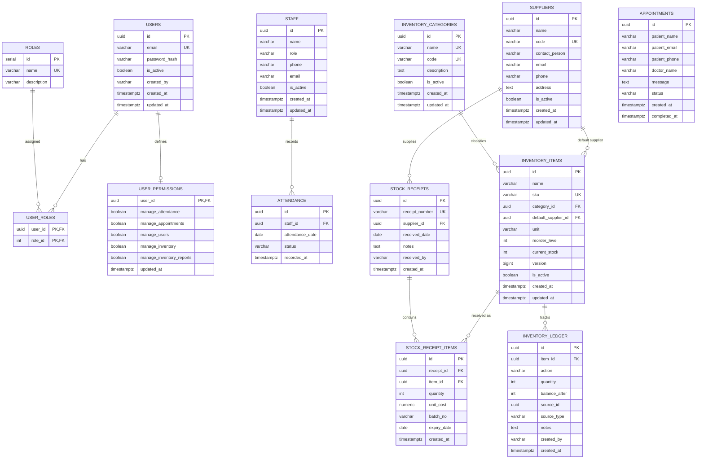

# Database Foundation & Migration Architecture

**Date**: October 28, 2026  
**Status**: Implemented & Verified Against PostgreSQL 18.1  
**Project**: GG Nursing Home Hub (Spring Boot 3 + PostgreSQL Modular Monolith)  
**Milestone**: Task 2 — PostgreSQL & Flyway Database Foundation  

---

## 1. Executive Summary

Task 2 establishes the database persistence and migration foundation for the GG Nursing Home Hub modular monolith. All relational schema definitions are codified as reproducible, immutable Flyway migrations under `backend/src/main/resources/db/migration/`.

### Core Accomplishments
1. **Flyway Migration Engine**: Integrated `flyway-core` into Spring Boot 3.2.5 with `spring.jpa.hibernate.ddl-auto: validate`, ensuring production database migrations are strictly code-first and never reliant on Hibernate auto-generation.
2. **Normalized Relational Schema**: Designed and implemented 13 relational tables covering Identity & Access (RBAC), Staff Employment & Daily Attendance, Patient Appointments, and a multi-item Inventory Management module with stock ledger traceability and optimistic concurrency control (`version`).
3. **Strict Domain Integrity**: Configured UUID primary keys across entities, explicit foreign-key constraints with safe deletion policies (`RESTRICT` on legal/audit records, `CASCADE` on strict owned dependents), database-level `CHECK` constraints on all enum statuses/quantities, and non-redundant B-tree indexes.
4. **JPA Entity & Repository Alignment**: Created/updated 12 JPA entities, 3 enum type converters, and 12 Spring Data JPA repositories with lazy fetching (`FetchType.LAZY`) to prevent N+1 query recursion and serialization loops.
5. **Verified Against PostgreSQL**: Migrations and schema validation were directly verified against an isolated PostgreSQL instance (PostgreSQL 18.1), confirming clean execution of Flyway `V1` and `V2` migrations and full Hibernate metadata validation.
6. **Zero Frontend Regressions**: Verified that 100% of frontend React files (`src/*`), layouts, Tailwind configs, and BaaS configurations remain untouched.

---

## 2. Relational Schema Architecture

### 2.1 Entity-Relationship Diagram



---

## 3. Schema Design & Domain Model Explanations

### 3.1 Identity and Access Model (RBAC)
- **Separation of Concerns**: User authentication accounts (`users`) are strictly separated from staff employment records (`staff`). An employee is not automatically an application user, and application administrators do not require clinical staff profiles.
- **Roles & Permissions**:
  - `roles`: Seeded with 6 system roles matching `AuthContext.tsx`: `owner`, `editor`, `viewer`, `store-manager`, `department-head`, `auditor`.
  - `user_roles`: Standard junction table supporting many-to-many role assignments with `ON DELETE CASCADE` for users and `ON DELETE RESTRICT` for roles (preventing accidental deletion of active system roles).
  - `user_permissions`: 1:1 granular authorization flags (`manage_attendance`, `manage_appointments`, `manage_users`, `manage_inventory`, `manage_inventory_reports`) allowing custom permission overrides by the hospital owner.
- **Account State**: `is_active` defaults to `FALSE` for self-registered users, enforcing administrative approval prior to granting system access. No plain-text or dummy administrator credentials are stored in migrations.

### 3.2 Staff and Attendance
- **Staff Record**: Tracks full name, clinical/administrative role, phone number, and email. Staff members can be deactivated (`is_active = FALSE`) without destroying historical records.
- **Attendance Records**:
  - `attendance_date`: Uses SQL `DATE` (standard ISO `YYYY-MM-DD`).
  - **Daily Uniqueness**: Enforced via `CONSTRAINT uq_attendance_staff_date UNIQUE (staff_id, attendance_date)`. A staff member can have at most one attendance record per calendar date.
  - **Attendance Statuses**: Validated via check constraint:
    `status IN ('present', 'absent', 'leave', 'off', 'half-time', 'over-time')` preserving all 6 statuses actively used in the React frontend.
  - **Safe Deletion Policy**: `staff_id REFERENCES staff(id) ON DELETE RESTRICT`. Historical attendance records cannot be orphaned or deleted by deleting a staff entity.

### 3.3 Patient Appointments
- **Patient Contact Information**: Captures `patient_name`, `patient_email`, `patient_phone`, `doctor_name`, and optional consultation `message`.
- **Status Workflow**: Validated via check constraint:
  `status IN ('booked', 'completed', 'cancelled')`.
- **Audit Timestamps**: `created_at` (timestamptz) and `completed_at` (timestamptz) populated upon triage completion.
- **Non-Interference**: Conflict detection is intentionally omitted as current business rules permit overlapping appointment requests for doctor triage.

### 3.4 Inventory Module & Concurrency Model
- **Master Data**: `inventory_categories` (unique `name` and `code`) and `suppliers` (unique vendor `code`).
- **Normalized Stock Receipts (Header + Line Items)**:
  - Appwrite previously recorded 1 receipt per item. The new relational design normalizes stock receiving into `stock_receipts` (header with unique `receipt_number`, vendor, received date, receiver) and `stock_receipt_items` (line items with `item_id`, `quantity > 0`, `unit_cost >= 0`, `batch_no`, and `expiry_date`).
  - Single-item receiving from the current UI maps to 1 header + 1 line item, while providing native support for multi-item purchase receiving without schema alterations.
- **Stock Traceability Ledger (`inventory_ledger`)**:
  - Immutable audit trail recording every inventory movement.
  - Validated movement actions: `receive`, `issue`, `adjust`, `waste`, `return`.
  - Non-zero quantity constraint: `quantity <> 0`.
  - Non-negative running balance: `balance_after >= 0`.
  - References `source_id` (e.g., receipt item ID) and `source_type` (`stock-receipt`, `stock-issue`, `stock-adjustment`, `manual-adjustment`).
- **Concurrency & Stock Consistency Strategy**:
  - `inventory_items` includes a `version BIGINT NOT NULL DEFAULT 0` column mapped to JPA `@Version`.
  - In Task 4, concurrent inward stock operations will use pessimistic row locking (`SELECT ... FOR UPDATE` on `inventory_items`) combined with Spring `@Transactional` to guarantee serial updates of `current_stock` and prevent lost updates under simultaneous receiving events.

---

## 4. Constraints & Index Rationale

| Table | Constraint / Index | Type | Rationale |
| :--- | :--- | :--- | :--- |
| `roles` | `uq_roles_name` | UNIQUE | Prevents duplicate role naming. |
| `users` | `uq_users_email` | UNIQUE | Enforces unique email credentials per account. |
| `attendance` | `uq_attendance_staff_date` | UNIQUE | Enforces business rule: at most one attendance status per staff member per calendar date. |
| `attendance` | `chk_attendance_status` | CHECK | Restricts status to known valid values: `present`, `absent`, `leave`, `off`, `half-time`, `over-time`. |
| `attendance` | `idx_attendance_date` | INDEX (B-tree) | Accelerates daily attendance grid lookups (`WHERE attendance_date = ?`). |
| `appointments` | `chk_appointment_status` | CHECK | Enforces valid status transitions: `booked`, `completed`, `cancelled`. |
| `appointments` | `idx_appointments_status` | INDEX (B-tree) | Accelerates triage filtering by status. |
| `appointments` | `idx_appointments_created_at` | INDEX (B-tree DESC) | Optimizes default reverse-chronological triage pagination. |
| `inventory_categories` | `uq_inventory_categories_code` | UNIQUE | Unique short codes for categories (e.g., `MED-SUP`). |
| `suppliers` | `uq_suppliers_code` | UNIQUE | Unique vendor reference codes. |
| `inventory_items` | `uq_inventory_items_sku` | UNIQUE | Guarantees SKU uniqueness across the catalog. |
| `inventory_items` | `chk_inventory_items_reorder` | CHECK (`reorder_level >= 0`) | Prevents negative reorder thresholds. |
| `inventory_items` | `chk_inventory_items_stock` | CHECK (`current_stock >= 0`) | Database-level guarantee against negative stock. |
| `inventory_items` | `idx_inventory_items_category` | INDEX (B-tree) | Optimizes category filtering in item master list. |
| `stock_receipts` | `uq_stock_receipts_number` | UNIQUE | Unique voucher/invoice numbers for incoming receipts. |
| `stock_receipts` | `idx_stock_receipts_received_date` | INDEX (B-tree DESC) | Optimizes date-range receiving audit reports. |
| `stock_receipt_items`| `chk_stock_receipt_items_qty` | CHECK (`quantity > 0`) | Disallows zero or negative inward quantities. |
| `stock_receipt_items`| `chk_stock_receipt_items_cost` | CHECK (`unit_cost >= 0.00`)| Disallows negative costs on financial records. |
| `stock_receipt_items`| `idx_stock_receipt_items_item` | INDEX (B-tree) | Speeds up item-level receipt history retrieval. |
| `inventory_ledger` | `chk_inventory_ledger_action` | CHECK | Restricts movements to `receive`, `issue`, `adjust`, `waste`, `return`. |
| `inventory_ledger` | `idx_inventory_ledger_item_created` | INDEX (B-tree DESC) | Optimizes item trace report (`WHERE item_id = ? ORDER BY created_at DESC`). |

*Note on Index Hygiene: Columns already governed by `UNIQUE` constraints (`sku`, `email`, `code`, `(staff_id, attendance_date)`) are automatically indexed by PostgreSQL; duplicate indexes were deliberately excluded to avoid write overhead.*

---

## 5. Migration File Inventory

All migrations reside in `backend/src/main/resources/db/migration/`:

```
backend/src/main/resources/db/migration/
├── V1__create_initial_schema.sql  # Full PostgreSQL 16 DDL with tables, FKs, constraints, and indexes
└── V2__seed_static_roles.sql      # Idempotent seed for the 6 system roles (owner, editor, etc.)
```

### Migration Verification Trace
When executed against PostgreSQL 18.1, Flyway records:
- `V1`: `version 1 - create initial schema` (success: `true`, applied in 1.38s)
- `V2`: `version 2 - seed static roles` (success: `true`, applied in 0.02s)

---

## 6. Entity-to-Table Mapping

| Entity Class | Target Table | Primary Key | Key Relationships & Foreign Keys | Identifier Strategy |
| :--- | :--- | :--- | :--- | :--- |
| `Role` | `roles` | `Integer id` | `@ManyToMany` via `user_roles` | `@GeneratedValue(IDENTITY)` |
| `User` | `users` | `UUID id` | `@ManyToMany` with `Role`; `@OneToOne` with `UserPermission` | `@GeneratedValue(UUID)` |
| `UserPermission` | `user_permissions` | `UUID userId` | `@OneToOne` with `@MapsId` to `User` | Maps ID from `User` |
| `Staff` | `staff` | `UUID id` | Target of `Attendance.staff` | `@GeneratedValue(UUID)` |
| `Attendance` | `attendance` | `UUID id` | `@ManyToOne(LAZY)` -> `Staff` (`staff_id`) | `@GeneratedValue(UUID)` |
| `Appointment` | `appointments` | `UUID id` | None (standalone patient appointment record) | `@GeneratedValue(UUID)` |
| `InventoryCategory` | `inventory_categories` | `UUID id` | Target of `InventoryItem.category` | `@GeneratedValue(UUID)` |
| `Supplier` | `suppliers` | `UUID id` | Target of `InventoryItem.defaultSupplier` & `StockReceipt.supplier` | `@GeneratedValue(UUID)` |
| `InventoryItem` | `inventory_items` | `UUID id` | `@ManyToOne(LAZY)` -> `Category`, `Supplier` | `@GeneratedValue(UUID)` |
| `StockReceipt` | `stock_receipts` | `UUID id` | `@ManyToOne(LAZY)` -> `Supplier`; `@OneToMany` -> `StockReceiptItem` | `@GeneratedValue(UUID)` |
| `StockReceiptItem` | `stock_receipt_items`| `UUID id` | `@ManyToOne(LAZY)` -> `StockReceipt`, `InventoryItem` | `@GeneratedValue(UUID)` |
| `InventoryLedger` | `inventory_ledger` | `UUID id` | `@ManyToOne(LAZY)` -> `InventoryItem` | `@GeneratedValue(UUID)` |

---

## 7. Configuration & Environment Variables

### 7.1 Backend Environment Configuration Matrix

| Variable Name | Default / Fallback | Purpose | Required in Prod |
| :--- | :--- | :--- | :--- |
| `SPRING_PROFILES_ACTIVE` | `postgres` | Active Spring profile (`postgres`, `dev`, `h2`) | Yes |
| `SPRING_DATASOURCE_URL` | `jdbc:postgresql://localhost:5432/ggnh_db` | PostgreSQL JDBC connection URL | Yes |
| `SPRING_DATASOURCE_USERNAME` | `postgres` | Database authentication username | Yes |
| `SPRING_DATASOURCE_PASSWORD` | `postgres` | Database authentication password | Yes |
| `SERVER_PORT` | `8080` | Embedded Tomcat HTTP port | Optional |
| `SERVER_SERVLET_CONTEXT_PATH` | `/api/v1` | Base REST endpoint prefix | Optional |

### 7.2 Docker Compose Local PostgreSQL

A standalone development PostgreSQL 16 container definition is provided in `docker-compose.yml`:
```bash
# Start local PostgreSQL service
docker compose up -d

# Stop local PostgreSQL service
docker compose down
```

---

## 8. Verification Commands & Actual Results

### 1. Spring Boot Test Compilation
- **Command**: `mvn -f backend/pom.xml test-compile`
- **Result**: `BUILD SUCCESS` (34 source files compiled cleanly with Java 17).

### 2. Spring Boot Automated Test Suite
- **Command**: `mvn -f backend/pom.xml test`
- **Result**: `BUILD SUCCESS`
  ```
  [INFO] Running com.ggnh.hub.GgnhApplicationTests
  [INFO] Tests run: 1, Failures: 0, Errors: 0, Skipped: 0
  [INFO] Running com.ggnh.hub.RepositoryIntegrationTest
  [INFO] Tests run: 4, Failures: 0, Errors: 0, Skipped: 0
  [INFO] Results: Tests run: 6, Failures: 0, Errors: 0, Skipped: 1
  ```
  *(1 test intentionally skipped: conditional PostgreSQL integration test which activates only when `VERIFY_POSTGRES=true`).*

### 3. PostgreSQL 18.1 Flyway Migration & Schema Validation Execution
- **Command**:
  ```powershell
  # Initialized isolated cluster, started on port 5434, created ggnh_verify_db
  mvn -f backend/pom.xml test -Dtest=PostgresFlywayIntegrationTest
  ```
- **Actual Runtime Log**:
  ```
  Database: jdbc:postgresql://localhost:5434/ggnh_verify_db (PostgreSQL 18.1)
  Successfully validated 2 migrations (execution time 00:00.157s)
  Creating Schema History table "public"."flyway_schema_history" ...
  Migrating schema "public" to version "1 - create initial schema"
  Migrating schema "public" to version "2 - seed static roles"
  Successfully applied 2 migrations to schema "public", now at version v2 (execution time 00:01.383s)
  Initialized JPA EntityManagerFactory for persistence unit 'default' [ddl-auto: validate]
  Tests run: 1, Failures: 0, Errors: 0, Skipped: 0, Time elapsed: 23.09 s
  BUILD SUCCESS
  ```
- **Outcome**: Both migrations applied without errors, tables and roles seeded, and Hibernate verified that all 12 entities match the PostgreSQL database schema.

### 4. Runnable JAR Packaging
- **Command**: `mvn -f backend/pom.xml package`
- **Result**: `BUILD SUCCESS` — Generated `backend/target/ggnh-backend-0.0.1-SNAPSHOT.jar`.

### 5. Frontend UI Preservation Check
- **Command**: `git status`
- **Result**: Zero modifications to `src/*`, `package.json`, or UI styling.

---

## 9. Compatibility Changes & Minimal Adjustments

To ensure existing controller code compiled while adopting proper domain types:
1. **Identifier Transition (`String` -> `UUID`)**:
   - `StaffController`, `AttendanceController`, and `AppointmentController` were updated to accept `UUID` path and query variables.
2. **Attendance Model Alignment**:
   - `Attendance` changed from a composite string ID (`{date}_{staffId}`) to a clean UUID primary key with a relational `@ManyToOne Staff staff` and `LocalDate attendanceDate`.
   - `AttendanceController.markAttendance` now accepts `MarkAttendanceRequest` (`{date, staffId, status}`), resolves or creates the relational entity, and returns the persisted record.
   - Convenience getters (`getDate()`, `getStaffId()`) were added to `Attendance` to maintain exact response shapes.
3. **Appointment Field Naming**:
   - Entity fields were mapped to explicit database columns (`patient_name`, `patient_email`, `patient_phone`, `doctor_name`), with Jackson alias accessors (`getName()`, `setName()`, etc.) ensuring callers sending `{name, email, phone, doctor, message}` continue to work.

---

## 10. Directives for Task 3 & Downstream Business Modules

1. **Authentication (Task 3)**:
   - Must authenticate against the `users` table and check `is_active == TRUE`.
   - Must issue JWT tokens with role claims derived from `user_roles` and permissions from `user_permissions`.
   - Must bootstrap the initial hospital owner using `APP_SUPER_ADMIN_EMAIL` without committing secrets.
2. **Inventory Stock Mutations (Task 4)**:
   - Must use `SELECT ... FOR UPDATE` (or pessimistic write locks) on `inventory_items` during stock receipt and issue operations to ensure atomic updates of `current_stock` alongside ledger insertions.
   - Must create both a `stock_receipt_items` line record and an `inventory_ledger` row inside a single `@Transactional` boundary.
3. **Frontend API Client Integration (Task 5)**:
   - Must adapt frontend request payloads to match the REST endpoints without modifying page layouts or Radix UI components.

