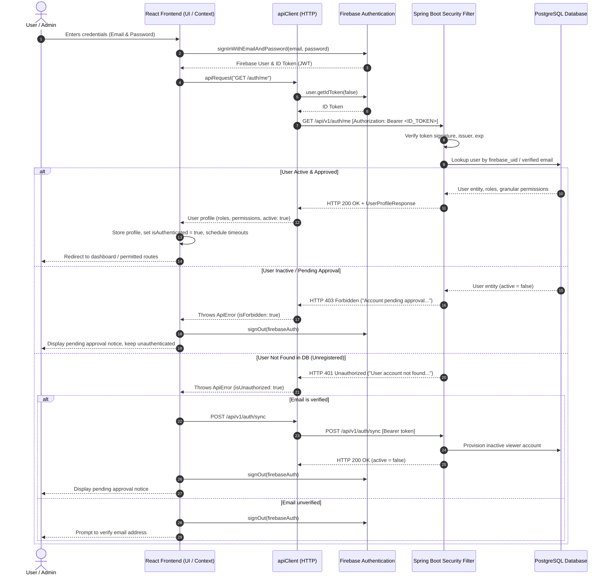

# GG Nursing Home Hub — Frontend Firebase Authentication & Spring Boot API Integration

**Task Reference**: Task 4.1 — React Firebase Authentication and Spring Boot API Integration  
**Date**: November 4, 2026  
**Frontend Stack**: React 18, TypeScript, Vite, Tailwind CSS, shadcn/ui, Vitest  
**Backend Stack**: Spring Boot 3.2.5 (Java 17), Spring Security, PostgreSQL (Supabase / Flyway V1–V3)  
**Identity Provider**: Firebase Authentication (ID Tokens)  
**Authorization Authority**: PostgreSQL (`users`, `roles`, `user_roles`, `user_permissions`)  

---

## 1. Authentication Request Flow

The React frontend integrates with Spring Boot using a hybrid token-bearer architecture. Firebase Authentication serves purely as the identity provider, while the Spring Boot backend and PostgreSQL serve as the sole authorization source of truth.



---

## 2. API Client Architecture (`src/services/apiClient.ts`)

The shared API client provides typed, robust, and secure communication with the Spring Boot REST API.

### Core Capabilities

1. **Configuration**:
   - Reads backend URL from `import.meta.env.VITE_SPRINGBOOT_API_URL` (defaulting to `http://localhost:8080/api/v1`).
   - Normalizes URLs and endpoints, preventing malformed paths and double-slashes.
2. **Automatic Token Attachment**:
   - Automatically retrieves the current Firebase ID token via `firebaseAuth.currentUser?.getIdToken()`.
   - Attaches `Authorization: Bearer <token>` to requests without exposing tokens in application code.
3. **Transparent Token Refresh**:
   - On encountering an HTTP 401 response when a user is signed in, `apiClient` automatically executes a single retry using `firebaseAuth.currentUser?.getIdToken(true)` to refresh expired ID tokens without interrupting user actions.
4. **Content Negotiation & Serialization**:
   - Sets `Accept: application/json` on all requests.
   - Automatically sets `Content-Type: application/json` and serializes JavaScript objects when request bodies are present.
   - Handles empty responses (HTTP 204 No Content or `content-length: 0`) safely without failing JSON parsing.
5. **Categorized Error Handling (`ApiError`)**:
   - Safe JSON error parsing with fallback to plain text.
   - Differentiates error categories through typed flags:
     - `isUnauthorized`: HTTP 401
     - `isForbidden`: HTTP 403
     - `isNotFound`: HTTP 404
     - `isRateLimited`: HTTP 429
     - `isServerError`: HTTP 500–599
6. **Network Failure & Timeout Safeguards**:
   - Employs `AbortController` with a configurable timeout (default: 15,000 ms).
   - Catches timeouts and connection dropouts, converting them into structured `ApiError` instances (`status: 0`, `statusText: "Timeout"` or `"NetworkError"`).
7. **Security & Data Sanitization**:
   - Sensitive tokens, credentials, and payload bodies are never logged to the browser console.

---

## 3. Environment Variables Reference

| Variable Name | Environment | Required | Default / Example | Purpose |
| :--- | :--- | :--- | :--- | :--- |
| `VITE_SPRINGBOOT_API_URL` | Frontend (`.env`) | Required | `http://localhost:8080/api/v1` | Base REST endpoint for the Spring Boot backend |
| `VITE_FIREBASE_API_KEY` | Frontend (`.env`) | Required | `your_firebase_api_key` | Firebase web API key |
| `VITE_FIREBASE_AUTH_DOMAIN` | Frontend (`.env`) | Required | `ggnh-arunesh.firebaseapp.com` | Firebase auth domain |
| `VITE_FIREBASE_PROJECT_ID` | Frontend (`.env`) | Required | `ggnh-arunesh` | Firebase project identifier |
| `VITE_FIREBASE_APP_ID` | Frontend (`.env`) | Required | `1:10629587...` | Firebase web client app identifier |

> [!IMPORTANT]
> Never expose Firebase Admin SDK credentials (`serviceAccountKey.json` or `FIREBASE_CREDENTIALS_JSON`) in Vite environment variables. Only the public Firebase client SDK configuration belongs in the frontend `.env`.

---

## 4. Login, Registration & Approval Flow

### Login (`login(email, password)`)
1. Signs in via Firebase Authentication (`signInWithEmailAndPassword`).
2. Queries `GET /api/v1/auth/me` with the newly acquired Bearer token.
3. If the account is pending (`active: false` or HTTP 403), signs out of Firebase immediately and notifies the user: `"Account pending approval. Please wait for super admin access approval."`
4. If the account is active (`active: true`), resolves permissions and establishes the session.

### Registration (`register(email, password)`)
1. Creates account in Firebase Auth (`createUserWithEmailAndPassword`).
2. Dispatches Firebase email verification (`sendEmailVerification`).
3. If email is verified (e.g. pre-verified mock/test), calls `POST /api/v1/auth/register` to provision the database user.
4. If email is unverified, backend SEC-01 restrictions prevent immediate linking. The account is safely provisioned upon first verified login via `POST /api/v1/auth/sync`.
5. The client signs out of Firebase so unapproved users cannot access protected views, displaying: `"Account created. Wait for super admin approval before login."`

### Pending-Account Behavior
- Unapproved users are **never authenticated** in React.
- Firebase session is terminated (`signOut(firebaseAuth)`), preventing navigation to `/staff` or protected sub-routes.
- Inactivity and session timers are halted.
- The UI presents a clear pending status notification on the login page.

---

## 5. Role and Permission Architecture

### Authority Hierarchy
- Firebase custom claims (`token.claims.role`) and client-side claims are **strictly ignored**.
- Authorization is determined exclusively by the PostgreSQL database via Spring Security:
  - Roles: `owner`, `editor`, `viewer`, `store-manager`, `department-head`, `auditor`.
  - Permissions: `manageAttendance`, `manageAppointments`, `manageUsers`, `manageInventory`, `manageInventoryReports`.

### Frontend Mapping (`src/services/userService.ts`)
The user service maps Spring Boot `UserProfileResponse` DTOs to the frontend `UserAccessRecord` structure:
- `owner` role retains full access across all modules.
- Non-owner users receive permissions based on their active role or explicitly granted granular database overrides.

---

## 6. User Access Management (`src/pages/AdminUserAccess.tsx`)

The `AdminUserAccess` page connects directly to the Spring Boot REST endpoints:

- **List Users**: `GET /api/v1/users` (requires `ROLE_owner` or `PERM_MANAGE_USERS`).
- **Account Approval / Status Toggle**: `PATCH /api/v1/users/{id}/status` with `{ "active": boolean }`.
  - Backend enforces:
    - Administrators cannot deactivate themselves (`400 Bad Request`).
    - Delegated managers cannot deactivate an owner account (`403 Forbidden`).
    - The last active owner cannot be deactivated (`400 Bad Request`).
- **Role & Permission Management**: `PUT /api/v1/users/{id}/access` with `{ "role": string, "permissions": UserPermissionsDto }`.
  - Backend enforces:
    - Administrators cannot modify their own access/permissions (`403 Forbidden`).
    - Only an owner can modify an owner's access or grant the `owner` role (`403 Forbidden`).

---

## 7. Protected Route Enforcement (`src/components/ProtectedRoute.tsx`)

Protected routes guard views client-side using `useAuth()` permissions:
- `requiredAccess = "authenticated"`: Requires `isAuthenticated && isAccessActive`.
- `requiredAccess = "manage-attendance"`: Requires `canManageAttendance`.
- `requiredAccess = "manage-appointments"`: Requires `canManageAppointments`.
- `requiredAccess = "manage-users"`: Requires `canManageUsers`.
- `requiredAccess = "manage-inventory"`: Requires `canManageInventory`.
- `requiredAccess = "view-inventory-reports"`: Requires `canViewInventoryReports`.

If a user lacks the authority for a route, they are automatically redirected to `/staff` (or `/admin/login` if unauthenticated). Downstream, the Spring Boot REST API remains the final authorization authority.

---

## 8. Local Development & Verification Instructions

### 1. Configure Environment
Ensure `.env` in the root folder contains:
```env
VITE_SPRINGBOOT_API_URL=http://localhost:8080/api/v1
VITE_FIREBASE_API_KEY=your_firebase_api_key_here
VITE_FIREBASE_AUTH_DOMAIN=ggnh-arunesh.firebaseapp.com
VITE_FIREBASE_PROJECT_ID=ggnh-arunesh
VITE_FIREBASE_APP_ID=1:1062958739905:web:0d1e6efe5d83db12f67f40
```

### 2. Run Automated Test Suites
```bash
# Frontend test suite (22 unit & integration tests)
npm run test

# Frontend linting
npm run lint

# Frontend production build
npm run build

# Backend integration & security regression suite (44 tests)
cd backend
mvn test
```

---

## 9. Endpoint Contract Notes & Remaining Integration Boundaries

1. **User Creation via Admin Panel**:
   - In Spring Boot, user records are created strictly through verified Firebase self-registration (`POST /api/v1/auth/register` or `POST /api/v1/auth/sync`).
   - The admin panel informs administrators that users must self-register first, after which administrators approve and assign permissions.
2. **Account Deletion**:
   - The Spring Boot backend does not implement `DELETE /api/v1/users/{id}` for physical account purging. Instead, accounts are revoked via deactivation (`PATCH /api/v1/users/{id}/status` with `{ "active": false }`).
3. **Features Still Using Appwrite (Scheduled for Later Phases)**:
   - Staff directory service (`src/services/appointmentService.ts`, Appwrite collection `staff`).
   - Attendance management service (`src/services/attendanceService.ts`, Appwrite collection `attendance`).
   - Appointment booking service (`src/services/appointmentService.ts`, Appwrite collection `appointment`).
   - Inventory modules (`src/services/inventoryService.ts`, Appwrite collections `inventory_*`).
   - In accordance with the Task 4.1 strict boundaries, all Appwrite service implementations have been left completely intact without premature migration.

