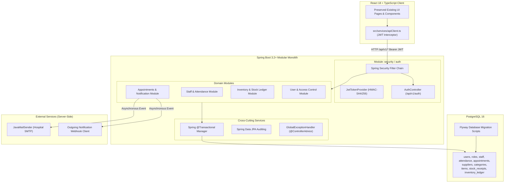
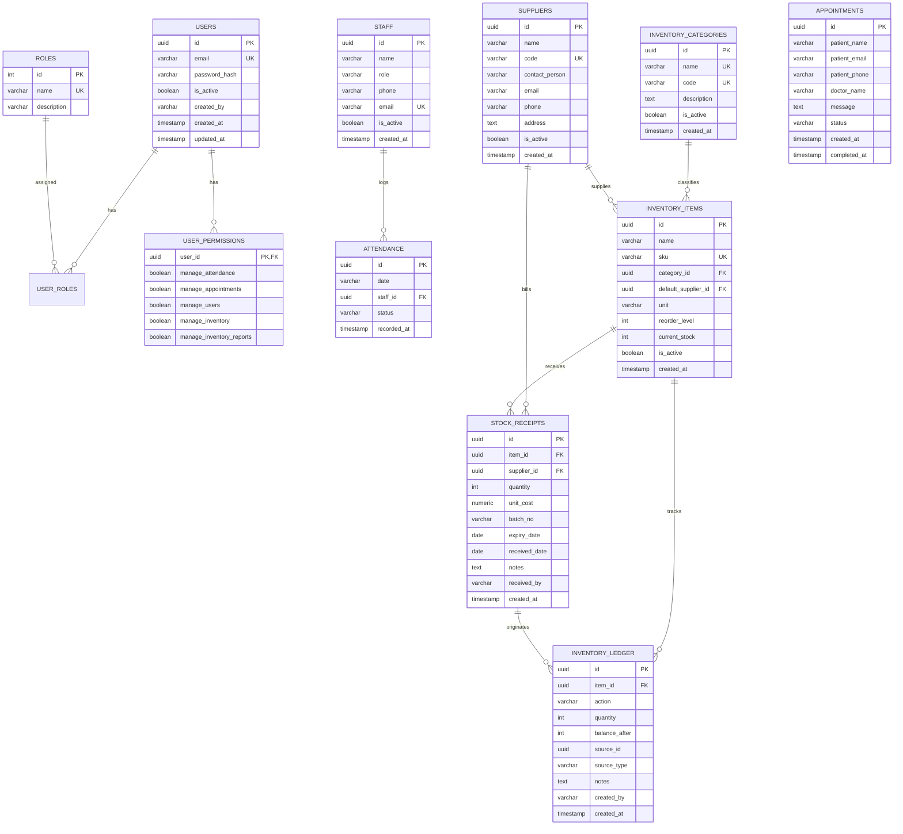
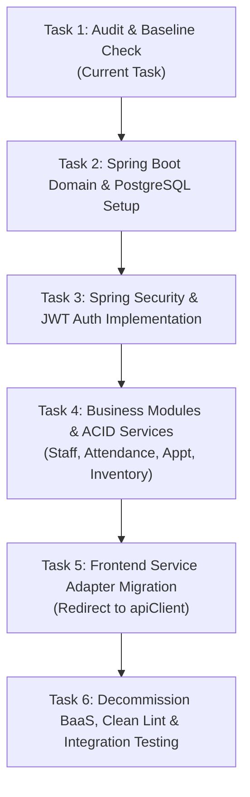

# GG Nursing Home Hub — Comprehensive Codebase & Refactoring Audit

**Date of Audit**: October 28, 2026  
**Auditor**: Senior Full-Stack Software Engineer  
**Git Branch**: `feature/springboot-backend`  
**Target Milestone**: Production-Grade React + TypeScript + Spring Boot 3 + PostgreSQL Monolith  
**Core Directive**: Preserve 100% of existing user-facing UI layouts, styling, Tailwind CSS design system, and workflows.

---

## 1. Executive Summary

A comprehensive architectural and static audit of the **GG Nursing Home Hub** repository reveals a critical divergence between the application's perceived/documented architecture and its actual runtime data paths:

1. **Orphaned Spring Boot Scaffold**: A Spring Boot 3 backend application exists in `/backend` (with entities and controllers for `Staff`, `Attendance`, and `Appointment`), along with a frontend HTTP utility (`src/services/apiClient.ts`). However, **neither the Spring Boot API nor `apiClient.ts` is connected to any frontend component or service**. 100% of the active frontend data flows continue to communicate directly with external cloud backend-as-a-service (BaaS) providers: **Appwrite Cloud** and **Firebase**.
2. **Client-Centric BaaS Vulnerabilities**: Critical business processes—including user authentication, role assignment, attendance records, appointment scheduling, and multi-step stock inventory mutations—execute directly from the browser against Appwrite and Firebase. Collection rules in `appwrite.config.json` expose wildcard permissions (`read("any")`, `create("any")`, `update("any")`, `delete("any")`) with row security disabled (`rowSecurity: false`), presenting extreme security risks.
3. **Broken Concurrency & Transaction Boundaries**: The inventory receiving operation (`inventoryService.receiveStock`) executes five distinct, non-transactional HTTP requests across three different Appwrite collections directly from client code. Any network drop or concurrent mutation leaves items, stock receipts, and ledger balances permanently out of sync.
4. **Build & Lint Failures**: The frontend TypeScript/React application compiles successfully with Vite (`npm run build`), but fails linting (`npm run lint`, 3 errors, 10 warnings). The Spring Boot backend compiles and packages clean into a runnable JAR (`mvn clean package`), but contains zero automated unit or integration tests.
5. **Refactoring Feasibility**: Because the frontend cleanly encapsulates data access in service modules (`attendanceService.ts`, `appointmentService.ts`, `inventoryService.ts`, `accessControlService.ts`) and React Contexts (`AuthContext.tsx`, `AttendanceContext.tsx`), the backend migration to Spring Boot + PostgreSQL can be achieved with **zero visual regressions or UI layout changes** by redirecting these service functions to a shared REST API client.

---

## 2. Current Architecture & Actual Request Paths

### 2.1 Current System Topology vs Documented Perception

```mermaid
graph TB
    subgraph Browser ["Client SPA (React 18 + Vite)"]
        UI_Pub["Public Portal (Index, About, Doctors, Services, Contact)"]
        UI_Staff["Staff Portal (Home, Attendance, Appointments, Inventory, Access)"]
        Ctx_Auth["AuthContext (Firebase Auth SDK)"]
        Ctx_Att["AttendanceContext (Appwrite Client SDK)"]
        Svc_Inv["inventoryService.ts (Appwrite Client SDK)"]
        Svc_Appt["appointmentService.ts (Appwrite Client SDK)"]
        Svc_API["apiClient.ts (UNREFERENCED / UNUSED)"]
    end

    subgraph FirebaseCloud ["Firebase (External BaaS)"]
        FB_Auth["Firebase Authentication (Identity / JWT)"]
        FB_Fn["Cloud Function: deleteUserAccessAccount"]
    end

    subgraph AppwriteCloud ["Appwrite Cloud DB (NoSQL)"]
        AW_Staff["Collection: staff"]
        AW_Att["Collection: attendance"]
        AW_Appt["Collection: appointment"]
        AW_Access["Collection: user_access"]
        AW_Inv["Collections: categories, items, suppliers, receipts, ledger"]
    end

    subgraph ExternalWebhooks ["Third-Party Notification APIs"]
        FS["FormSubmit.co Email Endpoint"]
        WH_SMS["VITE_SMS_WEBHOOK_URL"]
        WH_WA["VITE_WHATSAPP_WEBHOOK_URL"]
    end

    subgraph LocalBackend ["Spring Boot 3 (Port 8080) - CURRENTLY UNUSED"]
        SB_Ctrl["StaffController / AttendanceController / AppointmentController"]
        SB_H2["H2 In-Memory DB (or local PostgreSQL via profile)"]
    end

    %% Actual Data Paths
    UI_Pub -->|Direct Fetch POST| FS
    UI_Pub -->|Direct Fetch POST| WH_SMS
    UI_Pub -->|Direct Fetch POST| WH_WA
    UI_Pub -->|appointmentService| AW_Appt

    Ctx_Auth -->|signIn / register / session| FB_Auth
    Ctx_Auth -->|accessControlService| AW_Access
    UI_Staff -->|Callable Function| FB_Fn

    Ctx_Att -->|attendanceService| AW_Staff
    Ctx_Att -->|attendanceService| AW_Att
    UI_Staff -->|inventoryService| AW_Inv

    %% Disconnected Link
    Svc_API -.->|Configured BaseURL, Never Imported| SB_Ctrl
    SB_Ctrl --- SB_H2

    classDef unused stroke:#e11d48,stroke-width:2px,stroke-dasharray: 5 5;
    class Svc_API,LocalBackend,SB_Ctrl,SB_H2 unused;
```



### 2.2 Actual Runtime Request Paths

| Workflow | Initiator | Transport | Target Service | Verified Code Path |
| :--- | :--- | :--- | :--- | :--- |
| **Book Appointment** | `Contact.tsx` | HTTPS POST | `https://formsubmit.co/ajax/ggnhpvtltd@gmail.com` | `Contact.tsx` L64-71 |
| **SMS/WhatsApp Alert** | `Contact.tsx` | HTTPS POST | Webhook URLs (`VITE_SMS_WEBHOOK_URL`, `VITE_WHATSAPP_WEBHOOK_URL`) | `Contact.tsx` L94-112 |
| **Persist Appointment**| `Contact.tsx` | Appwrite SDK | Appwrite `appointmentCollectionId` | `appointmentService.ts` L74-92 |
| **Mark Appt Complete** | `StaffAppointments.tsx` | Appwrite SDK | Appwrite `appointmentCollectionId` | `appointmentService.ts` L94-108 |
| **Staff Auth (Login)** | `AdminLogin.tsx` | Firebase Auth | Firebase Authentication endpoint | `AuthContext.tsx` L555-578 |
| **Staff Auth (Register)**| `AdminRegister.tsx` | Firebase Auth + Appwrite | Firebase Auth + Appwrite `user_access` | `AuthContext.tsx` L580-605 |
| **Delete User Account** | `AdminUserAccess.tsx` | Firebase Callable | `deleteUserAccessAccount` Firebase Function | `accessControlService.ts` L293-315 |
| **Staff Attendance CRUD**| `AdminAttendance.tsx` | Appwrite SDK | Appwrite `staff` & `attendance` collections | `attendanceService.ts` L50-198 |
| **Inventory Categories** | `ItemCategories.tsx` | Appwrite SDK | Appwrite `inventoryCategoryCollectionId` | `inventoryService.ts` L171-240 |
| **Item Master CRUD** | `ItemMaster.tsx` | Appwrite SDK | Appwrite `inventoryItemCollectionId` | `inventoryService.ts` L327-419 |
| **Supplier Master CRUD**| `Suppliers.tsx` | Appwrite SDK | Appwrite `inventorySupplierCollectionId` | `inventoryService.ts` L241-325 |
| **Stock Receiving** | `StockReceiving.tsx` | Appwrite SDK (5 sequential calls) | Appwrite `items`, `receipts`, `ledger` | `inventoryService.ts` L435-512 |
| **Inventory Reports** | `InventoryReports.tsx` | Client Aggregation | Queries all items, categories, receipts, ledger | `inventoryService.ts` L514-600 |
| **Spring Boot APIs** | *None* | HTTP REST | `http://localhost:8080/api/v1/*` | **Zero callers in frontend** |

---

## 3. Important Source File Inventory & Responsibilities

### 3.1 Frontend Source Tree (`/src`)

```
src/
├── App.tsx                     # Top-level client routing, QueryClientProvider, AuthProvider, AttendanceProvider
├── index.css                   # Global Tailwind CSS tokens, theme variables (HSL colors), fonts
├── main.tsx                    # React DOM root bootstrapping
├── components/
│   ├── FloatingActionBar.tsx   # Mobile quick-action bar (Call, WhatsApp, Appointment anchor)
│   ├── Footer.tsx              # Public footer with hospital contact details and hours
│   ├── Navbar.tsx              # Public responsive header navigation
│   ├── StaffNavbar.tsx         # Staff authenticated top navigation with RBAC-filtered links
│   ├── ProtectedRoute.tsx      # Route guard inspecting AuthContext.permissions
│   ├── ScrollReveal.tsx        # Intersection-observer animation wrapper
│   ├── SectionHeading.tsx      # Consistent section titles and subheadings
│   ├── layout/
│   │   ├── PublicLayout.tsx    # Outlet wrapper: Navbar + Page + Footer + FloatingActionBar
│   │   └── StaffLayout.tsx     # Outlet wrapper: StaffNavbar + Page
│   └── ui/                     # 38 Radix UI / Shadcn UI primitive components
├── context/
│   ├── AuthContext.tsx         # Firebase auth state, session timers (30 min idle, 24 hr max), RBAC
│   └── AttendanceContext.tsx   # Staff & attendance state, optimistic caching, local fallbacks
├── lib/
│   ├── appwrite.ts             # Appwrite Client & Databases singleton initialization
│   ├── firebase.ts             # Firebase App, Auth, and Functions singleton initialization
│   └── utils.ts                # Tailwind clsx + twMerge utility function (`cn`)
├── pages/
│   ├── Index.tsx               # Homepage hero, statistics, departments overview, testimonials
│   ├── About.tsx               # Hospital background, leadership, mission, facility showcase
│   ├── Services.tsx            # Inpatient, ICU, surgical, pharmacy, diagnostic service cards
│   ├── Doctors.tsx             # Doctor profiles, specialties, schedules, booking triggers
│   ├── Contact.tsx             # Patient appointment request form, email/SMS/WhatsApp triggers
│   ├── Gallery.tsx             # Categorized photo gallery of facilities and equipment
│   ├── AdminLogin.tsx          # Staff/admin sign-in interface
│   ├── AdminRegister.tsx       # Staff self-registration interface (creates pending account)
│   ├── AdminAttendance.tsx     # Daily attendance sheet, status toggling, staff CRUD, PDF export
│   ├── AdminAttendanceReport.tsx # Date-range timeline attendance grid report
│   ├── StaffHome.tsx           # Staff landing dashboard with role-based navigation cards
│   ├── StaffAppointments.tsx   # Appointment triage list, completion toggles, CSV export
│   ├── AdminUserAccess.tsx     # User management, role elevation, permission checkboxes, account deletion
│   ├── NotFound.tsx            # 404 fallback page
│   └── inventory/
│       ├── InventoryHome.tsx   # Inventory portal launcher with quick module cards
│       ├── ItemCategories.tsx  # CRUD for stock categories (name, code, description)
│       ├── ItemMaster.tsx      # CRUD for inventory SKUs, reorder thresholds, supplier linking
│       ├── Suppliers.tsx       # CRUD for approved vendors, contacts, addresses
│       ├── StockReceiving.tsx  # Inward stock receipt entry (batch, expiry, quantity, unit cost)
│       └── InventoryReports.tsx# Stock availability report (low-stock alerts) & item trace ledger audit
├── services/
│   ├── accessControlService.ts # Appwrite user_access document queries & Firebase delete function call
│   ├── apiClient.ts            # Generic fetch wrapper for Spring Boot API (currently unused)
│   ├── appointmentService.ts   # Appwrite document operations for appointment booking/completion
│   ├── attendanceService.ts    # Appwrite document operations for staff & attendance records
│   └── inventoryService.ts     # Appwrite document operations for 5 inventory collections
└── types/
    └── inventory.ts            # TypeScript definitions for Category, Item, Supplier, Receipt, Ledger
```

### 3.2 Spring Boot Backend Source Tree (`/backend`)

```
backend/
├── pom.xml                     # Maven project definition: Spring Boot 3.2.5, JPA, Validation, H2, Postgres, Lombok
└── src/main/
    ├── java/com/ggnh/hub/
    │   ├── GgnhApplication.java# Spring Boot entry point + global WebMvcConfigurer CORS configuration
    │   ├── entity/
    │   │   ├── Appointment.java# JPA entity for appointments (UUID ID, name, email, phone, doctor, status)
    │   │   ├── Attendance.java # JPA entity for attendance (synthetic ID '{date}_{staffId}', status)
    │   │   └── Staff.java      # JPA entity for staff members (UUID ID, name, role, phone, email)
    │   ├── repository/
    │   │   ├── AppointmentRepository.java # JpaRepository with status and pagination queries
    │   │   ├── AttendanceRepository.java  # JpaRepository with date queries and delete helpers
    │   │   └── StaffRepository.java       # JpaRepository standard CRUD
    │   └── controller/
    │       ├── AppointmentController.java # REST: GET /appointments, POST /appointments, PATCH /{id}/complete
    │       ├── AttendanceController.java  # REST: GET /attendance, POST /attendance/mark, DELETE /attendance
    │       └── StaffController.java       # REST: GET /staff, GET /{id}, POST, PUT /{id}, DELETE /{id}
    └── resources/
        └── application.yml     # Configuration: H2 default in-memory; postgres profile for localhost:5432
```

### 3.3 Serverless Functions Source Tree (`/functions`)

```
functions/
├── package.json                # Dependencies: firebase-admin, firebase-functions, node-appwrite
├── tsconfig.json               # TypeScript compiler config
└── src/
    ├── index.ts                # Function exports root
    └── deleteUserAccessAccount.ts # 2nd-gen HTTPS callable function coordinating account deletion across Firebase Auth, Firestore, and Appwrite
```

---

## 4. Feature Completeness & Operational Status

| Feature Module | Code Implementation Status | Runtime Verification Status | Known Limitations & Gaps |
| :--- | :--- | :--- | :--- |
| **Public Site Pages** | Complete (React + Lucide + Tailwind) | Verified via static build | Fully functional static views. |
| **Appointment Booking** | Complete in frontend (`Contact.tsx`) | Requires external FormSubmit & Webhook configuration | Triggers third-party email service from client; no backend validation; Spring Boot `POST /appointments` is unused. |
| **Staff Appointments List** | Complete (`StaffAppointments.tsx`) | Appwrite-dependent; working with cloud DB | Fetches up to 5,000 documents via Appwrite SDK; client-side status filtering. |
| **Staff Authentication** | Complete (`AuthContext.tsx`) | Firebase-dependent; working with cloud config | Relies on Firebase Auth; pending approval gate works in code; session inactivity timer active. |
| **Staff Attendance Grid** | Complete (`AdminAttendance.tsx`) | Appwrite-dependent; has in-memory mock fallback | Allows marking `present`, `absent`, `leave`, `off`, `half-time`, `over-time`; prevents future dates; exports PDF. |
| **Attendance Report** | Complete (`AdminAttendanceReport.tsx`)| Appwrite-dependent | Date range timeline calculation executed client-side. |
| **User Access Control** | Complete (`AdminUserAccess.tsx`) | Appwrite + Firebase Function dependent | 6 roles supported; granular permission flags; account deletion calls cloud function. |
| **Inventory Categories**| Complete (`ItemCategories.tsx`) | Appwrite-dependent | CRUD operations active; code auto-capitalized. |
| **Item Master** | Complete (`ItemMaster.tsx`) | Appwrite-dependent | Reorder level and supplier association active. |
| **Supplier Directory** | Complete (`Suppliers.tsx`) | Appwrite-dependent | Contact person, phone, email, address captured. |
| **Stock Receiving** | Complete (`StockReceiving.tsx`) | Appwrite-dependent | 5 sequential client calls; no transaction boundary. |
| **Inventory Reports** | Complete (`InventoryReports.tsx`)| Appwrite-dependent | Availability & item trace ledger audit; CSV download. |
| **Spring Boot Backend** | Partially Implemented (Scaffold) | Verified compiling via Maven | Only `Staff`, `Attendance`, and `Appointment` implemented. **Missing:** Security, Users, Roles, Inventory, Notifications, Tests. |

---

## 5. Security Risks, Data Consistency & Codebase Flaws

### 5.1 Critical Security Vulnerabilities

1. **Permissive Appwrite Collection Permissions**:
   In `appwrite.config.json` and client services, permissions are configured as:
   ```json
   "$permissions": [
       "create(\"any\")",
       "read(\"any\")",
       "update(\"any\")",
       "delete(\"any\")"
   ],
   "rowSecurity": false
   ```
   *Impact*: Any user with browser DevTools can obtain the project ID and database ID from Vite environment variables and directly read, overwrite, or delete all staff, attendance, and patient appointment records via the Appwrite REST API without authentication.

2. **Client-Side Notification & Webhook Exposure**:
   In `src/pages/Contact.tsx`, external endpoints (`https://formsubmit.co/ajax/ggnhpvtltd@gmail.com`, `VITE_SMS_WEBHOOK_URL`, `VITE_WHATSAPP_WEBHOOK_URL`) are called directly from browser JavaScript.
   *Impact*: Patient names, phone numbers, and consultation notes are dispatched across unmonitored third parties from the browser. Webhook URLs can be inspected and spammed.

3. **Open Spring Boot CORS Policy with Credentials**:
   In `backend/src/main/java/com/ggnh/hub/GgnhApplication.java`:
   ```java
   registry.addMapping("/**")
           .allowedOriginPatterns("*")
           .allowCredentials(true);
   ```
   *Impact*: Pairing wildcard origins (`*`) with credentials allowed (`allowCredentials(true)`) creates a Cross-Origin Resource Sharing (CORS) security hazard and violates standard browser security specifications.

4. **Zero Spring Boot Authentication / Authorization**:
   The existing Spring Boot endpoints (`/staff`, `/attendance`, `/appointments`) have **no Spring Security configuration, no JWT filters, and no permission checks**. Any HTTP client reaching port 8080 can perform arbitrary mutations.

5. **Client-Side Privilege Enforcement**:
   Privileges such as `canEditAttendance` and `canManageUsers` are verified only in React components (`ProtectedRoute.tsx`, `AdminAttendance.tsx`). While `AuthContext` resolves roles, all actual database mutations are executed using client SDK instances.

### 5.2 Data-Consistency & Transactional Flaws

1. **Lack of ACID Transaction in Stock Receiving**:
   In `src/services/inventoryService.ts` (`receiveStock`), the system:
   - Fetches the item document
   - Fetches the supplier document
   - Creates a stock receipt document
   - Updates item `currentStock`
   - Creates an inventory ledger entry
   
   If network failure occurs between steps 3 and 5, stock quantity becomes permanently corrupt with no automated reconciliation.

2. **Foreign Key Integrity Missing in Spring JPA Entities**:
   - `Attendance.java` stores `staffId` as a bare `String`, rather than a `@ManyToOne` relation to `Staff`.
   - In `StaffController.java`, staff deletion manually invokes `attendanceRepository.deleteByStaffId(id)` before deleting the staff record. If an error occurs between these calls, orphaned records remain.
   
3. **Dual Source of Truth for Users**:
   Users reside in Firebase Authentication (for credentials) and Appwrite `user_access` (for roles and permissions). During registration, an account created in Firebase can fail Appwrite document creation, leaving an orphaned Firebase user.

### 5.3 Duplicate Implementations & Inconsistencies

- **Date Formatting Logic**: Date formatting functions (`formatLocalDate`, `getTodayDate`, `isValidDateInput`) are copy-pasted across `AttendanceContext.tsx`, `AdminAttendance.tsx`, `AdminAttendanceReport.tsx`, `StockReceiving.tsx`, and `inventoryService.ts` instead of using a shared utility module or `date-fns`.
- **Role String Normalization**: Role alias mapping (converting `"store_manager"` to `"store-manager"`, `"admin"` to `"owner"`) is duplicated across `AuthContext.tsx` and `accessControlService.ts`.

### 5.4 Unused & Dead Code

- `src/services/apiClient.ts`: Defines `apiRequest<T>`, but is never imported by any other file in the repository.
- `VITE_APPWRITE_INVENTORY_DEPARTMENT_COLLECTION_ID`: Declared in `appwrite.ts` but never utilized anywhere in the business logic.
- `playwright.config.ts` and `playwright-fixture.ts`: Configured in the repository root, but no actual E2E test files exist in the project.

### 5.5 Build, Lint & Static Analysis Problems

1. **ESLint Violations**: Executing `npm run lint` generates **3 errors** and **10 warnings**:
   - `src/components/ui/command.tsx`: `@typescript-eslint/no-empty-object-type` on empty interface.
   - `src/components/ui/textarea.tsx`: `@typescript-eslint/no-empty-object-type` on empty interface.
   - `tailwind.config.ts`: `@typescript-eslint/no-require-imports` on `require("tailwindcss-animate")`.
   - `src/context/AttendanceContext.tsx`: React Hook `useMemo` has missing dependency `getAttendance`.
2. **Missing Backend Automated Tests**: `backend/src/test` contains no test classes or slice tests.
3. **Frontend Chunk Size**: Production build outputs a monolithic chunk (`dist/assets/index-*.js`) of **1,203 kB**, exceeding recommended thresholds and requiring code-splitting.

---

## 6. Proposed Target Architecture: Spring Boot Modular Monolith

### 6.1 Architectural Overview

Rather than introducing microservices, Redis, Kafka, or Kubernetes—which add significant DevOps complexity without justification for this scale—the application will be refactored into a **Spring Boot 3 Modular Monolith backed by PostgreSQL 16**.



### 6.2 Module Breakdown & Boundaries

| Module | Entities | Controllers | Core Responsibilities & Business Rules |
| :--- | :--- | :--- | :--- |
| **`auth`** | `User`, `Role`, `RefreshToken` | `AuthController` | Registration (pending state), login, JWT issuance, token refresh, password hashing with BCrypt, super-admin bootstrapping. |
| **`staff`** | `Staff` | `StaffController` | Staff member management; unique email/phone checks; active status tracking. |
| **`attendance`** | `Attendance` | `AttendanceController` | Record daily status (`present`, `absent`, `leave`, etc.); reject future dates; unique constraint on `(date, staff_id)`; date-range timeline queries. |
| **`appointment`** | `Appointment` | `AppointmentController` | Patient booking; status triage (`booked`, `completed`); server-side email/SMS webhook dispatch via Spring `@Async` listeners. |
| **`inventory`** | `Category`, `Supplier`, `Item`, `StockReceipt`, `StockLedger` | `CategoryController`, `SupplierController`, `ItemController`, `StockController`, `InventoryReportController` | Stock receiving with `@Transactional` ACID guarantee (receipt creation, current stock increment, ledger append); low-stock threshold triggers; item traceability ledger. |
| **`access`** | `UserPermission` | `UserAccessController` | User approval by owner; granular permission toggles; cascading user deletion. |

---

## 7. Relational Database Model (PostgreSQL)

### 7.1 Entity-Relationship Diagram



### 7.2 Database Schema DDL Specification

```sql
-- PostgreSQL 16 DDL for GG Nursing Home Hub

CREATE EXTENSION IF NOT EXISTS "uuid-ossp";

-- 1. Security & Authentication
CREATE TABLE roles (
    id SERIAL PRIMARY KEY,
    name VARCHAR(50) UNIQUE NOT NULL, -- 'owner', 'editor', 'viewer', 'store-manager', 'department-head', 'auditor'
    description VARCHAR(255)
);

CREATE TABLE users (
    id UUID PRIMARY KEY DEFAULT uuid_generate_v4(),
    email VARCHAR(255) UNIQUE NOT NULL,
    password_hash VARCHAR(255) NOT NULL,
    is_active BOOLEAN NOT NULL DEFAULT FALSE,
    updated_by VARCHAR(255),
    created_at TIMESTAMP WITH TIME ZONE DEFAULT CURRENT_TIMESTAMP NOT NULL,
    updated_at TIMESTAMP WITH TIME ZONE DEFAULT CURRENT_TIMESTAMP NOT NULL
);

CREATE TABLE user_roles (
    user_id UUID NOT NULL REFERENCES users(id) ON DELETE CASCADE,
    role_id INT NOT NULL REFERENCES roles(id) ON DELETE RESTRICT,
    PRIMARY KEY (user_id, role_id)
);

CREATE TABLE user_permissions (
    user_id UUID PRIMARY KEY REFERENCES users(id) ON DELETE CASCADE,
    manage_attendance BOOLEAN NOT NULL DEFAULT FALSE,
    manage_appointments BOOLEAN NOT NULL DEFAULT FALSE,
    manage_users BOOLEAN NOT NULL DEFAULT FALSE,
    manage_inventory BOOLEAN NOT NULL DEFAULT FALSE,
    manage_inventory_reports BOOLEAN NOT NULL DEFAULT FALSE
);

-- 2. Staff & Attendance
CREATE TABLE staff (
    id UUID PRIMARY KEY DEFAULT uuid_generate_v4(),
    name VARCHAR(200) NOT NULL,
    role VARCHAR(100) NOT NULL,
    phone VARCHAR(30),
    email VARCHAR(255),
    is_active BOOLEAN NOT NULL DEFAULT TRUE,
    created_at TIMESTAMP WITH TIME ZONE DEFAULT CURRENT_TIMESTAMP NOT NULL
);

CREATE TABLE attendance (
    id UUID PRIMARY KEY DEFAULT uuid_generate_v4(),
    date VARCHAR(10) NOT NULL, -- YYYY-MM-DD
    staff_id UUID NOT NULL REFERENCES staff(id) ON DELETE CASCADE,
    status VARCHAR(30) NOT NULL, -- 'present', 'absent', 'leave', 'off', 'half-time', 'over-time'
    recorded_at TIMESTAMP WITH TIME ZONE DEFAULT CURRENT_TIMESTAMP NOT NULL,
    CONSTRAINT uq_attendance_date_staff UNIQUE (date, staff_id)
);

CREATE INDEX idx_attendance_date ON attendance(date);
CREATE INDEX idx_attendance_staff_date ON attendance(staff_id, date);

-- 3. Patient Appointments
CREATE TABLE appointments (
    id UUID PRIMARY KEY DEFAULT uuid_generate_v4(),
    patient_name VARCHAR(200) NOT NULL,
    patient_email VARCHAR(255),
    patient_phone VARCHAR(50) NOT NULL,
    doctor_name VARCHAR(150) NOT NULL,
    message TEXT,
    status VARCHAR(30) NOT NULL DEFAULT 'booked', -- 'booked', 'completed'
    created_at TIMESTAMP WITH TIME ZONE DEFAULT CURRENT_TIMESTAMP NOT NULL,
    completed_at TIMESTAMP WITH TIME ZONE
);

CREATE INDEX idx_appointments_status ON appointments(status);
CREATE INDEX idx_appointments_created_at ON appointments(created_at DESC);

-- 4. Inventory Module
CREATE TABLE inventory_categories (
    id UUID PRIMARY KEY DEFAULT uuid_generate_v4(),
    name VARCHAR(120) UNIQUE NOT NULL,
    code VARCHAR(24) UNIQUE NOT NULL,
    description TEXT,
    is_active BOOLEAN NOT NULL DEFAULT TRUE,
    created_at TIMESTAMP WITH TIME ZONE DEFAULT CURRENT_TIMESTAMP NOT NULL,
    updated_at TIMESTAMP WITH TIME ZONE DEFAULT CURRENT_TIMESTAMP NOT NULL
);

CREATE TABLE suppliers (
    id UUID PRIMARY KEY DEFAULT uuid_generate_v4(),
    name VARCHAR(200) NOT NULL,
    code VARCHAR(30) UNIQUE NOT NULL,
    contact_person VARCHAR(150),
    email VARCHAR(255),
    phone VARCHAR(50),
    address TEXT,
    is_active BOOLEAN NOT NULL DEFAULT TRUE,
    created_at TIMESTAMP WITH TIME ZONE DEFAULT CURRENT_TIMESTAMP NOT NULL,
    updated_at TIMESTAMP WITH TIME ZONE DEFAULT CURRENT_TIMESTAMP NOT NULL
);

CREATE TABLE inventory_items (
    id UUID PRIMARY KEY DEFAULT uuid_generate_v4(),
    name VARCHAR(200) NOT NULL,
    sku VARCHAR(50) UNIQUE NOT NULL,
    category_id UUID NOT NULL REFERENCES inventory_categories(id) ON DELETE RESTRICT,
    supplier_id UUID REFERENCES suppliers(id) ON DELETE SET NULL,
    unit VARCHAR(30) NOT NULL,
    reorder_level INT NOT NULL DEFAULT 0,
    current_stock INT NOT NULL DEFAULT 0,
    is_active BOOLEAN NOT NULL DEFAULT TRUE,
    created_at TIMESTAMP WITH TIME ZONE DEFAULT CURRENT_TIMESTAMP NOT NULL,
    updated_at TIMESTAMP WITH TIME ZONE DEFAULT CURRENT_TIMESTAMP NOT NULL
);

CREATE INDEX idx_inventory_items_sku ON inventory_items(sku);
CREATE INDEX idx_inventory_items_category ON inventory_items(category_id);

CREATE TABLE stock_receipts (
    id UUID PRIMARY KEY DEFAULT uuid_generate_v4(),
    item_id UUID NOT NULL REFERENCES inventory_items(id) ON DELETE RESTRICT,
    supplier_id UUID REFERENCES suppliers(id) ON DELETE SET NULL,
    quantity INT NOT NULL CHECK (quantity > 0),
    unit_cost NUMERIC(12, 2) NOT NULL DEFAULT 0.00,
    batch_no VARCHAR(100) NOT NULL,
    expiry_date DATE,
    received_date DATE NOT NULL,
    notes TEXT,
    received_by VARCHAR(255) NOT NULL,
    created_at TIMESTAMP WITH TIME ZONE DEFAULT CURRENT_TIMESTAMP NOT NULL
);

CREATE INDEX idx_stock_receipts_item ON stock_receipts(item_id);

CREATE TABLE inventory_ledger (
    id UUID PRIMARY KEY DEFAULT uuid_generate_v4(),
    item_id UUID NOT NULL REFERENCES inventory_items(id) ON DELETE RESTRICT,
    action VARCHAR(30) NOT NULL, -- 'receive', 'issue', 'adjust'
    quantity INT NOT NULL,
    balance_after INT NOT NULL,
    source_id UUID NOT NULL,
    source_type VARCHAR(50) NOT NULL, -- 'stock-receipt'
    notes TEXT,
    created_by VARCHAR(255) NOT NULL,
    created_at TIMESTAMP WITH TIME ZONE DEFAULT CURRENT_TIMESTAMP NOT NULL
);

CREATE INDEX idx_inventory_ledger_item ON inventory_ledger(item_id, created_at DESC);
```

---

## 8. Data Migration Plan (Appwrite/Firebase to PostgreSQL)

To guarantee that no historical staff, attendance, appointment, or inventory records are lost during the transition, the following non-destructive migration pipeline will be executed:

```
[Phase A: Read-Only Cloud Export] ──> [Phase B: Transform & Validate] ──> [Phase C: Idempotent SQL Import] ──> [Phase D: Dual-Read Verification]
```

### Step 1: Automated JSON Extraction
Execute a Node.js export script using existing `node-appwrite` and `firebase-admin` credentials (read-only):
- `export-staff.json`: Pulls all documents from Appwrite `staff` collection.
- `export-attendance.json`: Pulls all documents from Appwrite `attendance` collection.
- `export-appointments.json`: Pulls all documents from Appwrite `appointment` collection.
- `export-inventory.json`: Pulls categories, items, suppliers, receipts, and ledger.
- `export-users.json`: Pulls Firebase Auth users paired with Appwrite `user_access` records.

### Step 2: Schema Normalization & Key Mapping
A migration runner will map string IDs into canonical UUIDs using a persistent mapping table (`legacy_id_mapping`), ensuring all relational references (e.g., `staffId` in attendance pointing to `staff.id`) maintain strict integrity.

### Step 3: Flyway Migration & Database Seeding
Create a Flyway migration:
1. `V1__init_schema.sql`: Contains the complete PostgreSQL DDL.
2. `V2__seed_roles_and_admin.sql`: Inserts default system roles (`owner`, `editor`, `viewer`, etc.) and the bootstrap super-admin account.
3. `V3__import_legacy_data.sql`: Parameterized data import populating existing historical data.

### Step 4: Verification & Fallback
Before retiring Appwrite collections:
- Compare row counts and record checksums between Appwrite and PostgreSQL.
- Maintain Appwrite collections in read-only archive mode.

---

## 9. UI Preservation & Frontend Refactoring Strategy

### 9.1 Routes and Layouts to Preserve Without Changes

The following routes, visual wrappers, and layouts must remain visually and structurally identical:

```
Public Routes (PublicLayout: Navbar + Page + Footer + FloatingActionBar)
├── /                    --> Index.tsx
├── /about               --> About.tsx
├── /services            --> Services.tsx
├── /doctors             --> Doctors.tsx
├── /gallery             --> Gallery.tsx
├── /contact             --> Contact.tsx
├── /admin/login         --> AdminLogin.tsx
└── /admin/register      --> AdminRegister.tsx

Staff Routes (StaffLayout: StaffNavbar + ProtectedRoute + Page)
├── /staff               --> StaffHome.tsx
├── /staff/attendance    --> AdminAttendance.tsx
├── /staff/attendance/report --> AdminAttendanceReport.tsx
├── /staff/appointments  --> StaffAppointments.tsx
├── /staff/access-control--> AdminUserAccess.tsx
├── /staff/inventory     --> InventoryHome.tsx
├── /staff/inventory/categories --> ItemCategories.tsx
├── /staff/inventory/items      --> ItemMaster.tsx
├── /staff/inventory/suppliers  --> Suppliers.tsx
├── /staff/inventory/stock-receiving --> StockReceiving.tsx
└── /staff/inventory/reports    --> InventoryReports.tsx
```

### 9.2 Frontend Service Adapter Integration

Rather than altering page components (`AdminAttendance.tsx`, `StockReceiving.tsx`, etc.), the refactoring will follow the **Adapter Pattern**:

```
Existing Component UI (Unchanged)
        │ calls
Existing Service Signature (e.g. attendanceService.getStaff())
        │ delegates to
`src/services/apiClient.ts` ──> HTTP REST ──> Spring Boot API
```

1. **Keep Exact Method Signatures**: `attendanceService`, `appointmentService`, `inventoryService`, and `accessControlService` will retain their existing public function names, arguments, and return types.
2. **Standardize on `apiClient.ts`**:
   - Store the JWT access token in memory with automatic refresh or HTTP-only secure cookie.
   - Attach `Authorization: Bearer <token>` automatically to all outgoing requests.
   - Transform Spring Boot REST responses into the exact shape expected by components.
3. **Preserve Toast Notifications & State**:
   - Component state management (`useState`, `useAttendance`, `useAuth`) remains intact.
   - Error messages and loading skeletons continue using existing Shadcn UI primitives (`toast`, `Alert`, `Skeleton`).

---

## 10. Task-by-Task Implementation Sequence



### Task Execution Details

| Task | Dependencies | Affected Files | Key Risks | Verification Criteria |
| :--- | :--- | :--- | :--- | :--- |
| **Task 1: Codebase Audit & Baseline Verification** | None | `docs/REFACTORING_AUDIT.md` | Overlooking hidden BaaS dependencies or secret keys. | Audit report generated; all commands tested and documented. |
| **Task 2: Database Schema & Spring Boot Infrastructure** | Task 1 | `backend/pom.xml`, `application.yml`, `db/migration/*`, JPA entities | Dialect discrepancies between H2 and PostgreSQL. | Flyway runs clean on PostgreSQL; entities pass JPA validation tests. |
| **Task 3: Spring Security, Auth & RBAC Backend** | Task 2 | `backend/.../security/*`, `AuthController.java`, `UserService.java` | JWT token expiration handling, BCrypt hashing compatibility. | Unit/MockMvc tests pass for registration, login, role-guards, and token refresh. |
| **Task 4: Core Domain Services & ACID Transactions** | Task 3 | `backend/.../service/*`, `controller/*` | Breaking multi-step stock receiving logic. | Unit and integration tests verify transactional rollback on stock receipt error. |
| **Task 5: Frontend Service Migration to REST API** | Task 4 | `src/services/apiClient.ts`, `attendanceService.ts`, `appointmentService.ts`, `inventoryService.ts`, `AuthContext.tsx` | UI regression, broken context bindings, subtle type mismatches. | 100% of existing frontend routes function without calling Appwrite/Firebase; zero UI layout drift. |
| **Task 6: Lint Fixes, BaaS Decommission & Final Verification** | Task 5 | `package.json`, `appwrite.ts`, `firebase.ts`, `functions/`, UI lint fixes | Lingering dangling imports. | `npm run lint` exits 0; `npm run test` exits 0; `npm run build` exits 0; `mvn clean test` exits 0. |

---

## 11. Environment Variables & Configuration Matrix

> [!NOTE]  
> Secret values are deliberately omitted. Below is the full inventory of required variable names and their functional purposes.

### 11.1 Frontend (`.env`)

| Variable Name | Required | Purpose |
| :--- | :--- | :--- |
| `VITE_SPRINGBOOT_API_URL` | Yes | Target base URL for the Spring Boot REST backend (e.g., `http://localhost:8080/api/v1`). |
| `VITE_APP_NAME` | Optional | Application brand display name. |
| `VITE_APP_ENV` | Optional | Runtime environment tag (`development`, `staging`, `production`). |

*Note: All `VITE_APPWRITE_*` and `VITE_FIREBASE_*` variables will be systematically phased out and retired upon completion of Task 5.*

### 11.2 Spring Boot Backend (`backend/src/main/resources/application.yml` or Environment)

| Variable Name | Default / Example | Purpose |
| :--- | :--- | :--- |
| `SERVER_PORT` | `8080` | Port for the embedded Tomcat web server. |
| `SERVER_SERVLET_CONTEXT_PATH` | `/api/v1` | Context root prefix for all REST controllers. |
| `SPRING_PROFILES_ACTIVE` | `postgres` (or `h2`) | Active Spring configuration profile. |
| `SPRING_DATASOURCE_URL` | `jdbc:postgresql://localhost:5432/ggnh_db` | JDBC connection string for PostgreSQL. |
| `SPRING_DATASOURCE_USERNAME` | `postgres` | Database username. |
| `SPRING_DATASOURCE_PASSWORD` | *(User provided)* | Database password. |
| `JWT_SECRET` | *(256-bit secret)* | Secret key for signing and validating JWT tokens. |
| `JWT_EXPIRATION_MS` | `86400000` (24h) | Access token lifespan in milliseconds. |
| `APP_SUPER_ADMIN_EMAIL` | *(User provided)* | Seed email address automatically assigned the `owner` role on initial boot. |
| `NOTIFICATION_SMS_WEBHOOK_URL` | *(Optional URL)* | Outgoing server-side webhook URL for SMS appointment alerts. |
| `NOTIFICATION_WA_WEBHOOK_URL` | *(Optional URL)* | Outgoing server-side webhook URL for WhatsApp appointment alerts. |
| `SPRING_MAIL_HOST` | *(Optional SMTP)* | SMTP server host for appointment confirmation emails. |
| `SPRING_MAIL_PORT` | `587` | SMTP server port. |
| `SPRING_MAIL_USERNAME` | *(Optional)* | SMTP authentication username. |
| `SPRING_MAIL_PASSWORD` | *(Optional)* | SMTP authentication password. |

---

## 12. Baseline Build & Test Execution Report

The following commands were actually executed during this audit on the workspace machine:

### Test 1: Frontend Unit Tests
- **Command**: `npm run test`
- **Working Directory**: `d:\TryingStuff\gg-nursing-home-hub-main`
- **Result**: `Exit code: 0` (SUCCESS)
- **Output Summary**:
  ```
  RUN  v3.2.4 D:/TryingStuff/gg-nursing-home-hub-main
  ✓ src/test/example.test.ts (1 test) 2ms
  Test Files  1 passed (1)
       Tests  1 passed (1)
  ```
- **Finding**: Only 1 dummy test (`expect(true).toBe(true)`) currently exists.

### Test 2: Frontend Static Linting
- **Command**: `npm run lint`
- **Working Directory**: `d:\TryingStuff\gg-nursing-home-hub-main`
- **Result**: `Exit code: 1` (FAILED)
- **Output Summary**:
  ```
  src\components\ui\command.tsx:24:11: error An interface declaring no members is equivalent to its supertype
  src\components\ui\textarea.tsx:5:18: error An interface declaring no members is equivalent to its supertype
  tailwind.config.ts:86:13: error A `require()` style import is forbidden
  ✖ 13 problems (3 errors, 10 warnings)
  ```
- **Finding**: Linting must be addressed during refactoring; warnings include an unmemoized dependency in `AttendanceContext.tsx`.

### Test 3: Frontend Production Build
- **Command**: `npm run build`
- **Working Directory**: `d:\TryingStuff\gg-nursing-home-hub-main`
- **Result**: `Exit code: 0` (SUCCESS)
- **Output Summary**:
  ```
  vite v5.4.19 building for production...
  ✓ 2160 modules transformed.
  dist/index.html                            2.24 kB │ gzip:   0.75 kB
  dist/assets/index-D1P6iJP_.css            78.32 kB │ gzip:  13.43 kB
  dist/assets/index-TUGB8fVV.js          1,203.80 kB │ gzip: 354.12 kB
  ✓ built in 11.44s
  ```
- **Finding**: Frontend compiles cleanly into static distribution assets. Bundle chunk exceeds 500 kB and would benefit from route-level dynamic imports.

### Test 4: Spring Boot Backend Tests
- **Command**: `mvn -f backend/pom.xml clean test`
- **Working Directory**: `d:\TryingStuff\gg-nursing-home-hub-main`
- **Result**: `Exit code: 0` (SUCCESS)
- **Output Summary**:
  ```
  [INFO] Building ggnh-backend 0.0.1-SNAPSHOT
  [INFO] Compiling 8 source files with javac [debug target 17] to target/classes
  [INFO] No tests to run.
  [INFO] BUILD SUCCESS (Total time: 9.201 s)
  ```
- **Finding**: Backend source code compiles under Java 17 and Spring Boot 3.2.5; no test suites exist yet.

### Test 5: Spring Boot Package Execution
- **Command**: `mvn -f backend/pom.xml package -DskipTests`
- **Working Directory**: `d:\TryingStuff\gg-nursing-home-hub-main`
- **Result**: `Exit code: 0` (SUCCESS)
- **Output Summary**:
  ```
  [INFO] Building jar: .../backend/target/ggnh-backend-0.0.1-SNAPSHOT.jar
  [INFO] Replacing main artifact with repackaged archive (BOOT-INF)
  [INFO] BUILD SUCCESS (Total time: 5.999 s)
  ```
- **Finding**: Generates a runnable Spring Boot fat JAR with embedded Tomcat and dependencies.

