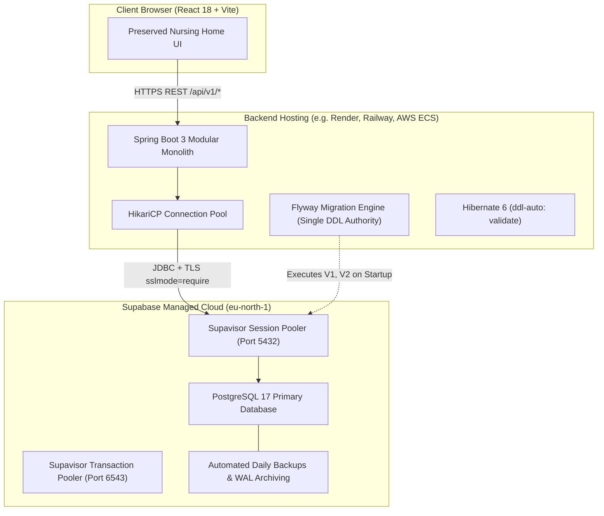

# Supabase PostgreSQL Integration & Operations Guide

**Date**: October 29, 2026  
**Status**: Configured & Ready for Deployment  
**Project**: GG Nursing Home Hub  
**Supabase Project ID**: `ocbloisbsincewtvspvg` (`gg-nursing-home-hub`)  
**Region**: `eu-north-1`  
**Database**: PostgreSQL 17  

---

## 1. Architectural Strategy

GG Nursing Home Hub is architected as a **Spring Boot 3 modular monolith** backed by **Supabase-hosted PostgreSQL 17**.



### Key Principles
1. **Cloud-Hosted Persistence**: Relieves local workstation dependency. When local machines are powered down, the database remains 24/7 online and ready for production web visitors.
2. **Strict Single-Authority DDL Migration**: Schema changes are managed exclusively by Flyway inside the Spring Boot application artifact. Supabase CLI is used for remote operations, diagnostic inspection, and backups—never for competing DDL execution.
3. **Defense-in-Depth Security**: All credentials remain strictly on the backend. No database secrets or service-role keys are exposed to the Vite React frontend.

---

## 2. Schema Migration Ownership Evaluation

Before configuring Supabase CLI, two migration models were evaluated:

| Criterion | Alternative A: Flyway as Single Authority (Chosen) | Alternative B: Supabase CLI Migrations |
| :--- | :--- | :--- |
| **Authority** | **Sole Authority**: Spring Boot Flyway (`db/migration/*.sql`) | Supabase CLI (`supabase/migrations/*.sql`) |
| **Risk of Dual Schema Drift** | **Zero**: Only Flyway writes to `flyway_schema_history`. | **High**: Flyway and Supabase CLI would compete to execute tables. |
| **Local / Test Portability** | Runs uniformly in unit tests, local Docker, and cloud deployments. | Requires Node.js and Supabase CLI locally before backend tests can run. |
| **JPA Entity Alignment** | Java entities and Flyway SQL are version-controlled in the same Git repository and branch. | Requires switching between Node CLI and Maven to sync entity changes. |
| **Deployment Atomicity** | Atomic: New backend containers migrate the schema before opening HTTP traffic. | Two-stage deployment: CLI push must succeed before backend container starts. |

### Decision & Rationale
**Alternative A is selected**. Flyway remains the single, undisputed authority for schema migrations. Supabase CLI migrations are explicitly disabled to prevent schema corruption. Supabase acts purely as the enterprise-grade managed PostgreSQL provider.

---

## 3. Supabase CLI Installation & Reproducibility

Supabase CLI is pinned in `package.json` under `devDependencies` to ensure reproducible execution across all team members and CI/CD runners.

### CLI Version
- **Version**: `supabase@^2.122.0` (platform-specific binary `@supabase/cli-windows-x64`)

### How to Run Supabase CLI
You can execute Supabase commands via npm scripts or npx:
```powershell
# Using the project-pinned script
npm run supabase -- <command>

# Or directly via npx
npx supabase <command>
```

### Helpful Diagnostic Commands
```powershell
# Verify CLI version
npm run supabase -- --version

# Check project linking status
npm run supabase -- projects list

# Inspect remote table statistics
npm run supabase -- inspect db table-stats --linked

# Inspect active database locks
npm run supabase -- inspect db locks --linked
```

---

## 4. Project Linking & Remote Authentication

The project is linked to the hosted Supabase instance:
- **Project Ref**: `ocbloisbsincewtvspvg`
- **Project Name**: `gg-nursing-home-hub`
- **Region**: `eu-north-1`

### Step-by-Step Linking Instructions (For New Environments)
If cloning the repository on a new machine:

1. **Login to Supabase CLI**:
   ```powershell
   npx supabase login
   ```
   *(Opens browser for interactive OAuth token generation).*

2. **Link the Project**:
   ```powershell
   npx supabase link --project-ref ocbloisbsincewtvspvg
   ```
   *(Prompts for your Supabase database password in terminal. The password is never stored in git).*

3. **Verify Linked Status**:
   ```powershell
   npx supabase projects list
   ```
   Verify that `gg-nursing-home-hub` shows `linked: true`.

---

## 5. Secure Spring Boot Database Configuration

Spring Boot is configured with profile-specific properties in [`backend/src/main/resources/application.yml`](file:///d:/TryingStuff/gg-nursing-home-hub-main/backend/src/main/resources/application.yml).

### 5.1 Profile Overview

- `postgres` (Default): Local PostgreSQL development on `localhost:5432/ggnh_db`.
- `supabase`: Hosted Supabase production profile using SSL (`sslmode=require`) and HikariCP connection tuning.
- `h2`: In-memory isolated mode for non-database development.
- `test`: Automated test slice profile with H2 in PostgreSQL compatibility mode.

### 5.2 Required Environment Variables (Backend Only)

Set these environment variables in your hosting environment (e.g., Render, Railway, AWS ECS, or local environment):

| Environment Variable | Description | Example / Typical Value |
| :--- | :--- | :--- |
| `SPRING_PROFILES_ACTIVE` | Set active profile to `supabase` | `supabase` |
| `SPRING_DATASOURCE_URL` | JDBC connection URL with SSL enabled | `jdbc:postgresql://aws-0-eu-north-1.pooler.supabase.com:5432/postgres?sslmode=require` |
| `SPRING_DATASOURCE_USERNAME` | Supabase Pooler Username | `postgres.ocbloisbsincewtvspvg` |
| `SPRING_DATASOURCE_PASSWORD` | Supabase Database Password | *(Your secure database password)* |
| `SERVER_PORT` | Port for embedded web server | `8080` |
| `SERVER_SERVLET_CONTEXT_PATH` | REST API context path | `/api/v1` |

### 5.3 Local Development with `backend/.env`

To avoid entering credentials into the shell manually or risking accidental commits to git:
1. Spring Boot is configured via `spring.config.import` to automatically load `backend/.env` (or `.env` when run from inside `backend/`).
2. A template file [`backend/.env.example`](file:///d:/TryingStuff/gg-nursing-home-hub-main/backend/.env.example) is committed to git with safe placeholders.
3. The actual [`backend/.env`](file:///d:/TryingStuff/gg-nursing-home-hub-main/backend/.env) file is strictly ignored by Git in `.gitignore`.
4. To connect locally to the hosted Supabase database, open `backend/.env` and replace `your_supabase_db_password_here` with your actual Supabase database password.

> [!CAUTION]  
> Never store database credentials in the root `.env` file! The root `.env` file is used by Vite for the React frontend, and any variables there risk client bundle pollution. Database credentials belong exclusively in `backend/.env` or hosting provider environment variables.

---

## 6. Connection String & Pooler Guidelines

Supabase provides two primary connectivity modes. Choose the appropriate mode based on your hosting infrastructure:

### Mode 1: Supavisor Session Pooler (Recommended for Spring Boot)
- **Host**: `aws-0-eu-north-1.pooler.supabase.com`
- **Port**: `5432`
- **Username**: `postgres.ocbloisbsincewtvspvg`
- **Database**: `postgres`
- **SSL**: `?sslmode=require`
- **Why**: Session pooler supports IPv4, prepared statements, and Flyway advisory locks. This makes it ideal for Spring Boot with HikariCP.

```
jdbc:postgresql://aws-0-eu-north-1.pooler.supabase.com:5432/postgres?sslmode=require
```

### Mode 2: Direct Connection
- **Host**: `db.ocbloisbsincewtvspvg.supabase.co`
- **Port**: `5432`
- **Username**: `postgres`
- **Database**: `postgres`
- **SSL**: `?sslmode=require`
- **Requirement**: Direct connections require IPv6 support from your backend host (or the Supabase IPv4 add-on).

```
jdbc:postgresql://db.ocbloisbsincewtvspvg.supabase.co:5432/postgres?sslmode=require
```

### Mode 3: Transaction Pooler (Port 6543) — DO NOT USE FOR FLYWAY
- **Host**: `aws-0-eu-north-1.pooler.supabase.com`
- **Port**: `6543`
- **Why Avoid for Spring Boot**: Transaction mode disables session-level features, causing Flyway migration locks and prepared statement caching in HikariCP to fail.

---

## 7. Local Development & Testing Instructions

1. **Automated Unit & Slice Tests (Zero External Dependencies)**:
   ```powershell
   mvn -f backend/pom.xml test
   ```
   Uses in-memory H2 in PostgreSQL compatibility mode. Runs fast and offline.

2. **Full Local PostgreSQL Verification**:
   ```powershell
   # If you have Docker:
   docker compose up -d

   # Or using a local PostgreSQL 16+ instance:
   $env:VERIFY_POSTGRES = "true"
   $env:SPRING_DATASOURCE_URL = "jdbc:postgresql://localhost:5432/ggnh_db"
   $env:SPRING_DATASOURCE_USERNAME = "postgres"
   $env:SPRING_DATASOURCE_PASSWORD = "postgres"
   mvn -f backend/pom.xml test -Dtest=PostgresFlywayIntegrationTest
   ```

3. **Running Spring Boot Locally Against Supabase**:
   In your private local terminal:
   ```powershell
   $env:SPRING_PROFILES_ACTIVE = "supabase"
   $env:SPRING_DATASOURCE_URL = "jdbc:postgresql://aws-0-eu-north-1.pooler.supabase.com:5432/postgres?sslmode=require"
   $env:SPRING_DATASOURCE_USERNAME = "postgres.ocbloisbsincewtvspvg"
   $env:SPRING_DATASOURCE_PASSWORD = "<YOUR_SUPABASE_DB_PASSWORD>"
   mvn -f backend/pom.xml spring-boot:run
   ```
   Spring Boot will connect, execute Flyway migrations `V1` and `V2`, validate Hibernate entities, and begin serving `/api/v1/*`.

---

## 8. Procedure for Applying Future Database Migrations

When domain entities or tables change in Task 3+:

1. **Create Sequential Flyway Migration**:
   Create a new file in `backend/src/main/resources/db/migration/`:
   `V3__add_authentication_tables.sql` (incrementing version number).
2. **Follow Migration Rules**:
   - Explicit primary keys, foreign keys, and indexes.
   - Idempotent and non-destructive (never drop tables or historical data).
   - Use `TIMESTAMP WITH TIME ZONE` and SQL `DATE`.
3. **Verify Locally First**:
   Run `mvn -f backend/pom.xml test` to verify entity and migration syntax.
4. **Deploy to Supabase**:
   When the updated Spring Boot application deploys with `SPRING_PROFILES_ACTIVE=supabase`, Flyway detects the new migration script, acquires the advisory lock, applies `V3`, updates `flyway_schema_history`, and unlocks.

---

## 9. Backup, Recovery & Disaster Planning

1. **Supabase Automated Backups**:
   Supabase automatically takes daily backups with 7-day retention (or point-in-time recovery on Pro plans).
2. **Manual Schema and Data Dumps via CLI**:
   ```powershell
   # Dump schema only
   npx supabase db dump --linked -f schema_backup.sql

   # Dump roles and table data
   npx supabase db dump --linked --data-only -f data_backup.sql
   ```
3. **Database Health Monitoring**:
   Use Supabase Studio dashboard or CLI inspection:
   ```powershell
   npx supabase inspect db table-stats --linked
   npx supabase inspect db bloat --linked
   ```

---

## 10. Remaining Manual Steps for the User

1. **Configure Supabase Database Password in Backend Host**:
   When deploying the Spring Boot backend to your hosting service (e.g. Render, Railway, AWS ECS), add:
   - `SPRING_PROFILES_ACTIVE`: `supabase`
   - `SPRING_DATASOURCE_URL`: `jdbc:postgresql://aws-0-eu-north-1.pooler.supabase.com:5432/postgres?sslmode=require`
   - `SPRING_DATASOURCE_USERNAME`: `postgres.ocbloisbsincewtvspvg`
   - `SPRING_DATASOURCE_PASSWORD`: `<your-supabase-db-password>`
2. **Apply Initial Flyway Migrations to Supabase**:
   Run the backend once with `SPRING_PROFILES_ACTIVE=supabase` using your database password in your private terminal to populate the tables on Supabase.

